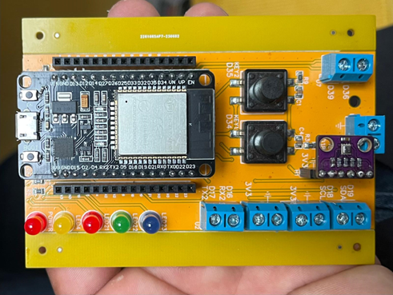

---
hide:
  - toc
---

Hanze · ESP32 · Arduino

# Embedded Programming

From your first LED to connected embedded systems. Understand the concepts in the lectures, practise with guided tutorials, and explore the behaviour in interactive simulations.

[Start learning :material-arrow-right:](lectures/index.md){ .md-button .md-button--primary }
[Explore the dashboard :material-view-dashboard-outline:](https://costawess.github.io/Programming-Dashboard/web/index.html){ .md-button }

## Your course, in one place

-   :material-book-open-page-variant-outline:{ .lg .middle } **Lectures**

    ---

    Explore 25 chapters covering programming, the ESP32, hardware interfaces, timing, communication, and connected systems. Study the diagrams, examples, quizzes, and exercises.

    [:material-arrow-right: Browse lectures](lectures/index.md)

-   :material-flask-outline:{ .lg .middle } **Simulations & experiments**

    ---

    Explore inputs, outputs, communication, and timing in your browser. Use the same dashboard throughout the course.

    [:material-arrow-right: Open EP Dashboard](https://costawess.github.io/Programming-Dashboard/web/index.html)

-   :material-chip:{ .lg .middle } **Practical tutorials**

    ---

    Set up the Arduino IDE and practise GPIO, variables, control flow, serial input, and hardware timers on your ESP32.

    [:material-arrow-right: Choose a tutorial](tutorials/index.md)

## Learn by doing

The course builds from simple concepts to more complete embedded systems. Each topic includes explanations, examples, and exercises you can reproduce and adapt independently.

1. **Read a lecture and follow a tutorial** to understand the concept and run the examples.
2. **Explore the dashboard** to observe and experiment with the behaviour.
3. **Try it on the ESP32** and modify the code to test your own ideas.

!!! tip "Find your way"
    Switch between **Home**, **Lectures**, **Tutorials**, and **Dashboard** using the top menu. Click a topic group in the left sidebar to expand it. On smaller screens, open the menu using the top-left icon.

## Hardware & software

{ .ep-hardware loading=lazy }

The course uses an **ESP32-WROOM** development board. The lectures cover Arduino-ESP32 core **3.x**; other ESP32 variants may require adjustments to pin mappings and available peripherals. The original practical examples were developed with **Arduino IDE 2.3.5**.

## Resources

- [Course source code on GitHub](https://github.com/costawess/EmbeddedProgramming-Course/)
- [ESP32-WROOM-32 datasheet](https://www.espressif.com/sites/default/files/documentation/esp32-wroom-32_datasheet_en.pdf)
