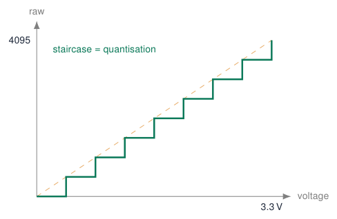
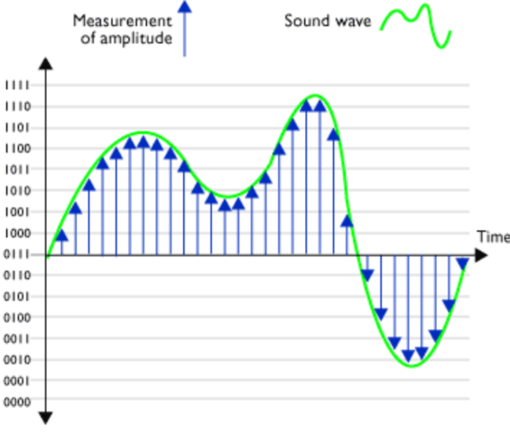
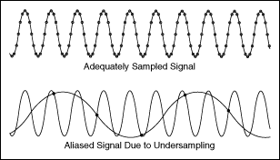
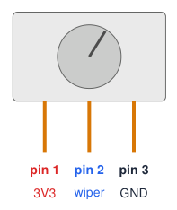
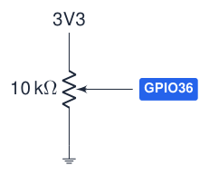
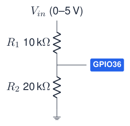
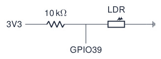
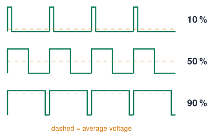
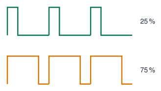
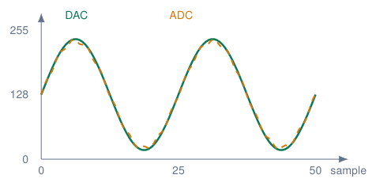

# Analog Input, PWM and DAC

## From voltage to number: the ADC

[Try simulation: ADC](../dashboard.md?lab=simulations/course_topics_lab.html&topic=adc){ .md-button .lecture-simulation }

- Many sensors produce a **voltage** that tells **how much**: light, temperature, position, humidity.

- The **ADC** (Analog-to-Digital Converter) turns that voltage into a number.

- ESP32: **12 bits** $\Rightarrow$ $2^{12} = 4096$ steps:  
  0 V $\rightarrow$ 0 … 3.3 V $\rightarrow$ 4095.

- One step (LSB) $\approx 3.3 / 4095 \approx 0.8$ mV. (The drawing uses only 3 bits = 8 steps.)

!!! info "Formula"
    
    $V = \text{raw} \times \dfrac{3.3}{4095}$ raw $= V \times \dfrac{4095}{3.3}$


{ .lecture-figure loading=lazy }

*Sources: [Embedded Programming, lectures 1–6](references.md#ep-lectures); [Arduino ESP32 Core Documentation](references.md#arduino-esp32-docs); [Espressif: GPIO Matrix and Pin Mux](https://docs.espressif.com/projects/arduino-esp32/en/latest/tutorials/io_mux.html)*

## Sampling: reading a changing signal

[Try simulation: ADC](../dashboard.md?lab=simulations/course_topics_lab.html&topic=adc){ .md-button .lecture-simulation }

{ .lecture-figure loading=lazy }

- Every `analogRead()` is one **sample**: a snapshot of the voltage at that moment.

- The **resolution** (bits) sets the vertical precision.

- The **sample rate** (samples per second) sets how fast changes can be followed.

{ .lecture-figure loading=lazy }

!!! warning "Aliasing"
    
    Sample at least **2$\times$** faster than the fastest change (Nyquist).


*Sources: Figures: lecture 2 [Embedded Programming, lectures 1–6](references.md#ep-lectures)*

## Connecting a potentiometer

[Try simulation: ADC](../dashboard.md?lab=simulations/course_topics_lab.html&topic=adc){ .md-button .lecture-simulation }

{ .lecture-figure loading=lazy }

- A potentiometer is a **resistor track** with a **sliding contact** (the wiper): a voltage divider you turn by hand.

- **Outer pins**: one to **3V3**, the other to **GND**. **Middle pin** (wiper) to an **ADC pin**.

- Turning the knob moves the wiper voltage from 0 V to 3.3 V.

- Course board: outer pins on the **3V3/GND terminal**, wiper on the **AD1 terminal** (GPIO36). Breadboard: any ADC1 pin (32–39).

- Typical value: 10 k$\Omega$ (anything 1–100 k$\Omega$ works).

!!! warning "Common wiring mistakes"
    
    **5 V / VIN** on the pot: input above 3.3 V. **Wiper to 3V3**: at the end position the pot shorts 3V3 to GND. Outer pins on the same rail: the value never changes. Outer pins swapped: direction reversed (harmless).


*Sources: [Embedded Programming, lectures 1–6](references.md#ep-lectures)*

## From ADC value to voltage, step by step

[Try simulation: ADC](../dashboard.md?lab=simulations/course_topics_lab.html&topic=adc){ .md-button .lecture-simulation }

**The steps**

1.  `analogRead(36)` measures the wiper voltage and returns a number **0 … 4095** (12 bits).

2.  0 means 0 V, 4095 means (about) 3.3 V: the relation is linear.

3.  Convert: $V = \text{raw} \times \dfrac{3.3}{4095}$

4.  Percentage of the knob: $\% = \text{raw} \times \dfrac{100}{4095}$

!!! warning "Use 4095.0"
    
    `raw * 3.3 / 4095.0` is correct. With `raw / 4095 * 3.3` the integer division gives **0** for every raw value below 4095.


**Worked examples**  

| **raw** | **voltage** | **knob** |
|--------:|------------:|---------:|
|       0 |      0.00 V |      0 % |
|    1024 |      0.83 V |     25 % |
|    2048 |      1.65 V |     50 % |
|    3071 |      2.47 V |     75 % |
|    4095 |      3.30 V |    100 % |

  
Example: raw $= 2048$ $\Rightarrow$ $2048 \times 3.3 / 4095 = 1.650$ V

!!! tip "Real ESP32"
    
    The ESP32 ADC is not perfectly linear: `analogReadMilliVolts()` applies the factory calibration (following sections).


## Code: read the potentiometer and convert to volts

[Try simulation: ADC](../dashboard.md?lab=simulations/course_topics_lab.html&topic=adc){ .md-button .lecture-simulation }

```cpp title="pot_voltage.ino"
const int POT_PIN = 36;            // AD1 terminal (wiper)
const float VREF = 3.3;            // full-scale voltage
const int ADC_MAX = 4095;          // 12-bit ADC
float toVolts(int raw) {
  return raw * VREF / ADC_MAX;     // float result
}
int toPercent(int raw) {
  return raw * 100L / ADC_MAX;     // 100L: no overflow
}
void setup() {
  Serial.begin(115200);
}
void loop() {
  int raw = analogRead(POT_PIN);
  float volts = toVolts(raw);
  int mv = analogReadMilliVolts(POT_PIN);  // calibrated
  Serial.printf("raw:%d,volts:%.2f,mV:%d,percent:%d\n",
                raw, volts, mv, toPercent(raw));
  delay(100);
}
```

[Download this example](examples/analog-pwm/pot_voltage.ino){ download }

1.  Upload, open the **Serial Monitor** (115200) and turn the knob from end to end.

2.  Check: raw goes 0 $\rightarrow$ 4095, volts 0.00 $\rightarrow$ 3.30.

3.  Open the **Serial Plotter**: the labels become four lines.

4.  Compare `volts` with `mV` and with a **multimeter** on the wiper.

!!! info "What you will see"
    
    Near the ends the calculated volts and the calibrated mV differ: that is the ADC non-linearity.


## Analog input: the 12-bit ADC

[Try simulation: ADC](../dashboard.md?lab=simulations/course_topics_lab.html&topic=adc){ .md-button .lecture-simulation }

```cpp title="adc.ino"
const int POT_PIN = 36;    // AD1 terminal: ADC1, OK with Wi-Fi

void setup() {
  Serial.begin(115200);
  analogReadResolution(12);         // 0..4095 (default)
  analogSetAttenuation(ADC_11db);   // range ~0..3.1 V
}

void loop() {
  int raw = analogRead(POT_PIN);
  int mv  = analogReadMilliVolts(POT_PIN); // calibrated
  Serial.printf("raw=%4d  voltage=%4d mV\n", raw, mv);
  delay(200);
}
```

[Download this example](examples/analog-pwm/adc.ino){ download }

{ .lecture-figure loading=lazy }

- $V \approx \text{raw} \cdot 3.3 / 4095$, but the ADC is **non-linear**: prefer `analogReadMilliVolts()`.

- Use **Serial Plotter** to see the signal.

- Noisy? Average $N$ samples.

*Sources: [Arduino ESP32 Core Documentation](references.md#arduino-esp32-docs); [Espressif: GPIO Matrix and Pin Mux](https://docs.espressif.com/projects/arduino-esp32/en/latest/tutorials/io_mux.html)*

## The ESP32 ADC is not perfect

| **Attenuation**               | **Accurate input range** |
|:------------------------------|:-------------------------|
| `ADC_0db`           | 100 – 950 mV             |
| `ADC_2_5db`           | 100 – 1250 mV            |
| `ADC_6db`           | 150 – 1750 mV            |
| `ADC_11db` (default) | 150 – 2450 mV            |

- **Non-linear** near 0 V and above $\approx$ 2.5 V.

- Noisy: average several samples.

- ADC2 does not work while Wi-Fi is on.

!!! warning "Copying Arduino Uno code"
    
    `float v = raw * 5.0 / 1023.0;` is for a **10-bit, 5 V** Uno.  
    On the ESP32: `raw * 3.3 / 4095.0`, or better `analogReadMilliVolts(pin)`, which uses the factory calibration.


!!! tip "Change resolution"
    
    `analogReadResolution(10);` gives 0–1023 like an Uno; `analogSetAttenuation()` or `analogSetPinAttenuation()` changes the range.


*Sources: [Arduino ESP32 Core Documentation](references.md#arduino-esp32-docs); [ESP32 Series Datasheet](references.md#esp32-datasheet)*

## Measuring higher voltages: the voltage divider

{ .lecture-figure loading=lazy }

- Two resistors divide the voltage:  
  $V_{out} = V_{in} \cdot \dfrac{R_2}{R_1 + R_2} = 5 \cdot \dfrac{20}{30} = 3.33$ V

- In code, multiply back: $V_{in} = V_{out} \cdot \dfrac{R_1 + R_2}{R_2} = V_{out} \times 1.5$

- Use for: batteries, 5 V sensors, solar panels.

- Choose $R_1 + R_2$ in the 10–100 k$\Omega$ range: small current, still fast enough for the ADC.

!!! tip "A potentiometer is a voltage divider"
    
    The wiper moves the point between $R_1$ and $R_2$: 0 V at one end, 3.3 V at the other.


## Example: light sensor with map() and constrain()

```cpp title="light_sensor.ino"
const int LDR_PIN = 39;      // AD2 terminal
const int DARK  = 300;       // raw value when covered
const int LIGHT = 3500;      // raw value under a lamp

void setup() { Serial.begin(115200); }

void loop() {
  int raw = analogRead(LDR_PIN);
  int percent = map(raw, DARK, LIGHT, 0, 100);
  percent = constrain(percent, 0, 100);
  Serial.printf("raw=%d  light=%d %%\n", raw, percent);
  delay(200);
}
```

[Download this example](examples/analog-pwm/light_sensor.ino){ download }

{ .lecture-figure loading=lazy }

- `map(x, inLo, inHi, outLo, outHi)` rescales linearly (integers only).

- `constrain(x, lo, hi)` clips to the range: needed when the sensor goes beyond your calibration.

- **Calibrate**: measure DARK and LIGHT in the real environment first.

!!! info "Calibration procedure"
    
    1. Print raw values. 2. Note min and max. 3. Put them in constants. 4. Map.


## PWM: faking an analog output

{ .lecture-figure loading=lazy }

- **P**ulse **W**idth **M**odulation: switch the pin on and off very fast.

- **Duty cycle** = time on / period.

- The **average** voltage = duty $\times$ 3.3 V.

- LEDs and motors respond to the average: smooth dimming, speed control.

- Frequency high enough that you do not see flicker ($>$ 200 Hz for LEDs).

!!! info "Simplest way"
    
    `analogWrite(pin, 0..255);` works on the ESP32 core 3.x (it uses the LEDC peripheral underneath).


## PWM with the LEDC peripheral: fading an LED

```cpp title="fade.ino"
const int LED_PIN  = 18;
const int FREQ_HZ  = 5000;
const int RES_BITS = 8;            // duty 0..255

void setup() {
  ledcAttach(LED_PIN, FREQ_HZ, RES_BITS);  // core 3.x
}

void loop() {
  for (int d = 0; d <= 255; d++) { ledcWrite(LED_PIN, d); delay(4); }
  for (int d = 255; d >= 0; d--) { ledcWrite(LED_PIN, d); delay(4); }
}
```

[Download this example](examples/analog-pwm/fade.ino){ download }

!!! note "Core 2.x (old tutorials)"
    
    `ledcSetup()` + `ledcAttachPin()`, and `ledcWrite()` takes a *channel*.


{ .lecture-figure loading=lazy }

- 16 channels, any output pin.

- Duty $= \text{value} / (2^{\text{res}}-1)$.

- Higher frequency $\Rightarrow$ lower max. resolution.

- `analogWrite()` also works (uses LEDC).

*Sources: [Migration from Arduino ESP32 Core 2.x to 3.0](references.md#arduino-esp32-migration)*

## Example: potentiometer controls brightness

```cpp title="dimmer.ino"
const int POT_PIN = 36;
const int LED_PIN = 22;          // green LED

void setup() {
  ledcAttach(LED_PIN, 5000, 12); // 5 kHz, 12 bit
}

void loop() {
  int raw = analogRead(POT_PIN); // 0..4095
  ledcWrite(LED_PIN, raw);       // duty 0..4095
  delay(10);
}
```

[Download this example](examples/analog-pwm/dimmer.ino){ download }

- Input range = output range (both 12 bit): no conversion needed!

- With 8-bit PWM you would write `raw / 16` or `map(raw, 0, 4095, 0, 255)`.

!!! tip "Gamma"
    
    Our eyes are non-linear: the LED seems to reach full brightness at half the pot. Try `duty = raw * raw / 4095;` for a more natural feel.


## PWM application: driving a hobby servo

```cpp title="servo.ino"
const int SERVO_PIN = 13;

void writeAngle(int deg) {
  int us = map(deg, 0, 180, 500, 2500);   // pulse width
  uint32_t duty = (uint32_t)us * 65535 / 20000;
  ledcWrite(SERVO_PIN, duty);
}

void setup() {
  ledcAttach(SERVO_PIN, 50, 16);  // 50 Hz = 20 ms, 16 bit
}

void loop() {
  writeAngle(0);   delay(1000);
  writeAngle(90);  delay(1000);
  writeAngle(180); delay(1000);
}
```

[Download this example](examples/analog-pwm/servo.ino){ download }

!!! info "Servo signal"
    
    Period 20 ms; pulse 0.5–2.5 ms sets the angle 0–180°.


!!! warning "Power"
    
    Feed the servo from **5 V (VIN)**, not from 3V3; connect the grounds. The 3.3 V signal is usually accepted.


**Library alternative: *ESP32Servo*.**

## True analog output (DAC) and capacitive touch

```cpp title="dac_ramp.ino"
// 8-bit DAC: GPIO25 (DAC1), GPIO26 (DAC2)
void setup() {}

void loop() {
  for (int v = 0; v < 256; v++) {
    dacWrite(25, v);      // 0..255 -> 0..3.3 V
    delayMicroseconds(100);
  }
}
```

[Download this example](examples/analog-pwm/dac_ramp.ino){ download }

- A real voltage, not PWM: audio, reference levels.

- Only on the original ESP32 (and S2).

```cpp title="touch.ino"
const int THRESHOLD = 30;

void setup() { Serial.begin(115200); }

void loop() {
  int t = touchRead(T0);      // T0 = GPIO4
  Serial.println(t);           // try the Plotter
  if (t < THRESHOLD) Serial.println("Touched!");
  delay(100);
}
```

[Download this example](examples/analog-pwm/touch.ino){ download }

- Any wire or copper pad becomes a button.

- ESP32: value **drops** when touched.

- Calibrate the threshold per board.

*Sources: [Espressif: GPIO Matrix and Pin Mux](https://docs.espressif.com/projects/arduino-esp32/en/latest/tutorials/io_mux.html)*

## DAC example: generate a sine wave and read it back

```cpp title="dac_adc_sine.ino"
#include <math.h>
const int DAC_PIN = 25;
const int ADC_PIN = 32;
const int N = 250;
const float frequency = 10.0;

void setup() {
  Serial.begin(115200);
  analogReadResolution(12); // ADC: 0..4095
}

void loop() {
  for (int i = 0; i < N; i++) {
    float angle = 2.0 * PI * frequency * i / N;
    int dacValue = 128 + 127 * sin(angle);
    dacWrite(DAC_PIN, dacValue);
    int adcValue = analogRead(ADC_PIN);
    int adc8bit = adcValue * 255 / 4095;
    Serial.printf("DAC:%d,ADC:%d\n", dacValue, adc8bit);
    // delay(5);
  }
}
```

[Download this example](examples/analog-pwm/dac_adc_sine.ino){ download }

- Classic ESP32: jumper **GPIO25 (DAC1)** to **GPIO32 (ADC1)** on the same board.

- These GPIOs are on the DevKit headers; GPIO32 is not the carrier’s AD1 terminal (GPIO36).

- `dacWrite`: 8-bit voltage command, 0–255.

- `analogRead`: 12-bit measurement, 0–4095.

- Rescale ADC to 0–255 to compare the curves. This is **not voltage calibration**; noise, nonlinearity and clipping can cause differences.

*Sources: [Espressif DAC API](https://docs.espressif.com/projects/arduino-esp32/en/latest/api/dac.html); [ADC API](https://docs.espressif.com/projects/arduino-esp32/en/latest/api/adc.html); [GPIO Matrix and Pin Mux](https://docs.espressif.com/projects/arduino-esp32/en/latest/tutorials/io_mux.html)*

## Serial Plotter: compare the DAC command and ADC measurement

1.  Upload the sketch; select its serial port.

2.  Open **Tools $\rightarrow$ Serial Plotter**: **115200 baud**.

3.  Enable **DAC** and **ADC**. Each line adds one point per series.

| **Version**       | **Visible X-axis points** |
|:------------------|--------------------------:|
| Arduino IDE 1.8.x |                       500 |
| Arduino IDE 2.x   |              50 (default) |

X counts samples, not seconds: $M$ visible points span approximately $M/f_s$ seconds.

{ .lecture-figure loading=lazy }

Illustrative curves, not a hardware capture.

This sketch has $250/10=25$ samples per cycle: **50 points show 2 cycles**; 500 show 20.

!!! info "Does frequency = 10 mean 10 Hz?"
    
    Here: **10 cycles per 250 samples**, so $f_{\rm signal}=f_s\times10/250$. For 10 Hz, sample at 250 samples/s (4 ms per sample). Without timed sampling, ADC and serial execution set the pace; `delay(5)` adds at least 5 ms per sample.


*Sources: [Arduino Serial Plotter](https://docs.arduino.cc/software/ide-v2/tutorials/ide-v2-serial-plotter/); [Arduino IDE issue 803: 50 vs 500 points](https://github.com/arduino/arduino-ide/issues/803)*

## Quiz: analog and PWM

1.  `analogRead()` returns 2048. What is the voltage (ideal ADC)?

    <details class="lecture-answer"><summary>Check your answer</summary><p><span class="arithmatex">\(2048 \times 3.3 / 4095 \approx 1.65\)</span> V.</p></details>

2.  How many levels does a 10-bit ADC have? And a 12-bit one?

    <details class="lecture-answer"><summary>Check your answer</summary><p>1024 and 4096.</p></details>

3.  8-bit PWM, value 64: what is the duty cycle and average voltage?

    <details class="lecture-answer"><summary>Check your answer</summary><p><span class="arithmatex">\(64/255 \approx 25\,\%\)</span> <span class="arithmatex">\(\Rightarrow\)</span> <span class="arithmatex">\(\approx\)</span> 0.83 V.</p></details>

4.  A 5 V sensor output must be read. Design a divider.

    <details class="lecture-answer"><summary>Check your answer</summary><p>E.g. <span class="arithmatex">\(R_1\)</span> = 10 k<span class="arithmatex">\(\Omega\)</span>, <span class="arithmatex">\(R_2\)</span> = 20 k<span class="arithmatex">\(\Omega\)</span> <span class="arithmatex">\(\Rightarrow\)</span> max 3.33 V.</p></details>

5.  Why does the pot only reach “full brightness” at half-turn?

    <details class="lecture-answer"><summary>Check your answer</summary><p>Human vision is logarithmic; use a gamma curve.</p></details>

## Exercises: analog and PWM

!!! example "Exercise 1 – Voltmeter"
    
    Print the voltage on AD1 with 2 decimals using your own `float toVolts(int raw)`, and compare with `analogReadMilliVolts()` and a multimeter.


!!! example "Exercise 2 – Breathing LED"
    
    Make the blue LED “breathe” (slow fade in/out, 3 s period) without using `delay()` longer than 5 ms.


!!! example "Exercise 3 – Night light with hysteresis"
    
    LDR + LED: the LED fades in when it gets dark (below 30 %) and out again above 40 %.


!!! example "Exercise 4 – Servo follows pot"
    
    The servo angle follows the potentiometer (0–180°). Smooth the input with a moving average.


## Further material: analog and PWM

### Read

- [Arduino-ESP32 ADC API](https://docs.espressif.com/projects/arduino-esp32/en/latest/api/adc.html)

- [Arduino-ESP32 LEDC (PWM) API](https://docs.espressif.com/projects/arduino-esp32/en/latest/api/ledc.html)

- [Analog to digital conversion (SparkFun)](https://learn.sparkfun.com/tutorials/analog-to-digital-conversion)

- [Voltage dividers (SparkFun)](https://learn.sparkfun.com/tutorials/voltage-dividers)

### Watch

- [YouTube: ESP32 ADC explained](https://www.youtube.com/results?search_query=esp32+adc+analogread+explained)

- [YouTube: PWM explained](https://www.youtube.com/results?search_query=pwm+pulse+width+modulation+explained)

### Try it

- [ADC simulation](../dashboard.md?lab=simulations/course_topics_lab.html&topic=adc)

- [Pulse width modulation (SparkFun)](https://learn.sparkfun.com/tutorials/pulse-width-modulation)
