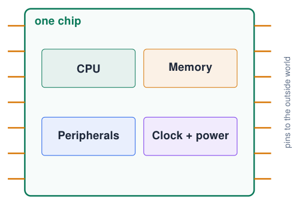
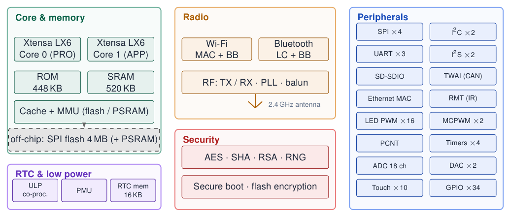
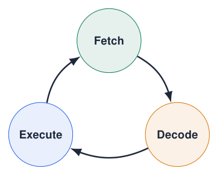
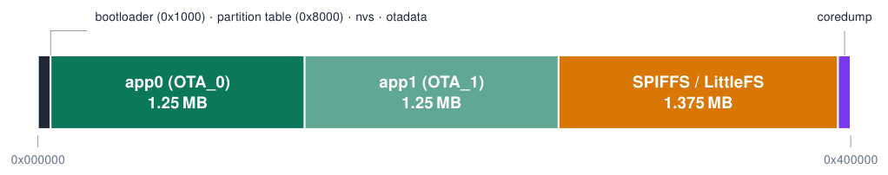
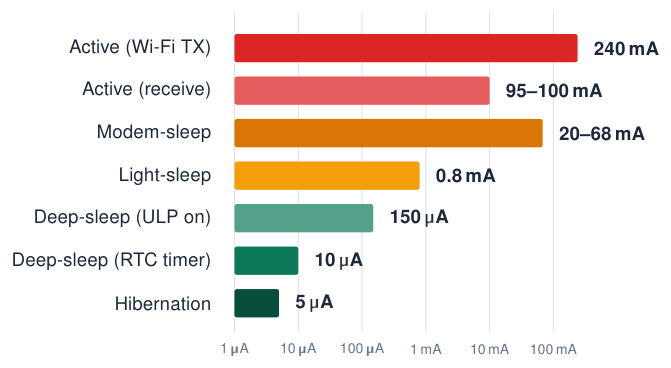
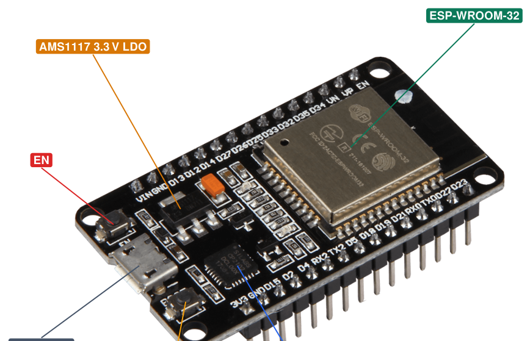

# Architecture

## What is a microcontroller?

{ .lecture-figure loading=lazy }

- A **complete small computer on one chip**: processor, memory, input/output and clock.

- Built to **control** something: read sensors, drive actuators, communicate.

- No screen, keyboard or operating system needed: it runs **one program**, directly on the hardware.

- Found everywhere: washing machines, cars (50–100 per car), toys, thermostats.

!!! info "PC vs microcontroller"
    
    PC: GHz, gigabytes, many programs. MCU: MHz, kilobytes, one job, milliwatts, starts in milliseconds.

## Functional block diagram

{ .lecture-figure loading=lazy }

*Sources: Adapted from the ESP32 Series Datasheet [ESP32 Series Datasheet](references.md#esp32-datasheet)*

## The CPU: fetch, decode, execute

{ .lecture-figure loading=lazy }

1.  **Fetch** the next instruction from memory.

2.  **Decode**: what operation, which registers?

3.  **Execute**: add, compare, load, store, jump…

- 240 MHz = 240 million clock ticks per second; simple instructions take 1 tick.

- One line of C may become several instructions.

- **32-bit** CPU: works on 32-bit numbers in one step.

!!! tip "How fast is fast?"
    
    A `digitalWrite()` takes about 0.1 μs; a `delay(1)` wastes $\approx$ 240 000 clock ticks.

## CPU and memory

**Two Xtensa LX6 cores**

- **PRO_CPU (core 0)**: Wi-Fi / BT stacks and system tasks.

- **APP_CPU (core 1)**: runs `setup()` and `loop()` in Arduino.

- Up to 240 MHz (also 160 / 80 MHz to save power), 600 DMIPS.

- **ULP co-processor**: tiny core that runs while the main CPUs sleep.

**Memory**

- 448 KB ROM: boot loader + core functions.

- 520 KB SRAM (data + instructions).

- 16 KB RTC memory: survives deep sleep (`RTC_DATA_ATTR`).

- External SPI flash (4 MB in WROOM-32), executed through a cache (XIP).

- Optional PSRAM (WROVER modules).

- 1 Kbit eFuse: MAC address, keys, chip config.

*Sources: [ESP32 Series Datasheet](references.md#esp32-datasheet); [ESP32 Technical Reference Manual](references.md#esp32-trm)*

## Memory types: capacity, purpose and retention

The course board uses several memories for different jobs.

@L1.7cmL2.1cmL5.5cmL2.7cm@ **Memory** & **Capacity here** & **What it is for** & **Keeps data?**  
ROM & 448 KB & Factory boot code and built-in routines; not rewritten by your sketch. & Without power: yes  
Internal SRAM & 520 KB total & Fast working memory for program data and some instructions. & Without power: no  
SPI flash & 4 MB on module & Uploaded firmware, stored settings and files; electrically rewritable. & Without power: yes  
RTC SRAM & 8 KB FAST + 8 KB SLOW & Small retained data/code areas for low-power operation. & In deep sleep, if powered  
PSRAM & None on WROOM-32 & Optional extra external RAM on other modules, such as WROVER. & Without power: no  
eFuse & 1 Kbit (128 bytes) & One-time programmable identity/configuration bits; partly reserved. & Without power: yes  

**Chip SRAM, module flash and free heap are different quantities; only part of SRAM is free for your application.**

*Sources: Classic ESP32 and WROOM-32 capacities [ESP32 Series Datasheet](references.md#esp32-datasheet); [ESP32-WROOM-32 Datasheet, Version 3.8](references.md#esp32-wroom32-datasheet)*

## Inside RAM: globals, stack, heap and instructions

**Different uses of the same working memory**

- **Global/static data**: exists for the entire run; not recreated on every function call.

- **Stack**: function calls and ordinary local variables; automatically reclaimed on return.

- **Heap**: dynamically allocated buffers and objects, including storage used by `String`.

**ESP32 names you will encounter**

- **DRAM** means **Data RAM** in ESP32 documentation: RAM used for data.

- **IRAM** means **Instruction RAM**: RAM used for executable code, including suitably placed ISRs.

- These are uses/mappings of internal SRAM, not extra 520 KB memories.

!!! tip "Why less memory is free than the headline capacity"
    
    The program, caches, buffers and system libraries already occupy memory. A large local array uses stack space; a large dynamic buffer consumes heap. Neither increases the physical RAM capacity.

*Sources: Memory allocation and IRAM/DRAM terminology [ESP-IDF Programming Guide: Memory Types (ESP32)](references.md#esp-idf-memory-types)*

## Which memory should hold this value?

@L4.2cmL3.1cmL4.4cm@ **Example** & **Use** & **Reason**  
Current temperature, state, timer & Ordinary RAM variables & Changes during execution  
Threshold saved by the user & `Preferences` / NVS in flash & Must survive restart and power loss  
HTML page or log file & Flash filesystem, e.g. LittleFS & Data organised as files  
Counter retained in deep sleep & RTC RAM, e.g. `RTC_DATA_ATTR` & Retention while the RTC domain stays powered  
Large image/audio buffer & PSRAM, if the module has it & More volatile working storage  

!!! info "NVS, filesystems and EEPROM are not extra memory chips"
    
    NVS and LittleFS share the flash capacity. The classic ESP32 has no separate EEPROM block: use `Preferences` for small persistent settings. Save settings when they change, not on every loop.

*Sources: Memory types and persistent storage [ESP-IDF Programming Guide: Memory Types (ESP32)](references.md#esp-idf-memory-types); [Arduino ESP32: Preferences Library](references.md#arduino-esp32-preferences)*

## Flash vs RAM: where does what live?

[Try simulation: Memory layout](../dashboard.md?lab=simulations/memory_layout_lab.html){ .md-button .lecture-simulation }

L2.9cm L3.3cm L3.3cm L2.4cm & **Flash (4 MB)** & **SRAM (520 KB)** & **RTC memory**  
Keeps data without power? & **yes** (non-volatile) & no (volatile) & during deep sleep  
Speed & slower (cached) & fast & fast  
Contents & your program, constants, files, NVS settings & variables, stack, heap, buffers & a few variables  
Written by & upload, OTA, `Preferences` & your program, constantly & `RTC_DATA_ATTR`  
Lifetime & $\approx$ 100 000 erase cycles & unlimited & unlimited  

!!! info "Analogy"
    
    Flash is the **book** on the shelf; RAM is the **notepad** on your desk: fast, but wiped when you leave.

!!! tip "Compiler output"
    
    After *Verify* the IDE prints how much flash (“program storage”) and RAM (“dynamic memory”) your sketch uses.

## Flash layout: the default partition table (4 MB)

{ .lecture-figure loading=lazy }

!!! info "app0 / app1"
    
    Two firmware slots allow **OTA updates**: write the new image to the idle slot, then switch.

!!! tip "nvs"
    
    Non-volatile key/value store used by `Preferences` and the Wi-Fi driver.

!!! note "SPIFFS / LittleFS"
    
    File system for HTML pages, configs, logs. Choose another scheme in *Tools $\rightarrow$ Partition Scheme*.

*Sources: [Arduino ESP32 Core Documentation](references.md#arduino-esp32-docs)*

## Peripherals: hardware that works for you

- A **peripheral** is a dedicated hardware block next to the CPU: UART, I2C, SPI, PWM, ADC, timers …

- The CPU only **configures** it; the peripheral then runs **in parallel**.

- Example: a PWM channel keeps an LED dimmed while your code does something else.

- Peripherals signal events to the CPU with **interrupts**.

!!! info "GPIO matrix"
    
    On the ESP32 most peripheral signals can be routed to **almost any GPIO**. That is why `Serial2.begin(115200, SERIAL_8N1, 16, 17);` lets you choose the pins.

!!! tip "Software vs hardware"
    
    “Bit-banging” (toggling pins in code) works, but costs CPU time and is less precise than a peripheral.

*Sources: [ESP32 Technical Reference Manual](references.md#esp32-trm)*

## Power modes

{ .lecture-figure loading=lazy }

- Log scale: **5 orders of magnitude** between transmitting and hibernating.

- Battery products spend most of their life in **deep sleep**.

- Modem-sleep: CPU on, radio off between DTIM beacons.

- Wake sources: timer, GPIO (ext0/ext1), touch, ULP.

*Sources: Typical values, ESP32 Series Datasheet [ESP32 Series Datasheet](references.md#esp32-datasheet); [ESP-IDF Programming Guide: Sleep Modes (ESP32)](references.md#esp-idf-sleep)*

## Inside the DevKit V1 board

{ .lecture-figure loading=lazy }

- **Module**: ESP32 chip + 40 MHz crystal + 4 MB flash + PCB antenna under a shield.

- **USB–UART bridge** (CP2102 or CH340): programming + `Serial`.

- **LDO**: 5 V (USB / VIN) $\rightarrow$ 3.3 V.

- **EN**: reset button. **BOOT**: holds GPIO0 LOW $\rightarrow$ download mode.

- On-board LED on `GPIO2`.

*Sources: [ESP32-WROOM-32E & ESP32-WROOM-32UE Datasheet](references.md#esp32-wroom32e-datasheet); [ESP32 Hardware Design Guidelines](references.md#esp32-hw-design)*

## Quiz: architecture

1.  Your program survives a power cycle, but a counter variable restarts at 0. Why?

    

Check your answer

The program is in flash (non-volatile); variables live in SRAM (volatile).

2.  Which core runs `setup()` and `loop()` in the Arduino core?

    

Check your answer

Core 1 (APP_CPU); core 0 handles the Wi-Fi and Bluetooth stacks.

3.  How many clock cycles does the CPU run during `delay(10)` at 240 MHz?

    

Check your answer

\(240 \cdot 10^6 \times 0.010 = 2.4\) million cycles, all wasted waiting.

4.  Name two advantages of a hardware peripheral over bit-banging.

    

Check your answer

Runs in parallel with your code, precise timing, lower CPU load.

## Further material: architecture

### Read

- [ESP32 Series Datasheet](https://www.espressif.com/sites/default/files/documentation/esp32_datasheet_en.pdf)

- [ESP32 Technical Reference Manual](https://www.espressif.com/sites/default/files/documentation/esp32_technical_reference_manual_en.pdf)

- [Getting started with the ESP32](https://randomnerdtutorials.com/getting-started-with-esp32/)

### Watch

- [YouTube: ESP32 architecture explained](https://www.youtube.com/results?search_query=esp32+architecture+explained)

- [YouTube: how a CPU works](https://www.youtube.com/results?search_query=how+a+cpu+works+fetch+decode+execute)

### Try it

- [Memory layout (course dashboard)](../dashboard.md?lab=simulations/memory_layout_lab.html)

- [Wokwi: ESP32 simulator](https://wokwi.com/projects/new/esp32)
