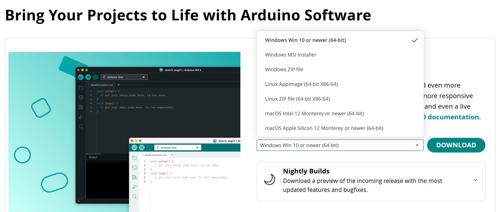
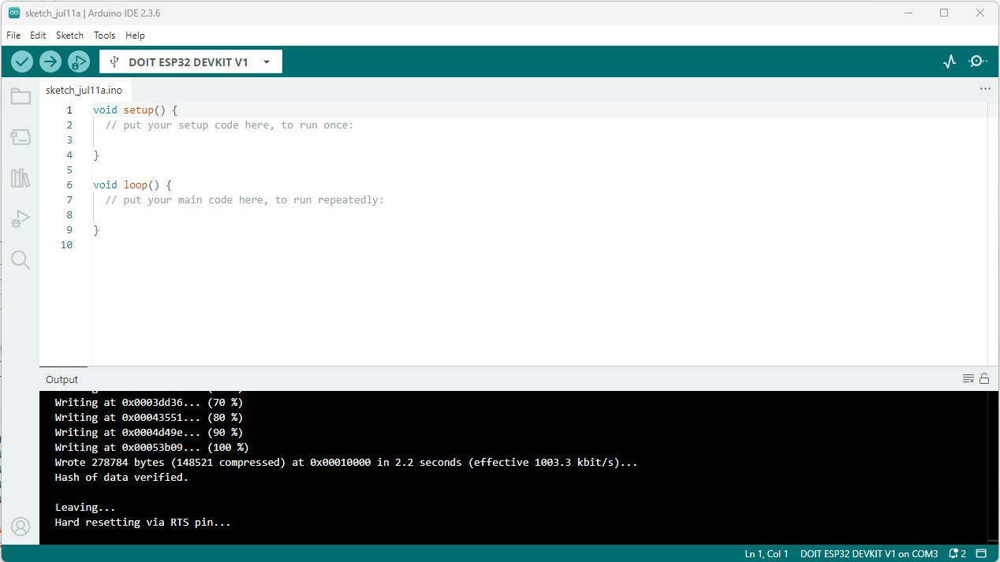
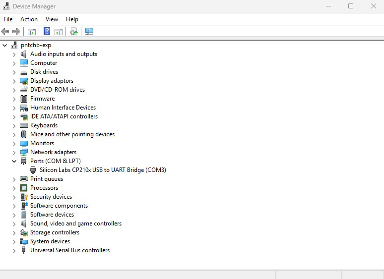
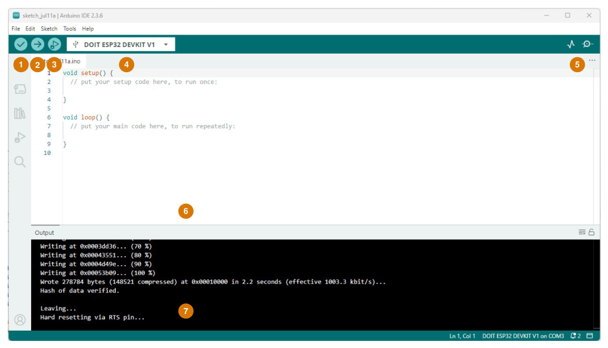
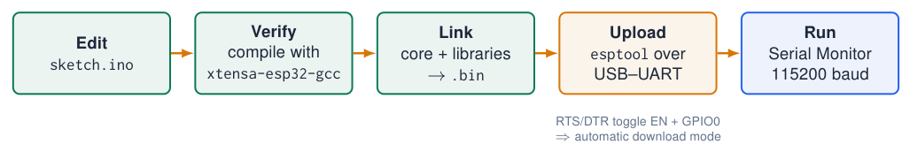
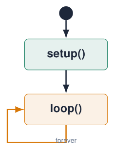
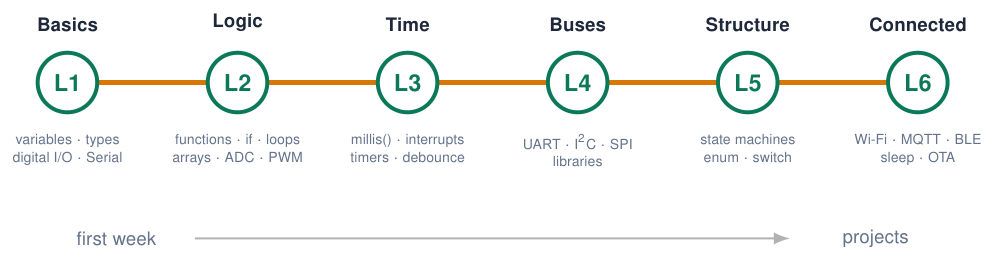

# Arduino IDE Setup

## Step 1: install the Arduino IDE

{ .lecture-figure loading=lazy }

1.  Download **Arduino IDE 2.x** for your OS from `arduino.cc/en/software`.

2.  Windows: the installer or the Microsoft Store version both work.

3.  macOS: drag the app to *Applications*; allow it in *Privacy & Security*.

4.  Start the IDE once so it can create its folders (*sketchbook* in `Documents/Arduino`).

!!! tip "Admin rights"
    
    On university laptops you may need admin rights for the USB driver.


*Sources: [Arduino IDE 2 Documentation](references.md#arduino-ide2)*

## Installing the ESP32 core in Arduino IDE 2

1.  Install **Arduino IDE 2.x** from `arduino.cc/en/software`.

2.  *File $\rightarrow$ Preferences $\rightarrow$ Additional boards manager URLs*:

```cpp title="example.cpp"
https://espressif.github.io/arduino-esp32/package_esp32_index.json
```

[Download this example](examples/arduino-ide/example.cpp){ download }

1.  *Tools $\rightarrow$ Board $\rightarrow$ Boards Manager*: search **esp32** by *Espressif Systems*, install **3.x**.

2.  Select **ESP32 Dev Module** (or *DOIT ESP32 DEVKIT V1*).

3.  Select the **port** (`COMx` / `/dev/ttyUSB0`).

{ .lecture-figure loading=lazy }

  

!!! tip "No port?"
    
    Install the **CP210x** or **CH340** USB driver and use a **data** cable (not charge-only).


*Sources: [Arduino ESP32 Core Documentation](references.md#arduino-esp32-docs); [Arduino IDE 2 Documentation](references.md#arduino-ide2)*

## Drivers and board settings

{ .lecture-figure loading=lazy }

| **Tools menu**   | **Typical value**           |
|:-----------------|:----------------------------|
| Board            | ESP32 Dev Module            |
| Upload speed     | 921600 (115200 if it fails) |
| CPU frequency    | 240 MHz (Wi-Fi/BT)          |
| Flash size       | 4 MB (32 Mb)                |
| Partition scheme | Default 4 MB with spiffs    |
| Core debug level | *Info* when debugging       |

*Sources: [Arduino ESP32 Core Documentation](references.md#arduino-esp32-docs)*

## A tour of the IDE

{ .lecture-figure loading=lazy }

1.  **Verify**: compile only (find syntax errors).

2.  **Upload**: compile + write to the board.

3.  **Debug** (not used in this course).

4.  **Board and port** selector.

5.  **Serial Plotter** and **Serial Monitor**.

6.  **Editor**: your sketch (`.ino`).

7.  **Output**: compiler and upload messages. Read them!

*Sources: [Arduino IDE 2 Documentation](references.md#arduino-ide2)*

## From sketch to running firmware

{ .lecture-figure loading=lazy }

!!! info "Sketch structure"
    
    `setup()` runs once after reset; `loop()` runs forever. Everything in `loop()` repeats as fast as possible: thousands of times per second.


!!! warning "“Connecting…_____” never ends?"
    
    Hold **BOOT** when “Connecting” appears, release when writing starts. Disconnect anything on GPIO 0, 2, 12.


## The structure of every sketch

{ .lecture-figure loading=lazy }

- `void setup()` runs **once** after power-up or reset: **initialisation** (pin modes, Serial, sensors).

- `void loop()` runs **again and again**, for as long as the board has power.

- Statements inside the braces `{ }` run **top to bottom**, one after the other.

- Code **outside** both functions: global variables, constants, `#include`, your own functions.

- `void` means: the function returns nothing.

!!! info "There is no “end”"
    
    An embedded program never finishes. When `loop()` reaches its last line, it simply starts again at the top.


*Sources: [Arduino Language Reference](references.md#arduino-reference); [Embedded Programming, lectures 1–6](references.md#ep-lectures)*

## Anatomy of a sketch

```cpp title="anatomy.ino"
/*
  Blink the four LEDs of the course board
  Author: you, date
*/
#include <Arduino.h>        // 1. libraries
const int LED_PINS[] = {23, 22, 21, 4};   // 2. globals
const int DELAY_MS = 300;
void allLeds(bool on) {      // 3. own functions
  for (int i = 0; i < 4; i++) {
    digitalWrite(LED_PINS[i], on);
  }
}
void setup() {               // 4. runs once
  for (int i = 0; i < 4; i++) {
    pinMode(LED_PINS[i], OUTPUT);
  }
}
void loop() {                // 5. runs forever
  allLeds(true);  delay(DELAY_MS);
  allLeds(false); delay(DELAY_MS);
}
```

[Download this example](examples/arduino-ide/anatomy.ino){ download }

1.  **Comment header**: what, who, when.

2.  **Includes**: libraries you use (`Arduino.h` is added automatically in `.ino`).

3.  **Global constants and variables**: visible everywhere; pin numbers live here.

4.  **Your own functions**: give a name to a job.

5.  `setup()` and `loop()`.

!!! tip "Copying code from these slides"
    
    Select, copy, paste in the IDE, then press **Ctrl+T** (Auto Format).


## Hello, ESP32: Serial output

```cpp title="hello.ino"
void setup() {
  Serial.begin(115200);          // UART0 -> USB
  delay(500);
  Serial.println("Hello, ESP32!");
  Serial.printf("CPU: %u MHz, cores: %u\n",
                (unsigned) getCpuFrequencyMhz(),
                (unsigned) ESP.getChipCores());
}

void loop() {
  Serial.printf("Uptime: %lu ms\n", millis());
  delay(1000);
}
```

[Download this example](examples/arduino-ide/hello.ino){ download }

- `Serial.begin(115200)`: match the baud rate in the **Serial Monitor**.

- `printf` is available on ESP32 (not on the Uno).

- `ESP` object: chip info, free heap, MAC …

!!! tip "Garbage on the monitor?"
    
    Wrong baud rate, or the boot log at 74880 baud.


## The Serial Monitor and the Serial Plotter

**Serial Monitor** (magnifier icon, top right)

- Shows the text your sketch prints with `Serial.print()`.

- The **baud rate** in the monitor must match `Serial.begin(115200)`.

- You can also **send** text to the board (input line at the top).

- Choose the line ending: *Newline* is easiest for commands.

**Serial Plotter** (graph icon)

- Draws numbers as **live graphs**.

- One value per line, or several separated by commas:  
  `Serial.printf("pot:%d,light:%d\ n", a, b);`

- Labels before the colon become the legend.

- Only one of the two windows can use the port at a time.

!!! warning "Upload fails with “port busy”?"
    
    Close other programs that use the COM port (another IDE window, PuTTY, a Python script).


## Troubleshooting the first upload

<div class="tabular">

@L4.9cm L8.4cm@ **Symptom** & **What to check**  
No port in *Tools $\rightarrow$ Port* & Data cable (not charge-only); CP210x / CH340 driver; try another USB port.  
`Failed to connect … Timed out waiting for packet header` & Hold **BOOT** while “Connecting…” appears; disconnect parts on GPIO 0, 2, 12.  
`A fatal error occurred: … port is busy` & Close the Serial Monitor in another window or other serial programs.  
Upload OK, nothing happens & Press **EN** (reset); check the pin numbers in your code; check the wiring.  
Garbage in the Serial Monitor & Baud rate in the monitor $\neq$ `Serial.begin()`.  
`exit status 1` after compiling & A compile error: scroll **up** in the output to the **first** red message.  

</div>

## The programming roadmap of this course

{ .lecture-figure loading=lazy }

!!! tip "Tip"
    
    Code slides carry these level tags. Level 6 is **extension material** for projects.


## Further material: the original setup resources

### Install and practise

- [How to install Arduino IDE on Mac (video linked in lecture 1)](https://www.youtube.com/watch?v=Lg-TtsZNgyw)

- [Course repository: documentation, tutorials and tools](https://github.com/costawess/EmbeddedProgramming-Course)

- [Example dashboard and interactive tools](https://costawess.github.io/Programming-Dashboard/web/index.html)

- [Arduino IDE documentation](https://docs.arduino.cc/software/ide/)

!!! info "Apply the course-board settings"
    
    Setup instructions for a generic ESP32 may use different LEDs and bus pins. Use the schematic and pin map in the course-board chapter.


*Sources: Lecture 1, slides 25–26 and 48 [Embedded Programming, lectures 1–6](references.md#ep-lectures)*

## Exercises: setting up

!!! example "Exercise 1 – Install and blink"
    
    Install the IDE and the ESP32 core, select the board and port, open *File $\rightarrow$ Examples $\rightarrow$ 01.Basics $\rightarrow$ Blink*, change `LED_BUILTIN` to `2` and upload. Then make it blink 5$\times$ faster.


!!! example "Exercise 2 – Hello you"
    
    Print your name, student number and the CPU frequency once in `setup()`; print a counter that increases every second in `loop()`.


!!! example "Exercise 3 – Break it on purpose"
    
    Remove a `;`, a `}` and misspell `pinMode`. Write down the exact error message for each. You will meet them again!


## Further material: Arduino IDE

### Read

- [Arduino IDE 2 documentation](https://docs.arduino.cc/software/ide/)

- [Installing the ESP32 core (Espressif)](https://docs.espressif.com/projects/arduino-esp32/en/latest/installing.html)

- [Installing the ESP32 board (Random Nerd Tutorials)](https://randomnerdtutorials.com/installing-the-esp32-board-in-arduino-ide-windows-instructions/)

### Watch

- [How to install Arduino IDE on Mac (2026)](https://www.youtube.com/watch?v=Lg-TtsZNgyw)

- [YouTube: ESP32 in Arduino IDE 2](https://www.youtube.com/results?search_query=esp32+arduino+ide+2+setup)

### Try it

- [Wokwi: ESP32 simulator](https://wokwi.com/projects/new/esp32)

- [CP210x USB driver (Silicon Labs)](https://www.silabs.com/developer-tools/usb-to-uart-bridge-vcp-drivers)
