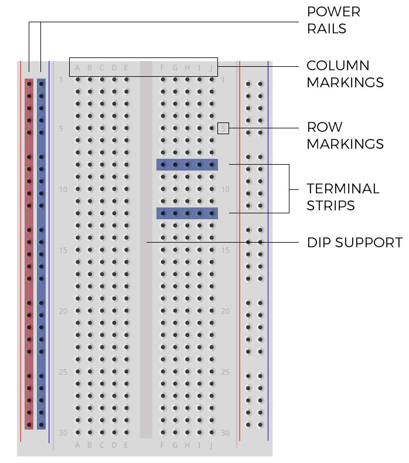
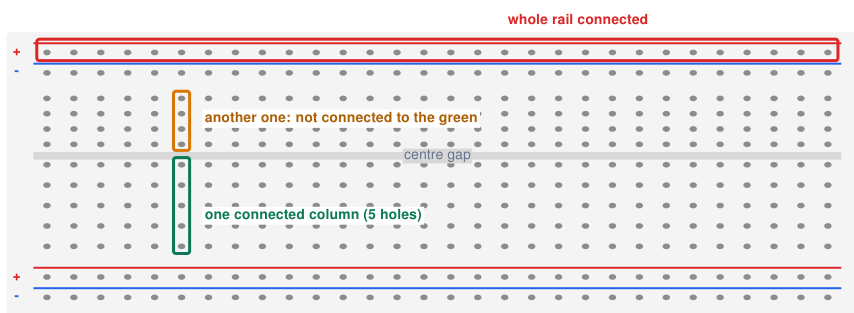
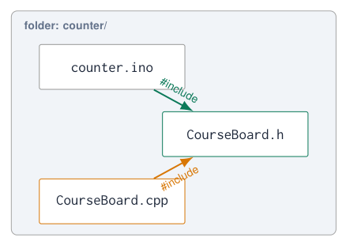

# Breadboard and Libraries

## The breadboard

{ .lecture-figure loading=lazy }

- Build and **test circuits before soldering**; debug designs quickly.

- **Side rails** (power rails): long strips for VCC (red, +) and GND (blue, $-$).

- **Terminal strips**: each row of 5 holes is connected.

- The **centre gap** separates the two halves: no connection across it. Chips (DIP) straddle it.

- Use **colour-coded jumper wires**: red = 3.3 V/5 V, black = GND, other colours = signals.

!!! warning "Long breadboards"
    
    On some boards the power rails are **split in the middle**: bridge them with a wire.


*Sources: Figure: lecture 4 [Embedded Programming, lectures 1–6](references.md#ep-lectures)*

## How the strips are connected

{ .lecture-figure loading=lazy }

!!! info "Rule"
    
    Two legs in the **same strip** are connected. Two legs in different strips only connect through a wire or component.


!!! tip "ESP32 DevKit on a breadboard"
    
    The DevKit is wide: it covers almost both halves. Use two breadboards side by side, or only one row of free holes.


## Common breadboard mistakes

1.  Both legs of a resistor or LED in the **same strip**: the component is shorted.

2.  Component placed **along** the gap instead of across it.

3.  Power rail split in the middle, half the board has no power.

4.  5 V on a rail that also feeds 3.3 V parts.

5.  LED inserted the wrong way round (long leg = anode = +).

6.  Loose wires: push them in fully, keep them short and flat.

!!! info "Build step by step"
    
    1.  Connect GND and 3.3 V rails, measure them.
    
    2.  Add **one** component, test with a small sketch.
    
    3.  Add the next one only when the first works.


!!! tip "Document"
    
    Take a photo of the working setup and draw the wiring (e.g. Fritzing, draw.io, Wokwi): you need it for the report.


## Libraries: standing on the shoulders of others

- A **library** is ready-made code for a task or a device: you call its functions instead of writing everything yourself.

- **Built into the ESP32 core**: `Wire` (I<sup>2</sup>C), `SPI`, `WiFi`, `Preferences`, `Ticker`, `WebServer` …

- **External**, via the Library Manager: sensor and display drivers (DHT, BME280, SSD1306, PubSubClient …).

**Workflow for every new library**

1.  **Install**: *Sketch $\rightarrow$ Include Library $\rightarrow$ Manage Libraries*, search, install (also its dependencies).

2.  **Read the example** sketch: *File $\rightarrow$ Examples $\rightarrow$ \<library\>*.

3.  Add `#include <LibraryName.h>`.

4.  Create the required **object**.

5.  Call its **initialisation** in `setup()`.

6.  Use its functions in `loop()` or your own functions.

*Sources: [Embedded Programming, lectures 1–6](references.md#ep-lectures); [Arduino ESP32 Core Documentation](references.md#arduino-esp32-docs)*

## Example: DHT22 temperature and humidity

```cpp title="dht22.ino"
#include <DHT.h>

DHT dht(25, DHT22);          // data pin, sensor type

void setup() {
  Serial.begin(115200);
  dht.begin();
}

void loop() {
  float t = dht.readTemperature();   // Celsius
  float h = dht.readHumidity();      // %
  if (isnan(t) || isnan(h)) {
    Serial.println("DHT read failed");
  } else {
    Serial.printf("T = %.1f C  RH = %.0f %%\n", t, h);
  }
  delay(2000);               // DHT22: max one read per 2 s
}
```

[Download this example](examples/breadboard-libraries/dht22.ino){ download }

- Library: *DHT sensor library* by Adafruit (+ *Adafruit Unified Sensor*).

- The object `dht` knows the pin and the sensor type.

- `isnan()`: the library returns “not a number” when the read fails: always check!

!!! tip "Error you will see"
    
    `fatal error: DHT.h: No such file or directory` $\Rightarrow$ the library is not installed.


*Sources: [DHT sensor library](references.md#adafruit-dht); [Embedded Programming, lectures 1–6](references.md#ep-lectures)*

## Example: SSD1306 OLED display

```cpp title="oled.ino"
#include <Wire.h>
#include <Adafruit_GFX.h>
#include <Adafruit_SSD1306.h>

Adafruit_SSD1306 display(128, 64, &Wire, -1);   // w, h, bus, no reset pin

void setup() {
  Serial.begin(115200);
  Wire.begin(19, 18);                            // course board I2C
  if (!display.begin(SSD1306_SWITCHCAPVCC, 0x3C)) {
    Serial.println("OLED not found");
    while (true) delay(10);
  }
  display.clearDisplay();
  display.setTextSize(2);
  display.setTextColor(SSD1306_WHITE);
  display.setCursor(0, 0);
  display.print("Hello");
  display.display();               // nothing shows before this call!
}

void loop() {}
```

[Download this example](examples/breadboard-libraries/oled.ino){ download }

- Libraries: *Adafruit SSD1306* + *Adafruit GFX*.

- `0x3C`: the I<sup>2</sup>C address of the display.

- Drawing happens in a **buffer** in RAM; `display()` sends it to the screen.

- `&Wire`: the address of the I<sup>2</sup>C object the display uses.

*Sources: [Adafruit SSD1306 Library](references.md#adafruit-ssd1306); [Embedded Programming, lectures 1–6](references.md#ep-lectures)*

## Under the hood: what a library does for you

- `display.begin()` sends a list of **command bytes** over I<sup>2</sup>C, for example `Wire.write(0xAE)`: “display off”, then contrast, addressing mode, … “display on”.

- Those numbers come from the **datasheet** of the SSD1306 controller.

- The library author read the datasheet so you do not have to, but you **can**, and sometimes must.

!!! info "Yes, hex"
    
    Registers, commands and addresses are written in hexadecimal: `0xAE`, `0x3C`, `0x76`. That is why we practised it.


!!! warning "Choose libraries carefully"
    
    Popular, maintained, with examples and compatible with the **ESP32 core 3.x**. Check the date of the last update.


*Sources: [Embedded Programming, lectures 1–6](references.md#ep-lectures)*

## Your own library: why and what?

**Why write a library?**

- **Reuse** the same code in every project, without copy-paste.

- **Hide details** (pins, registers, timing) behind clear names.

- **Share** with your project team, or publish it on GitHub.

- Fix a bug **once**: every project that uses the library benefits.

!!! tip "From functions to libraries"
    
    A library is the next step after functions: you group related functions (or a class) in their own files.


**What is inside?**  

<div class="tabular">

@l L3.6cm@ `CourseBoard.h` & **header**: what the library offers (declarations)  
`CourseBoard.cpp` & **implementation**: how it works (definitions)  
`examples/` & sketches that show how to use it  
`library.properties` & name, version, author  

</div>

!!! info "`#include 'x.h'` vs `<x.h>`"
    
    Quotes: file in your **sketch folder**. Angle brackets: an **installed** library.


*Sources: [Writing a Library for Arduino](references.md#arduino-library-guide); [Library specification](references.md#arduino-library-spec)*

## Step 1: split a sketch into tabs

{ .lecture-figure loading=lazy }

1.  In the IDE: the **…** menu at the right of the tabs $\rightarrow$ *New Tab*.

2.  Name it `CourseBoard.h`, then a second tab `CourseBoard.cpp`.

3.  The files are saved in the **same folder** as the sketch.

4.  Move the functions from the `.ino` file to the `.cpp` file; put their declarations in the `.h` file.

!!! tip "Start here"
    
    A library in tabs is already useful: it keeps `loop()` short. Step 5 turns it into an installed library.


*Sources: [Writing a Library for Arduino](references.md#arduino-library-guide)*

## Step 2: the header and the implementation

```cpp title="CourseBoard.h"
// CourseBoard.h: what the library offers
#pragma once              // include this file only once
#include <Arduino.h>

void boardBegin();                // LEDs + buttons
void setLed(int index, bool on);  // index 0..3
void showBinary(uint8_t value);   // 4 bits on the LEDs
bool keyPressed(int key);         // key 1 or 2
```

[Download this example](examples/breadboard-libraries/CourseBoard.h){ download }

- The header holds only **declarations**: the “menu” of the library.

- `#pragma once` prevents errors when the header is included twice.

- Comments in the header are the user’s documentation.

```cpp title="CourseBoard.cpp"
// CourseBoard.cpp: how it works
#include "CourseBoard.h"

// static: only visible inside this file (private)
static const int LEDS[4] = {23, 22, 21, 4};
static const int KEYS[2] = {34, 35};

void boardBegin() {
  for (int i = 0; i < 4; i++) pinMode(LEDS[i], OUTPUT);
  for (int i = 0; i < 2; i++) pinMode(KEYS[i], INPUT);
}

void setLed(int index, bool on) {
  if (index >= 0 && index < 4) digitalWrite(LEDS[index], on);
}

void showBinary(uint8_t value) {
  for (int i = 0; i < 4; i++) setLed(i, (value >> i) & 1);
}

bool keyPressed(int key) {
  return digitalRead(KEYS[key - 1]) == HIGH;   // active HIGH
}
```

[Download this example](examples/breadboard-libraries/CourseBoard.cpp){ download }

*Sources: [Writing a Library for Arduino](references.md#arduino-library-guide)*

## Step 3: use your library

```cpp title="counter.ino"
#include "CourseBoard.h"    // our own tab

uint8_t counter = 0;
bool lastKey = false;

void setup() {
  boardBegin();
}

void loop() {
  bool key = keyPressed(1);
  if (key && !lastKey) {      // new press
    counter++;
    showBinary(counter);      // 0..15 on the LEDs
  }
  lastKey = key;
  delay(20);
}
```

[Download this example](examples/breadboard-libraries/counter.ino){ download }

- The sketch no longer knows **which pins** are used, or that the buttons are active HIGH.

- A board with other pins? Only `CourseBoard.cpp` changes; every sketch keeps working.

- The names (`boardBegin`, `showBinary`) make `loop()` readable.

!!! warning "Typical errors"
    
    `undefined reference to ‘showBinary’`: declared in the `.h` but not defined in the `.cpp` (or a typo). `CourseBoard.h: No such file`: the tab is missing or misspelled.


## Step 4: a library with a class

```cpp title="Blinker.h"
#pragma once
#include <Arduino.h>
class Blinker {
  public:                                  // what users may call
    Blinker(int pin, unsigned long ms);    // constructor
    void begin();
    void update();                         // call often in loop()
  private:                                 // internal state
    int _pin;
    unsigned long _interval;
    unsigned long _last = 0;
    bool _on = false;
};
```

[Download this example](examples/breadboard-libraries/Blinker.h){ download }

- A **class** bundles data (pin, interval, state) and functions.

- Each **object** has its own data: two LEDs, two speeds, one code.

- Exactly how `DHT dht(25, DHT22); dht.begin();` works.

```cpp title="Blinker.cpp"
#include "Blinker.h"
Blinker::Blinker(int pin, unsigned long ms)
  : _pin(pin), _interval(ms) {}
void Blinker::begin() { pinMode(_pin, OUTPUT); }
void Blinker::update() {               // non-blocking
  if (millis() - _last >= _interval) {
    _last = millis();
    _on = !_on;
    digitalWrite(_pin, _on);
  }
}
```

[Download this example](examples/breadboard-libraries/Blinker.cpp){ download }

```cpp title="blink_two.ino"
#include "Blinker.h"
Blinker blue(23, 250), red(21, 1000);   // two objects
void setup() { blue.begin(); red.begin(); }
void loop()  { blue.update(); red.update(); }
```

[Download this example](examples/breadboard-libraries/blink_two.ino){ download }

*Sources: [Writing a Library for Arduino](references.md#arduino-library-guide)*

## Step 5: install it as a real library

```text title="Documents/Arduino/libraries/"
CourseBoard/
  library.properties
  README.md
  keywords.txt          (optional: colours in the IDE)
  src/
    CourseBoard.h
    CourseBoard.cpp
    Blinker.h
    Blinker.cpp
  examples/
    Counter/
      Counter.ino
    BlinkTwo/
      BlinkTwo.ino
```

[Download this example](examples/breadboard-libraries/DocumentsofArduinooflibrariesof.txt){ download }

Restart the IDE: the library appears in *Sketch $\rightarrow$ Include Library* and its examples in *File $\rightarrow$ Examples*.

```text title="library.properties"
name=CourseBoard
version=1.0.0
author=Your Name
maintainer=Your Name <you@example.com>
sentence=Helpers for the Embedded Programming course board.
paragraph=LEDs, buttons and a non-blocking Blinker class.
category=Device Control
url=https://github.com/you/CourseBoard
architectures=esp32
```

[Download this example](examples/breadboard-libraries/library.properties){ download }

- In sketches now: `#include <CourseBoard.h>` (angle brackets).

- Share it as a ZIP: *Sketch $\rightarrow$ Include Library $\rightarrow$ Add .ZIP Library*.

- Increase `version` at every change; keep it in Git.

*Sources: Library specification [Library specification](references.md#arduino-library-spec)*

## Good practices for your own library

- **Unique names**: a prefix or a class avoids clashes with other libraries (`boardBegin`, not `begin`).

- **Configurable**: pins via the constructor or `begin(pin)`, not hard-coded where possible.

- **Non-blocking**: no long `delay()` inside; offer an `update()` for `loop()`.

- **Private by default**: `static` helpers and `private:` members.

<!-- -->

- **Document** every function in the header (what, units, ranges).

- Ship at least one **example** sketch per feature.

- Test each function on its own before using the library in a project.

- **Version** it and keep it in Git.

!!! info "Include guards"
    
    `#pragma once` is short and supported everywhere in Arduino. The classic form is `#ifndef COURSEBOARD_H` / `#define COURSEBOARD_H` … `#endif`.


*Sources: [Writing a Library for Arduino](references.md#arduino-library-guide); [Library specification](references.md#arduino-library-spec)*

## Quiz: your own library

1.  What goes in the `.h` file and what in the `.cpp` file?

    <details class="lecture-answer"><summary>Check your answer</summary><p><code>.h</code>: declarations (what is available). <code>.cpp</code>: definitions (the code).</p></details>

2.  When do you write `#include "CourseBoard.h"` and when `#include <CourseBoard.h>`?

    <details class="lecture-answer"><summary>Check your answer</summary><p>Quotes: a tab in the sketch folder. Angle brackets: an installed library.</p></details>

3.  The compiler says `undefined reference to ‘setLed’`. What is missing?

    <details class="lecture-answer"><summary>Check your answer</summary><p>The definition of <code>setLed()</code> in the <code>.cpp</code> file (or the <code>.cpp</code> is not in the sketch/library folder).</p></details>

4.  Why use a class for `Blinker` instead of global variables?

    <details class="lecture-answer"><summary>Check your answer</summary><p>Each object keeps its own pin, interval and state: many blinkers with one piece of code.</p></details>

## Exercises: breadboard and libraries

!!! example "Exercise 1 – First breadboard circuit"
    
    Build an LED with resistor and a button (with `INPUT_PULLUP`) on the breadboard on GPIO 25 and 26. Reproduce the toggle example.


!!! example "Exercise 2 – Install and explore"
    
    Install the DHT library, run its example, then rewrite it in your own style: constants, a function `bool readClimate(float &t, float &h)`.


!!! example "Exercise 3 – Display your data"
    
    Show the temperature and the potentiometer value on the OLED, updated every second without `delay()`.


!!! example "Exercise 4 – Your CourseBoard library"
    
    Build the `CourseBoard` library with `Blinker` and a debounced `Button` class (`pressed()` returns `true` once per press). Install it, add two examples, and put it on GitHub.


## Further material: breadboard and libraries

### Read

- [How to use a breadboard (SparkFun)](https://learn.sparkfun.com/tutorials/how-to-use-a-breadboard)

- [Arduino-ESP32 libraries](https://docs.espressif.com/projects/arduino-esp32/en/latest/libraries.html)

- [Writing a library for Arduino](https://docs.arduino.cc/learn/contributions/arduino-creating-library-guide/)

- [Arduino library specification](https://arduino.github.io/arduino-cli/latest/library-specification/)

### Watch

- [YouTube: how to use a breadboard](https://www.youtube.com/results?search_query=how+to+use+a+breadboard)

- [YouTube: install Arduino libraries](https://www.youtube.com/results?search_query=arduino+ide+2+install+library)

### Try it

- [Wokwi: ESP32 simulator with parts](https://wokwi.com/projects/new/esp32)

- [Adafruit SSD1306 library](https://github.com/adafruit/Adafruit_SSD1306)

- [DHT sensor library](https://github.com/adafruit/DHT-sensor-library)
