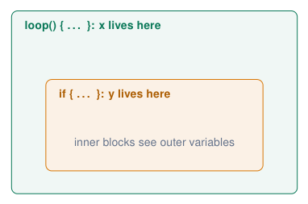

# Code Quality and Debugging

## Comments: explain the why

```cpp title="comments.ino"
// single-line comment: until end of line

/*
  multi-line comment
  for headers and longer explanations
*/

// BAD: repeats the code
i = i + 1;              // add 1 to i

// GOOD: explains the reason
delay(20);   // DHT22 needs 20 ms between reads

// GOOD: units and ranges
const int DRY_LIMIT = 30;   // soil humidity, %
```

[Download this example](examples/code-quality-debugging/comments.ino){ download }

- Comments are ignored by the compiler; they are for **humans** (including you in 3 weeks).

- Explain **why**, units, limits and assumptions; not what every line obviously does.

- Every file starts with a header: purpose, author, date, board, wiring.

- Commenting out code (`//`) is also a quick debugging tool.

!!! tip "Self-documenting code"
    
    Good names reduce the need for comments: `if (soilHumidity < DRY_LIMIT)` needs no explanation.


*Sources: [Embedded Programming, lectures 1–6](references.md#ep-lectures)*

## Editor shortcuts: Auto Format and comments

**Before: hard to read**

```cpp title="messy.ino"
void loop(){
int v=analogRead(36);
  if(v>2000){
digitalWrite(23,HIGH);
    }else{
 digitalWrite(23,LOW);}
      delay(50);}
```

[Download this example](examples/code-quality-debugging/messy.ino){ download }

**After Ctrl+T (Auto Format)**

```cpp title="formatted.ino"
void loop() {
  int v = analogRead(36);
  if (v > 2000) {
    digitalWrite(23, HIGH);
  } else {
    digitalWrite(23, LOW);
  }
  delay(50);
}
```

[Download this example](examples/code-quality-debugging/formatted.ino){ download }

<div class="tabular">

@l L4.3cm@ **Keys** & **What it does**  
**Ctrl+T** & Auto Format: indentation and spacing  
**Ctrl+K**, **Ctrl+C** & comment out the selected lines  
**Ctrl+K**, **Ctrl+U** & uncomment the selected lines  
**Ctrl+/** & toggle comment (*Edit* menu)  

</div>

  
: Cmd instead of Ctrl. The same keys work in VS Code.

- Indentation shows the **structure**: a missing `}` is visible at once.

- Debugging: select a block, **comment it out**, upload, check whether the problem is gone, then uncomment.

- Habit: **Ctrl+T** before every upload and every hand-in.

*Sources: [Arduino IDE 2 Documentation](references.md#arduino-ide2)*

## Scope: where does a variable exist?

```cpp title="scope.ino"
void loop() {
  int x = 10;
  if (x > 5) {
    int y = 20;
    Serial.println(x);   // OK
    Serial.println(y);   // OK
  }
  Serial.println(x);     // OK
  Serial.println(y);     // ERROR: y not
}                        // declared in this scope
```

[Download this example](examples/code-quality-debugging/scope.ino){ download }

{ .lecture-figure loading=lazy }

- Braces `{ }` define a **scope**.

- A variable exists from its declaration to the `}` of its block.

- Inner blocks can see outer variables, not the other way round.

*Sources: Example from lecture 3 [Embedded Programming, lectures 1–6](references.md#ep-lectures)*

## Global, local and static variables

```cpp title="lifetimes.ino"
int globalCount = 0;          // whole program

void countCalls() {
  int localCount = 0;         // new every call
  static int staticCount = 0; // keeps its value
  globalCount++;
  localCount++;
  staticCount++;
  Serial.printf("g=%d l=%d s=%d\n",
                globalCount, localCount, staticCount);
}

void setup() {
  Serial.begin(115200);
  countCalls();   // g=1 l=1 s=1
  countCalls();   // g=2 l=1 s=2
  countCalls();   // g=3 l=1 s=3
}
void loop() {}
```

[Download this example](examples/code-quality-debugging/lifetimes.ino){ download }

- **Global**: declared outside all functions; everyone can read and change it.

- **Local**: created when the block starts, destroyed at its end.

- **static local**: only visible inside the function, but keeps its value between calls.

!!! warning "Use globals sparingly"
    
    Any function can change a global: in a big program it becomes hard to know who changed what. Prefer parameters and return values.


## Reading compiler errors (1/2)

<div class="tabular">

@L4.3cm L4.4cm L4.6cm@ **Message** & **Code** & **Cause and fix**  
`expected ’,’ or ’;’ before ’void’` & `int ledPin = 2`  
`void setup() {` & missing `;` on the **previous** line  
`’pinMod’ was not declared in this scope` & `pinMod(2, OUTPUT);` & typo, wrong case, or a variable declared in another scope  
`fatal error: DHT.h: No such file or directory` & `#include <DHT.h>` & library not installed: *Sketch $\rightarrow$ Include Library $\rightarrow$ Manage Libraries*  
`expected ’}’ before ’void’` & a `{` without its `}` & count the braces; use **Auto Format (Ctrl+T)**  

</div>

!!! tip "Golden rule"
    
    Fix the **first** error in the output first. One missing brace can produce 20 follow-up errors.


*Sources: Errors from lecture 4 [Embedded Programming, lectures 1–6](references.md#ep-lectures)*

## Reading compiler errors (2/2)

<div class="tabular">

@L4.5cm L8.8cm@ **Message** & **Cause and fix**  
`multiple definition of …` & the same name is defined twice, or clashes with a library: rename one  
`stray ’\342’ in program` & invisible Unicode characters (curly quotes, long dashes) copied from a website or document: retype the line  
`invalid conversion from … to …` & wrong type, e.g. passing the text `"123"` to a function that expects an `int`  
`too few arguments to function …` & a parameter is missing in the call: `addNumbers(5)` for `addNumbers(int a, int b)`  
`array subscript is above array bounds` & index too large: an array of 3 has indices 0–2 (often only a warning!)  
`Sketch too big` & program larger than the partition: choose another *Partition Scheme*  

</div>

*Sources: Errors from lecture 4 [Embedded Programming, lectures 1–6](references.md#ep-lectures)*

## Quiz: spot the error

```cpp title="A.ino"
void setup() {
  Serial.begin(115200);
void loop() {
  Serial.println("Hello");
}
```

[Download this example](examples/code-quality-debugging/A.ino){ download }

<details class="lecture-answer"><summary>Check your answer</summary><p>Missing <code>}</code> after <code>setup()</code>: <em>expected '}' before 'void'</em>.</p></details>

```cpp title="B.ino"
void setNumber(int value) {
  Serial.println(value);
}
void setup() { setNumber("123"); }
```

[Download this example](examples/code-quality-debugging/B.ino){ download }

<details class="lecture-answer"><summary>Check your answer</summary><p><code>"123"</code> is text, not an <code>int</code>: <em>invalid conversion</em>.</p></details>

```cpp title="C.ino"
int leds[] = {23, 22, 21};
void setup() {
  for (int i = 0; i <= 3; i++)
    pinMode(leds[i], OUTPUT);
}
```

[Download this example](examples/code-quality-debugging/C.ino){ download }

<details class="lecture-answer"><summary>Check your answer</summary><p><code>i &lt;= 3</code> reads <code>leds[3]</code>: out of bounds. Use <code>i &lt; 3</code>.</p></details>

```cpp title="D.ino"
void loop() {
  if (test) {
    If (secondTest) {
    }
  }
}
```

[Download this example](examples/code-quality-debugging/D.ino){ download }

<details class="lecture-answer"><summary>Check your answer</summary><p><code>If</code>: C++ is case sensitive (and <code>test</code> must exist).</p></details>

*Sources: Examples from lecture 4 [Embedded Programming, lectures 1–6](references.md#ep-lectures)*

## Debugging strategies

**General tools**

1.  **Print statements** with labels: `Serial.printf("state=%d t=%.1f\ n", \dots)`.

2.  **LED indicators**: light an LED when the code reaches a point (no Serial needed).

3.  **Comment out** parts: divide and conquer until the problem disappears.

4.  **Minimal example**: copy only the failing part into a new sketch.

5.  **Test one thing at a time**; change one thing at a time.

**Think like a detective**

- What did you **expect**? What **happened**?

- When did it last work? What changed since then?

- Is it **hardware** or **software**? Swap one: other board, other LED, known-good example sketch.

- Explain the code line by line to someone else (“rubber duck”).

!!! info "The most important skill"
    
    Not writing code that works the first time, but understanding **why** it does not work and knowing how to investigate it.


*Sources: [Embedded Programming, lectures 1–6](references.md#ep-lectures)*

## Hardware or software? The LED that does not turn off

!!! info "The symptom"
    
    “My LED turns on, but it never turns off, even though my code writes `LOW`.”


- Measure the pin with a multimeter: does the voltage change?

- Print what the code thinks it is doing.

- Try the LED on another pin with the Blink example.

**Possible causes**

1.  The LED is wired to **3V3** instead of the GPIO.

2.  Code and wiring use **different pin numbers**.

3.  The `LOW` line is never reached (logic error, wrong `if`).

4.  Another line writes `HIGH` right after.

5.  `pinMode()` missing: the pin is an input with pull-up, the LED glows.

6.  LED wired to a pin that is **HIGH at boot** or used by something else.

*Sources: Example from lecture 4 [Embedded Programming, lectures 1–6](references.md#ep-lectures)*

## Original debugging case: the second button is not configured

```cpp title="button_pinmode_bug.ino"
const int LED = 23, ON_BUTTON = 34, OFF_BUTTON = 35;

void setup() {
  pinMode(LED, OUTPUT);
  pinMode(ON_BUTTON, INPUT);
  pinMode(ON_BUTTON, INPUT); // copy/paste bug!
  digitalWrite(LED, LOW);
}

void loop() {
  if (digitalRead(ON_BUTTON) == HIGH) {
    digitalWrite(LED, HIGH);
  }
  if (digitalRead(OFF_BUTTON) == HIGH) {
    digitalWrite(LED, LOW);
  }
}
```

[Download this example](examples/code-quality-debugging/button_pinmode_bug.ino){ download }

- The screenshot in lecture 4 configures the ON button twice.

- Replace the second occurrence with `pinMode(OFF_BUTTON, INPUT)`.

- Print both input readings and check the GPIO labels against the schematic.

- Course-board buttons are active HIGH with external pull-downs.

!!! warning "A suspicious line is a hypothesis"
    
    A pin can already be an input after reset, so this omission alone need not explain the symptom. Test the wiring, input value and executed branch.


*Sources: Lecture 4, slide 12; pin names adapted to the course board [Embedded Programming, lectures 1–6](references.md#ep-lectures)*

## Efficiency: do not repeat yourself

**Before: copy-paste**

```cpp title="before.ino"
if (sensorValue <= 1000) {
  digitalWrite(Red, HIGH);
  digitalWrite(Green, LOW);
  digitalWrite(Blue, LOW);
}
if (sensorValue > 1000 && sensorValue <= 2500) {
  digitalWrite(Red, LOW);
  digitalWrite(Green, LOW);
  digitalWrite(Blue, HIGH);
}
if (sensorValue > 2500) {
  digitalWrite(Red, LOW);
  digitalWrite(Green, HIGH);
  digitalWrite(Blue, LOW);
}
```

[Download this example](examples/code-quality-debugging/before.ino){ download }

**After: a function + else if**

```cpp title="after.ino"
void setColor(bool r, bool g, bool b) {
  digitalWrite(Red, r);
  digitalWrite(Green, g);
  digitalWrite(Blue, b);
}

void loop() {
  int v = analogRead(36);
  if (v <= 1000)      setColor(HIGH, LOW, LOW);
  else if (v <= 2500) setColor(LOW, LOW, HIGH);
  else                setColor(LOW, HIGH, LOW);
}
```

[Download this example](examples/code-quality-debugging/after.ino){ download }

- Fewer lines, one place to change.

- `else if`: no overlapping or forgotten ranges.

*Sources: Example from lecture 4 [Embedded Programming, lectures 1–6](references.md#ep-lectures)*

## Lessons from the assignments

- Use **Auto Format** (Ctrl+T) before every hand-in.

- Use **functions**: one job each.

- Use **function-specific timers**: each job its own `millis()` variable. Why reuse one timer for several elements?

- **Be as lazy as possible**: let loops, arrays and functions do the repetitive work.

- **Comments**: header, units, the why.

!!! warning "Refactor early"
    
    If your code becomes hard to debug, refactor or redesign it now: it **will** fail on you during the demo.


!!! tip "Version control"
    
    *final, finalv2, reallyreadyfordemo, asfafgrwv2* … Use Git, especially when you code together.


*Sources: Recap of assignment 2, lecture 6 [Embedded Programming, lectures 1–6](references.md#ep-lectures)*

## Exercises: code quality and debugging

!!! example "Exercise 1 – Refactor"
    
    Take your traffic-light program from *Digital I/O*. Remove every magic number, add a header comment, and replace repeated code with a function `setLights()`.


!!! example "Exercise 2 – Bug hunt"
    
    Your lecturer hands out a sketch with 6 bugs (syntax, runtime and logic). Find and classify all of them; for each, write how you found it.


!!! example "Exercise 3 – Scope"
    
    Predict the output of the global/local/static example, then run it. Change `static int` into `int`: what changes and why?


## Further material: code quality and debugging

### Read

- [Learn C++: scope and debugging](https://www.learncpp.com/)

- [Programming horror (what not to do)](https://www.reddit.com/r/programminghorror/)

- [Git: the simple guide](https://rogerdudler.github.io/git-guide/)

### Watch

- [YouTube: debugging Arduino code](https://www.youtube.com/results?search_query=debugging+arduino+code+serial+monitor)

- [YouTube: variable scope in C++](https://www.youtube.com/results?search_query=variable+scope+cpp+tutorial)

### Try it

- [Course repository (GitHub)](https://github.com/costawess/EmbeddedProgramming-Course)

- [Course dashboard](https://costawess.github.io/Programming-Dashboard/web/index.html)
