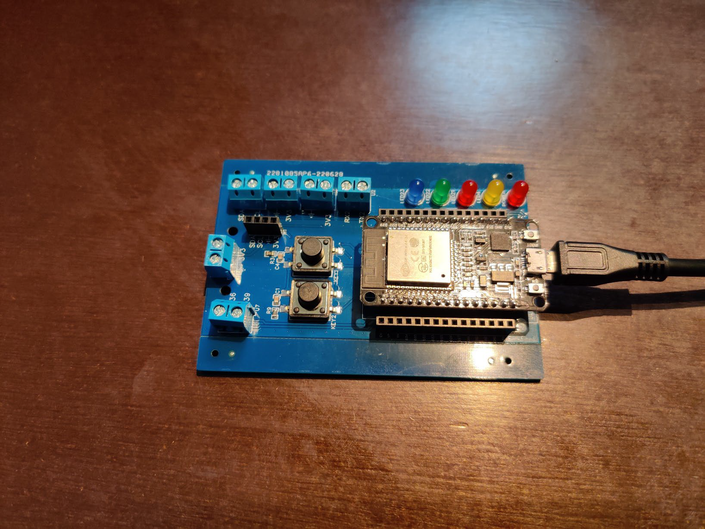
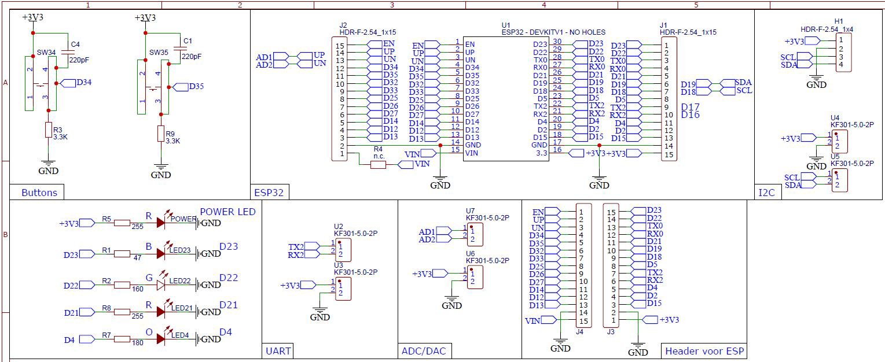
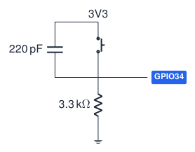
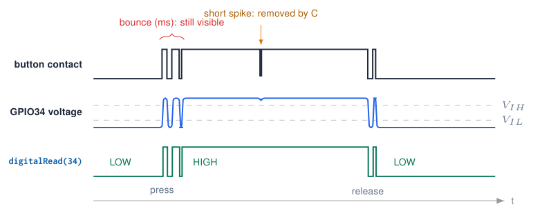

# The Course Board

## The Embedded Programming course board

{ .lecture-figure loading=lazy }

- Carrier PCB for an **ESP32 DevKit V1**.

- **4 LEDs** + power LED.

- **2 push buttons** with hardware debounce.

- Screw terminals for **I2C**, **UART2**, **analog in** and **3.3 V**.

- Female headers to plug in sensors and breakouts.

!!! tip "Why a carrier board?"
    
    No loose wires for the basics: you can start programming in the first practical.

## Schematic of the course board

{ .lecture-figure loading=lazy }

to read it: every label (e.g. `D23`) is a net. Equal labels are connected, even without a drawn wire.

## Course board pin map

l l l L5.3cm **Function** & **GPIO** & **Active** & **Details**  
Blue LED (LED23) & `23` & HIGH & 47 $\Omega$ series resistor  
Green LED (LED22) & `22` & HIGH & 160 $\Omega$  
Red LED (LED21) & `21` & HIGH & 255 $\Omega$  
Orange LED (LED4) & `4` & HIGH & 180 $\Omega$  
On-board LED (DevKit) & `2` & HIGH & blue LED on the DevKit itself  
Button SW34 (KEY1) & `34` & **HIGH** & to 3.3 V, 3.3 k$\Omega$ pull-down, 220 pF  
Button SW35 (KEY2) & `35` & **HIGH** & same; input-only pins: use `INPUT`  
I2C header & SDA `19` SCL `18` & – & `Wire.begin(19, 18);`  
UART2 terminal & RX2 `16` TX2 `17` & – &  
Analog terminals AD1 / AD2 & `36` `39` & – & VP / VN, ADC1: usable with Wi-Fi  

!!! warning "Different from many online examples"
    
    Tutorials use GPIO 21/22 for I2C. On this board 21/22 drive LEDs: always use `Wire.begin(19, 18)`.

## The buttons: active HIGH with hardware debounce

[Try simulation: Button debouncing](../dashboard.md?lab=simulations/debouncing_lab.html){ .md-button .lecture-simulation }

{ .lecture-figure loading=lazy }

- Released: the 3.3 k$\Omega$ resistor pulls the pin to GND $\Rightarrow$ `LOW`.

- Pressed: the switch connects the pin to 3.3 V $\Rightarrow$ `HIGH`.

- The 220 pF capacitor removes only very short spikes ($\tau = RC \approx 0.7$ μs).

- External pull-downs on the board: use `INPUT`. GPIO34/35 are input only, without internal pulls.

{ .lecture-figure loading=lazy }

!!! info "In code"
    
    `pinMode(34, INPUT);`  
    `bool pressed =`  
    `\ \ digitalRead(34) == HIGH;`

One press can still give several edges: debounce in software.

## Quiz: read the schematic

1.  Which GPIO controls the green LED, and what level turns it on?

    

Check your answer

GPIO22, HIGH (the LED cathode goes to GND).

2.  What does `digitalRead(35)` return while nobody presses KEY2?

    

Check your answer

LOW: the 3.3 k\(\Omega\) pull-down keeps the pin at GND.

3.  Why does the code use `INPUT` and not `INPUT_PULLUP` for the buttons?

    

Check your answer

GPIO 34/35 have no internal pull resistors, and the board already has an external pull-down.

4.  Estimate the current through the red LED (255 $\Omega$, $V_F \approx 2$ V).

    

Check your answer

\(I = (3.3 - 2.0)/255 \approx 5\) mA: well within the safe range of a GPIO.

## Further material: the course board

### Read

- [How to read a schematic (SparkFun)](https://learn.sparkfun.com/tutorials/how-to-read-a-schematic)

- [Course repository (GitHub)](https://github.com/costawess/EmbeddedProgramming-Course)

### Watch

- [YouTube: how to read schematics](https://www.youtube.com/results?search_query=how+to+read+electronic+schematics)

### Try it

- [Pull-up / pull-down (dashboard)](../dashboard.md?lab=simulations/pull_resistors_lab.html)

- [Button debouncing (dashboard)](../dashboard.md?lab=simulations/debouncing_lab.html)
