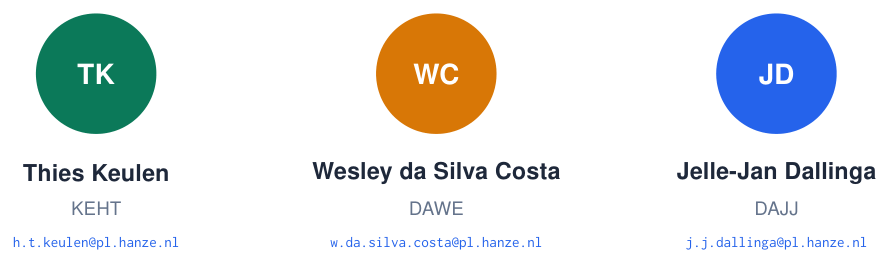
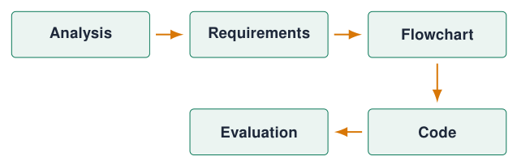
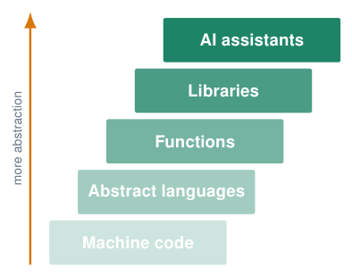
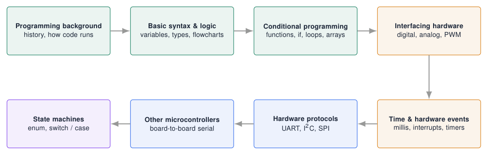

# The Course

## Who we are

{ .lecture-figure loading=lazy }

!!! info "Info"
    
    Questions about the course, the practicals or the assignments: ask any of us during the practical or via Brightspace.

## About this course

**What it is**

- An **introduction to programming**, applied to microcontrollers.

- Large diversity in prior knowledge: **zero prior knowledge expected**.

- Goal: convert a **client story** into a **program design and implementation** in an embedded environment.

- Prepares you for other courses and projects.

**Why it matters**

- Like many subjects, programming is **fundamental** to getting things to do something.

- You are EE students who will gain decent ICT skills, not ICT students.

- Any ICT topic could be a semester of its own: we focus on what an engineer needs.

- *The more you know, the more questions you have.*

## Organisation and assessment

**1 + 6 h**: lecture + practical per week

**3**: large exercises (assignments)

**5 EC**: $\approx$ 140 hours of work

- **Pass / fail**, **individual** assessment, but help each other out.

- Upload your work to **Brightspace**.

- **Demonstrate** it in the practical.

- Oral check: answer random questions about your code, **fast**.

**Every assignment report contains**  

{ .lecture-figure loading=lazy }

  
: PDF report + source code file(s) + extras (photos, video, wiring).

## Programming and AI

{ .lecture-figure loading=lazy }

- Every step in history made programming **faster** by hiding details.

- AI is **fast and helpful** … if you know what *you* and especially *the AI* are doing.

- AI **hallucinates** or is plainly wrong, with confidence.

- Ask the right questions; if you already know, it speeds things up. There is no way to ignore it.

!!! warning "The rule in this course"
    
    You must be able to **explain, adjust and expand** every line you hand in. Programming is more than producing something: it is a **way of thinking and solving problems**.

## Course content map

{ .lecture-figure loading=lazy }

!!! tip "Beyond the course"
    
    The last chapters (Wi-Fi, MQTT, Bluetooth, low power, OTA) are **extension material** for projects.

*Sources: Course content: Embedded Programming lectures 1–6 [Embedded Programming, lectures 1–6](references.md#ep-lectures)*

## Resources

!!! info "EP repository (GitHub)"
    
    - Docs, tutorials and `README.md`
    
    - Example dashboard
    
    - Tools used in the practicals

!!! tip "Brightspace"
    
    Assignments, uploads, announcements.

!!! note "Reference documentation"
    
    - Arduino language reference [Arduino Language Reference](references.md#arduino-reference)
    
    - Arduino-ESP32 core documentation [Arduino ESP32 Core Documentation](references.md#arduino-esp32-docs)
    
    - ESP32 datasheet [ESP32 Series Datasheet](references.md#esp32-datasheet)
    
    - Datasheets of every sensor you use

!!! example "Before the first practical"
    
    Install the Arduino IDE and the ESP32 core (see chapter *Arduino IDE Setup*).

## Further material: the course

### Read

- [Course repository (GitHub)](https://github.com/costawess/EmbeddedProgramming-Course)

- [Arduino language reference](https://docs.arduino.cc/language-reference/)

### Watch

- [YouTube: what is embedded programming?](https://www.youtube.com/results?search_query=what+is+embedded+programming)

### Try it

- [Course dashboard: simulations and experiments](https://costawess.github.io/Programming-Dashboard/web/index.html)
