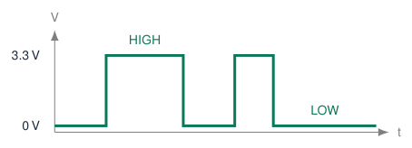
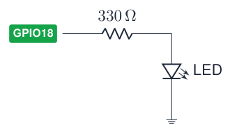
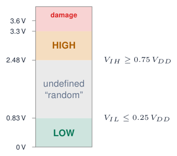
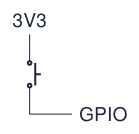
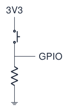
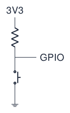
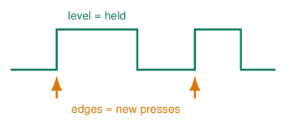
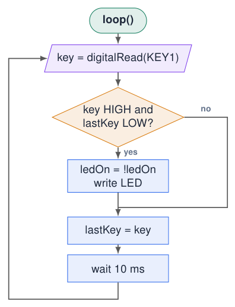
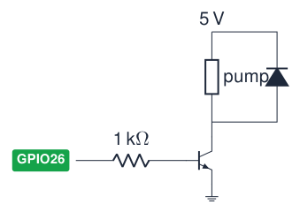

# Digital Inputs and Outputs

## Digital signals: only two values

[Try simulation: Digital I/O](../dashboard.md?lab=simulations/course_topics_lab.html&topic=foundations){ .md-button .lecture-simulation }

- A **digital** signal is either `HIGH` (1, 3.3 V) or `LOW` (0, 0 V).

- It tells you **yes or no**, not **how much**: a button is pressed or not.

- Three functions do almost all the work:

  - `pinMode(pin, mode)`: configure the pin

  - `digitalWrite(pin, value)`: set an output

  - `digitalRead(pin)`: read an input

{ .lecture-figure loading=lazy }

!!! info "Digital vs analog"
    
    Analog: any voltage between 0 and 3.3 V (next chapters). Digital: we only care whether it is low or high.


*Sources: [Embedded Programming, lectures 1–6](references.md#ep-lectures)*

## pinMode(): configure before use

<div class="tabular">

l L5.2cm L5.4cm **Mode** & **What the pin does** & **Use it for**  
`OUTPUT` & drives 0 V or 3.3 V & LEDs, transistor bases, relay modules, buzzers  
`INPUT` & high impedance: only listens & signals that are always driven; buttons **with** an external resistor (course board)  
`INPUT_PULLUP` & listens + internal $\approx$<!-- -->45 k$\Omega$ resistor to 3.3 V & a button to GND without external resistor (pressed = LOW)  
`INPUT_PULLDOWN` & listens + internal resistor to GND & a button to 3.3 V without external resistor (pressed = HIGH)  

</div>

!!! tip "Where?"
    
    Call `pinMode()` once in `setup()` for every pin you use.


!!! warning "GPIO 34–39"
    
    Input only, **no** internal pull-up or pull-down: `INPUT_PULLUP` silently does nothing.


*Sources: [Arduino Language Reference](references.md#arduino-reference); [ESP-IDF Programming Guide: GPIO & RTC GPIO (ESP32)](references.md#esp-idf-gpio)*

## digitalWrite(): switching an output

[Try simulation: Digital I/O](../dashboard.md?lab=simulations/course_topics_lab.html&topic=foundations){ .md-button .lecture-simulation }

```cpp title="led_on.ino"
// Version 1: magic numbers
void setup() {
  pinMode(23, OUTPUT);
  digitalWrite(23, HIGH);
}
void loop() {}
```

[Download this example](examples/digital-io/led_on.ino){ download }

```cpp title="led_on_const.ino"
// Version 2: a named constant
const int LED_BLUE = 23;

void setup() {
  pinMode(LED_BLUE, OUTPUT);     // pin as output
  digitalWrite(LED_BLUE, HIGH);  // 3.3 V: LED on
}
void loop() {}
```

[Download this example](examples/digital-io/led_on_const.ino){ download }

- `HIGH` puts 3.3 V on the pin; current flows through resistor and LED to GND.

- `LOW` puts 0 V on the pin: no current, LED off.

- Both versions do the same, but version 2 is **readable** and changing the pin means **one** edit.

!!! info "Rule"
    
    No “magic numbers” in your code: give every pin and every setting a `const` with a meaningful name.


*Sources: [Embedded Programming, lectures 1–6](references.md#ep-lectures)*

## Blink: digital output

```cpp title="blink.ino"
const int LED_PIN = 2;      // on-board LED

void setup() {
  pinMode(LED_PIN, OUTPUT);
}

void loop() {
  digitalWrite(LED_PIN, HIGH);
  delay(500);                // waits: nothing else runs
  digitalWrite(LED_PIN, LOW);
  delay(500);
}
```

[Download this example](examples/digital-io/blink.ino){ download }

**External LED**  

{ .lecture-figure loading=lazy }

- $R = (3.3 - V_F)/I \approx (3.3-2.0)/4\,\text{mA} \approx 330\,\Omega$.

- Pins use the **GPIO number**, not the label “D2”.

- During `delay()`, your sketch waits before executing its next statement.

## Example: all four LEDs of the course board

```cpp title="four_leds.ino"
const int LED_BLUE   = 23;
const int LED_GREEN  = 22;
const int LED_RED    = 21;
const int LED_ORANGE = 4;
void setup() {
  pinMode(LED_BLUE, OUTPUT);
  pinMode(LED_GREEN, OUTPUT);
  pinMode(LED_RED, OUTPUT);
  pinMode(LED_ORANGE, OUTPUT);
}
void loop() {
  digitalWrite(LED_BLUE, HIGH);   delay(200);
  digitalWrite(LED_GREEN, HIGH);  delay(200);
  digitalWrite(LED_RED, HIGH);    delay(200);
  digitalWrite(LED_ORANGE, HIGH); delay(200);
  digitalWrite(LED_BLUE, LOW);
  digitalWrite(LED_GREEN, LOW);
  digitalWrite(LED_RED, LOW);
  digitalWrite(LED_ORANGE, LOW);
  delay(500);
}
```

[Download this example](examples/digital-io/four_leds.ino){ download }

- The LEDs light up one by one, then all switch off together.

- It works, but notice the **repetition**: 4 almost identical lines, three times.

- In the chapters *Functions* and *Loops and Arrays* we will shrink this to a few lines.

!!! tip "Try"
    
    Change the order, or the delays, to make a “Knight Rider” effect.


## digitalRead(): what counts as HIGH or LOW?

[Try simulation: Digital I/O](../dashboard.md?lab=simulations/course_topics_lab.html&topic=foundations){ .md-button .lecture-simulation }

{ .lecture-figure loading=lazy }

- `digitalRead(pin)` returns `HIGH` or `LOW`: **yes or no**, not how much.

- Store the result: `bool pressed = digitalRead(34);`

- Between the thresholds the result is **undefined**: it may flip randomly.

- Lecture rule of thumb: LOW $\leq$ 0.8 V, HIGH $\geq$ 2.4 V.

!!! warning "5 V signals"
    
    Reduce them to $\approx$ 3.3 V or less before they reach a GPIO (voltage divider, level shifter).


*Sources: [ESP32 Series Datasheet](references.md#esp32-datasheet); [Embedded Programming, lectures 1–6](references.md#ep-lectures)*

## Floating inputs and pull resistors

[Try simulation: Pull-up / pull-down](../dashboard.md?lab=simulations/pull_resistors_lab.html){ .md-button .lecture-simulation }

**Floating**  

{ .lecture-figure loading=lazy }

  
Open button: the pin is connected to **nothing**. It picks up noise $\Rightarrow$ random readings.

**Pull-down**  

{ .lecture-figure loading=lazy }

  
Resistor to GND: released = `LOW`, pressed = `HIGH`. **Course board.**

**Pull-up**  

{ .lecture-figure loading=lazy }

  
Resistor to 3.3 V: released = `HIGH`, pressed = `LOW` (“active low”).

!!! info "Why a resistor and not a wire?"
    
    When the button is pressed, the resistor limits the current from 3.3 V to GND to a few μA–mA instead of a short circuit. Typical values: 3.3–47 k$\Omega$.


## External pull resistor? Configure the pin as INPUT

!!! info "The resistor already does the job in hardware"
    
    An **external pull-up or pull-down** already sets the released level. Use `pinMode(BUTTON, INPUT);` to configure the input; **no internal pull needs to be enabled**.


<div class="tabular">

@L5.6cml c c@ **Button circuit (normally open)** & **Software mode** & **Released** & **Pressed**  
External pull-down; button to 3V3 & `INPUT` & LOW & HIGH  
External pull-up; button to GND & `INPUT` & HIGH & LOW  
No external resistor; button to GND & `INPUT_PULLUP`\* & HIGH & LOW  
No external resistor; button to 3V3 & `INPUT_PULLDOWN`\* & LOW & HIGH  

</div>

\* Only on GPIOs that support internal pull resistors.

!!! tip "INPUT does not disconnect an external resistor"
    
    It disables internal pulls, leaving the external resistor connected. With no pull resistor, an open button leaves the high-impedance input floating.


!!! info "Course board: KEY1 and KEY2"
    
    GPIO34/35 already have external pull-downs: use `INPUT`; pressed is HIGH. These classic ESP32 pins have no internal pull resistors.


*Sources: [Arduino-ESP32 GPIO modes](https://docs.espressif.com/projects/arduino-esp32/en/latest/api/gpio.html); course-board schematic*

## Reading the course-board buttons

[Try simulation: Pull-up / pull-down](../dashboard.md?lab=simulations/pull_resistors_lab.html){ .md-button .lecture-simulation }

```cpp title="buttons.ino"
const int KEY1 = 34;        // active HIGH (pull-down)
const int KEY2 = 35;
const int LED_BLUE = 23;
const int LED_RED  = 21;
void setup() {
  Serial.begin(115200);
  pinMode(KEY1, INPUT);     // no internal pull on 34/35
  pinMode(KEY2, INPUT);
  pinMode(LED_BLUE, OUTPUT);
  pinMode(LED_RED, OUTPUT);
}
void loop() {
  bool key1 = digitalRead(KEY1);   // true = pressed
  bool key2 = digitalRead(KEY2);
  digitalWrite(LED_BLUE, key1);    // LED follows button
  digitalWrite(LED_RED, key2);
  Serial.printf("KEY1=%d KEY2=%d\n", key1, key2);
  delay(100);
}
```

[Download this example](examples/digital-io/buttons.ino){ download }

- Each LED follows its button: pressed = on.

- `digitalRead()` returns `HIGH`/`LOW`, which equals `true`/`false`: you can store it in a `bool`.

- The Serial Monitor shows the raw state: the **first test** for any input.

!!! tip "Breadboard version"
    
    Button to GND on GPIO25, with **no external pull-up**? Use `INPUT_PULLUP`; pressed = `LOW`. If an external pull-up is already fitted, use `INPUT` instead.


## Level vs edge: toggling an LED

[Try simulation: Button debouncing](../dashboard.md?lab=simulations/debouncing_lab.html){ .md-button .lecture-simulation }

```cpp title="toggle.ino"
const int KEY1 = 34;
const int LED_GREEN = 22;

bool ledOn = false;
bool lastKey = LOW;

void setup() {
  pinMode(KEY1, INPUT);
  pinMode(LED_GREEN, OUTPUT);
}

void loop() {
  bool key = digitalRead(KEY1);
  if (key == HIGH && lastKey == LOW) {  // rising edge
    ledOn = !ledOn;                     // toggle
    digitalWrite(LED_GREEN, ledOn);
  }
  lastKey = key;                        // remember
  delay(10);
}
```

[Download this example](examples/digital-io/toggle.ino){ download }

{ .lecture-figure loading=lazy }

- **Level**: “is the button pressed *now*?”

- **Edge**: “did it *become* pressed since last time?”

- Compare the current reading with the **previous** one, stored in a variable.

- `!ledOn` inverts a `bool`.

*Sources: [Arduino Language Reference](references.md#arduino-reference)*

## Flowchart: edge detection (toggle)

[Try simulation: Digital I/O](../dashboard.md?lab=simulations/course_topics_lab.html&topic=foundations){ .md-button .lecture-simulation }

[Try simulation: Arduino to flowchart](../dashboard.md?lab=simulations/arduino_flowchart_converter.html){ .md-button .lecture-simulation }

{ .lecture-figure loading=lazy }

- The decision compares **now** with **last time**: only a change from LOW to HIGH (an **edge**) toggles the LED.

- `lastKey = key` is executed on **both** paths: the program must always remember the latest state.

- Holding the button does nothing more: the condition is only true once per press.

## Driving bigger loads: use a transistor

{ .lecture-figure loading=lazy }

- A GPIO can deliver only $\approx$ 12–20 mA at 3.3 V.

- Motors, pumps, relays and LED strips need more current and often 5–12 V.

- The GPIO switches a **transistor** (or MOSFET), which switches the load.

- Inductive loads (motor, relay coil) need a **flyback diode** across them.

- Common ground between ESP32 and load supply.

!!! tip "Easy option"
    
    Ready-made relay or MOSFET modules contain transistor and diode.


## Quiz: digital I/O

1.  You forgot `pinMode(23, OUTPUT)`. What happens with `digitalWrite(23, HIGH)`?

    <details class="lecture-answer"><summary>Check your answer</summary><p>The pin stays an input; at best the LED glows very faintly. Always configure the mode.</p></details>

2.  A button on GPIO35 (to GND, no resistor) gives random values. Why?

    <details class="lecture-answer"><summary>Check your answer</summary><p>GPIO35 has no internal pull-up and nothing pulls it HIGH: the input floats.</p></details>

3.  With `INPUT_PULLUP`, what does a pressed button read?

    <details class="lecture-answer"><summary>Check your answer</summary><p><code>LOW</code>: the button connects the pin to GND.</p></details>

4.  Your toggle program sometimes switches twice per press. Name the cause.

    <details class="lecture-answer"><summary>Check your answer</summary><p>Contact bounce: one press produces several edges (see chapter <em>Time and Interrupts</em>).</p></details>

5.  Can a GPIO drive a 12 V water pump directly?

    <details class="lecture-answer"><summary>Check your answer</summary><p>No: use a transistor/MOSFET or relay module and a separate supply.</p></details>

## Exercises: digital I/O

[Try simulation: Traffic lights](../dashboard.md?lab=experiments/traffic_lights.html){ .md-button .lecture-simulation }

!!! example "Exercise 1 – Traffic light"
    
    Use the red, orange and green LEDs as a traffic light with realistic timing (green 5 s, orange 2 s, red 5 s).


!!! example "Exercise 2 – On and off"
    
    KEY1 switches the blue LED on, KEY2 switches it off. The LED keeps its state after you release the button.


!!! example "Exercise 3 – Counter"
    
    Count presses of KEY1 (edges, not levels) and print the count. Show the count in binary on the four LEDs (0–15).


!!! example "Exercise 4 – Both buttons"
    
    Light the red LED only when **both** buttons are pressed, the green LED when **exactly one** is pressed.


## Further material: digital I/O

### Read

- [Arduino-ESP32 GPIO API](https://docs.espressif.com/projects/arduino-esp32/en/latest/api/gpio.html)

- [Pull-up resistors (SparkFun)](https://learn.sparkfun.com/tutorials/pull-up-resistors)

- [Logic levels (SparkFun)](https://learn.sparkfun.com/tutorials/logic-levels)

### Watch

- [YouTube: ESP32 digital inputs and outputs](https://www.youtube.com/results?search_query=esp32+digital+input+output+arduino+ide)

- [YouTube: pull-up and pull-down resistors](https://www.youtube.com/results?search_query=pull+up+pull+down+resistor+explained)

### Try it

- [Digital input & output](../dashboard.md?lab=simulations/course_topics_lab.html&topic=foundations)

- [Pull-up / pull-down](../dashboard.md?lab=simulations/pull_resistors_lab.html)

- [Experiment: traffic lights](../dashboard.md?lab=experiments/traffic_lights.html)
