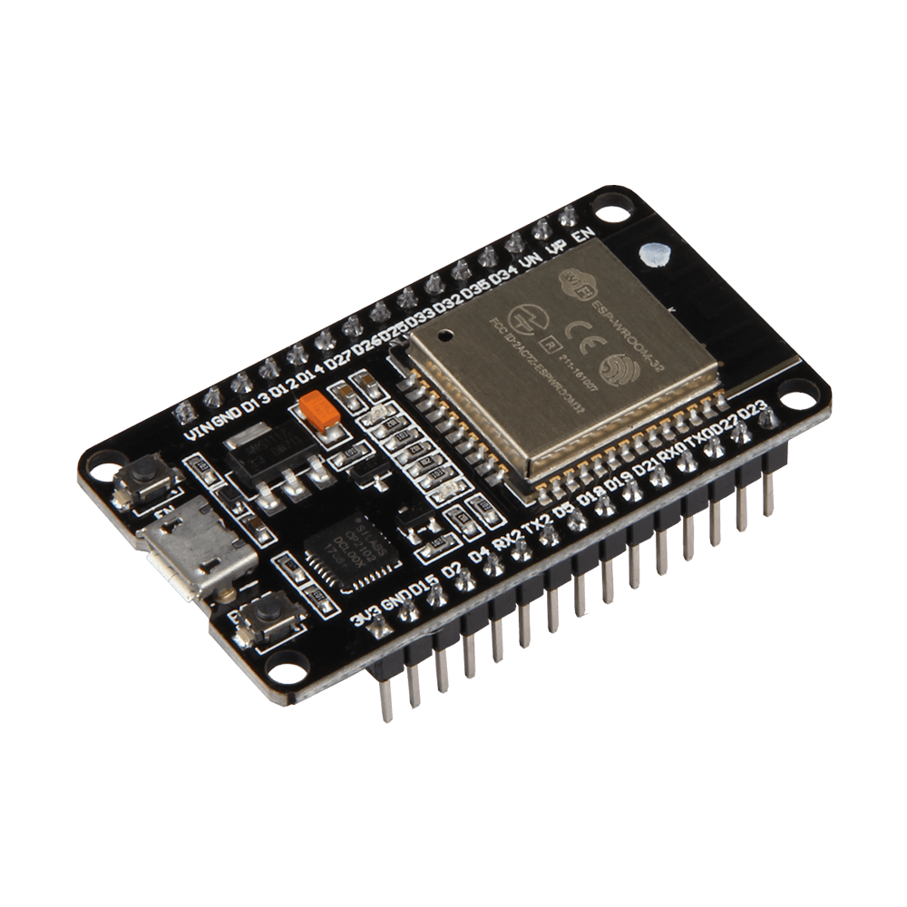
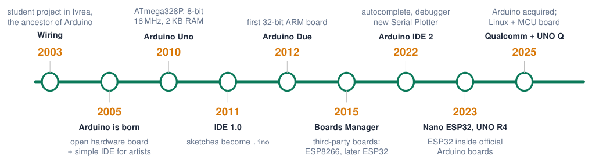
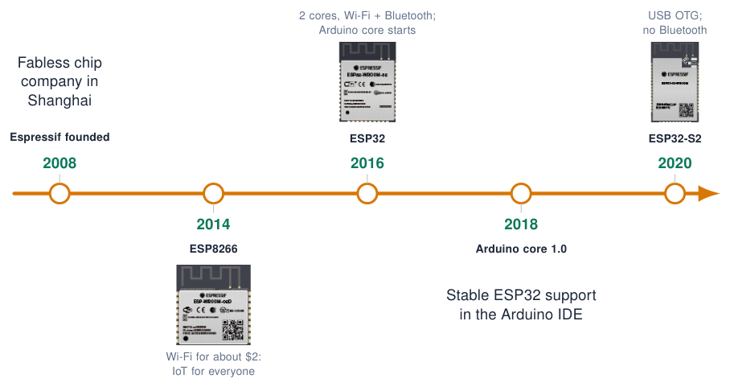
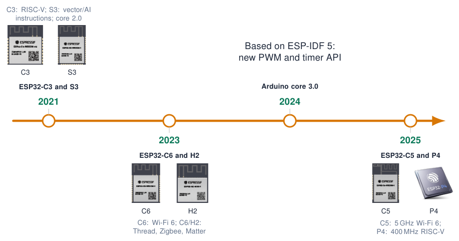

# Introduction to the ESP32

## What is the ESP32?

- Low-cost **System-on-Chip (SoC)** by Espressif Systems (Shanghai), released in 2016.

- Integrates **dual-core CPU**, **Wi-Fi** and **Bluetooth** on one die.

- Successor of the ESP8266; the de-facto platform for **IoT prototypes and products**.

- Programmable with:

  - **Arduino IDE** (Arduino-ESP32 core) this course

  - ESP-IDF (Espressif’s own C framework)

  - MicroPython, PlatformIO, Rust, Zephyr …

{ .lecture-figure loading=lazy }

*Sources: [ESP32 Series Datasheet](references.md#esp32-datasheet); [Comparative analysis and practical implementation of the ESP32 microcontroller module for the Internet of Things](references.md#maier2017comparative)*

## Timeline: the Arduino platform

{ .lecture-figure loading=lazy }

!!! info "What changed"
    
    8-bit $\rightarrow$ 32-bit, 16 MHz $\rightarrow$ hundreds of MHz, kilobytes $\rightarrow$ megabytes, no radio $\rightarrow$ Wi-Fi + Bluetooth, one board $\rightarrow$ hundreds of boards.

!!! tip "What stayed the same"
    
    `setup()`, `loop()`, `pinMode()`, `digitalWrite()` … The **same API** on every board: that is why we can program an ESP32 “as an Arduino”.

*Sources: Years are approximate [Arduino IDE 2 Documentation](references.md#arduino-ide2); [Arduino Language Reference](references.md#arduino-reference)*

## Timeline: Espressif and the ESP32 family (1/2)

{ .lecture-figure loading=lazy }

*Sources: Images: [Espressif](https://www.espressif.com/en/products/modules); dates approximate [ESP32 Series Datasheet](references.md#esp32-datasheet); [arduino-esp32: Arduino core for the ESP32 family of SoCs](references.md#arduino-esp32-github)*

## Timeline: Espressif and the ESP32 family (2/2)

{ .lecture-figure loading=lazy }

*Sources: Images: [Espressif modules](https://www.espressif.com/en/products/modules)/[SoCs](https://www.espressif.com/en/products/socs); dates approximate [arduino-esp32: Arduino core for the ESP32 family of SoCs](references.md#arduino-esp32-github); [Migration from Arduino ESP32 Core 2.x to 3.0](references.md#arduino-esp32-migration)*

## ESP32 at a glance

**240 MHz**: 2 $\times$ Xtensa LX6 cores

**520 KB**: internal SRAM

**4 MB**: SPI flash (in module)

**34**: programmable GPIO

**Wi-Fi 4**: 802.11 b/g/n, 2.4 GHz

**BT 4.2**: Classic + BLE

**18 ch**: 12-bit SAR ADC

**10 μA**: deep sleep (RTC timer)

!!! info "Info"
    
    Also on chip: 2 $\times$ 8-bit DAC, 10 capacitive touch inputs, 4 SPI, 2 I2C, 2 I2S, 3 UART, CAN 2.0 (TWAI), Ethernet MAC, SD/SDIO, IR (RMT), 16-channel LED PWM, motor PWM, hardware crypto.

- [ESP32 Series Datasheet (Espressif)](https://www.espressif.com/sites/default/files/documentation/esp32_datasheet_en.pdf)

*Sources: [ESP32 Series Datasheet](references.md#esp32-datasheet)*

## The ESP32 family

l l l l L3.6cm **Chip** & **CPU** & **Wi-Fi** & **Bluetooth** & **Highlights**  
**ESP32** & 2 $\times$ Xtensa LX6, 240 MHz & Wi-Fi 4 & Classic + BLE 4.2 & The original; DAC, touch, Ethernet MAC  
ESP32-S2 & 1 $\times$ Xtensa LX7, 240 MHz & Wi-Fi 4 & – & Native USB OTG  
ESP32-S3 & 2 $\times$ Xtensa LX7, 240 MHz & Wi-Fi 4 & BLE 5 & Vector instr. for AI, USB OTG  
ESP32-C3 & 1 $\times$ RISC-V, 160 MHz & Wi-Fi 4 & BLE 5 & Low cost, small packages  
ESP32-C6 & RISC-V, 160 MHz + LP core & Wi-Fi 6 & BLE 5 & 802.15.4: Thread / Zigbee / Matter  
ESP32-H2 & 1 $\times$ RISC-V, 96 MHz & – & BLE 5 & 802.15.4 only, very low power  

!!! note "Note"
    
    All of them are supported by the same Arduino-ESP32 core; pin numbers and peripherals **differ per chip**.

*Sources: [Arduino ESP32 Core Documentation](references.md#arduino-esp32-docs)*

## ESP32 vs. Arduino Uno

|               | **Arduino Uno (ATmega328P)** |        **ESP32 DevKit**         |
|:--------------|:----------------------------:|:-------------------------------:|
| CPU           |  8-bit AVR, 1 core, 16 MHz   | 32-bit Xtensa, 2 cores, 240 MHz |
| RAM / Flash   |         2 KB / 32 KB         |          520 KB / 4 MB          |
| Logic level   |           **5 V**            |  **3.3 V** (not 5 V tolerant!)  |
| ADC           |         10-bit, 6 ch         |          12-bit, 18 ch          |
| DAC / Touch   |            – / –             |             2 / 10              |
| Wireless      |              –               |        Wi-Fi + Bluetooth        |
| Typical price | $\approx$ EUR 20 (original)  |       $\approx$ EUR 5–10        |

!!! warning "Porting Uno code"
    
    Same Arduino API, but check **voltage levels**, **pin numbers** and libraries that use AVR registers.

## Quiz: ESP32 basics

1.  How many CPU cores does the original ESP32 have, and at what clock?

    

Check your answer

Two Xtensa LX6 cores at up to 240 MHz.

2.  You connect a 5 V sensor output that worked on an Arduino Uno directly to an ESP32 pin. Problem?

    

Check your answer

Yes: ESP32 pins are 3.3 V and not 5 V tolerant. Use a voltage divider or level shifter.

3.  Which ESP32 variant would you choose for a Zigbee / Thread device?

    

Check your answer

ESP32-C6 or ESP32-H2 (IEEE 802.15.4 radio).

4.  An example from 2021 uses `ledcSetup()` and does not compile. Why?

    

Check your answer

It was written for core 2.x; core 3.x uses <code>ledcAttach()</code> / <code>ledcWrite(pin, duty)</code>.

## Further material: introduction to the ESP32

### Read

- [Getting started with the ESP32](https://randomnerdtutorials.com/getting-started-with-esp32/)

- [ESP32 Series Datasheet](https://www.espressif.com/sites/default/files/documentation/esp32_datasheet_en.pdf)

- [Arduino-ESP32 core on GitHub](https://github.com/espressif/arduino-esp32)

### Watch

- [YouTube: ESP32 vs Arduino Uno](https://www.youtube.com/results?search_query=esp32+vs+arduino+uno)

- [YouTube: history of Arduino](https://www.youtube.com/results?search_query=arduino+history+documentary)

### Try it

- [Migration guide core 2.x to 3.0](https://docs.espressif.com/projects/arduino-esp32/en/latest/migration_guides/2.x_to_3.0.html)
