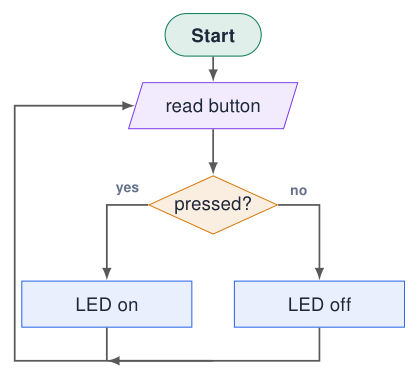
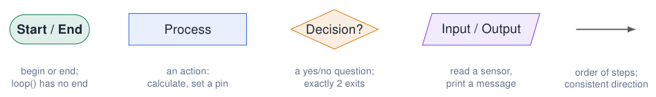
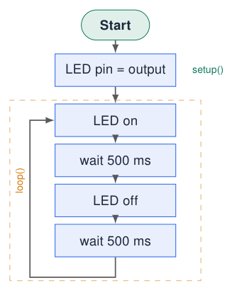
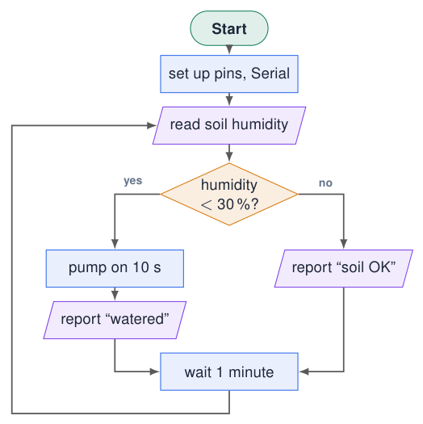
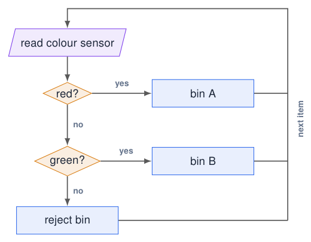
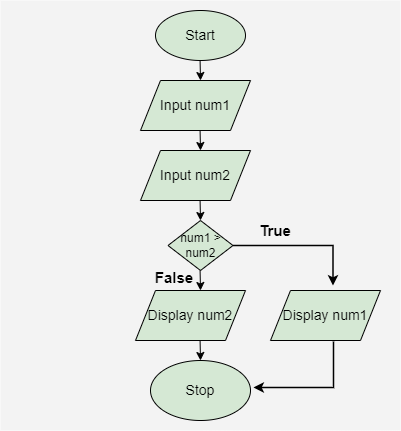
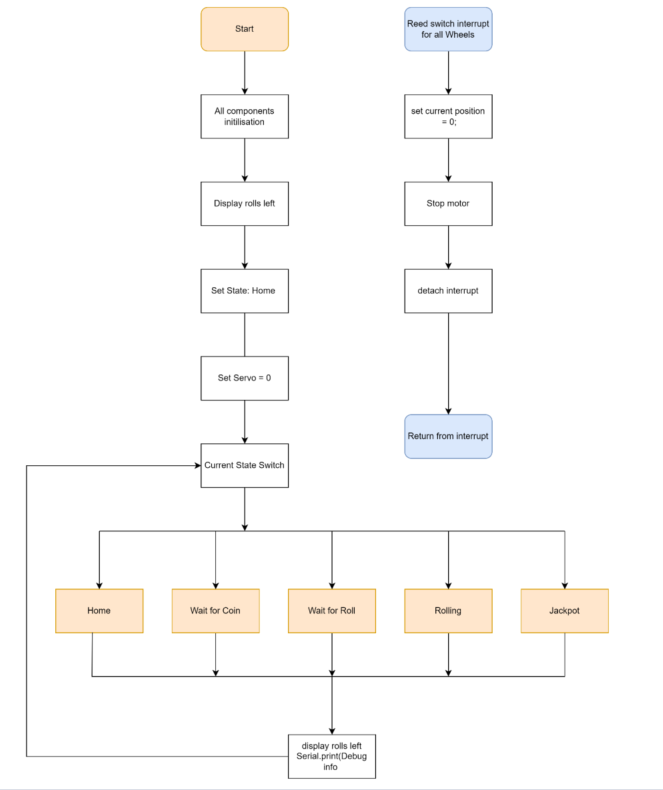

# Flowcharts

## Why flowcharts?

[Try simulation: Arduino to flowchart](../dashboard.md?lab=simulations/arduino_flowchart_converter.html){ .md-button .lecture-simulation }

- A **visual diagram** of a program or process.

- **Synchronise understanding** with the client: does the drawing match what they want?

- **Design** the code before typing it.

- Find **logic errors** early: a missing “no” branch is easy to see.

- **Explain** and **document** your program in reports.

!!! info "In this course"
    
    Every assignment contains a flowchart. It is part of the assessment.


{ .lecture-figure loading=lazy }

*Sources: [Embedded Programming, lectures 1–6](references.md#ep-lectures)*

## The standard symbols

{ .lecture-figure loading=lazy }

!!! tip "Good habits"
    
    - Flow from **top to bottom**, left to right.
    
    - Label every decision exit (yes / no).
    
    - One idea per box, in plain words.
    
    - Loops go back **up** with a clear arrow.


!!! warning "Common mistakes"
    
    - A decision with only one exit.
    
    - Arrows that cross or have no direction.
    
    - Code syntax inside boxes instead of meaning.
    
    - No way back to the start (program “ends”).


## Example 1: blink as a flowchart

[Try simulation: Arduino to flowchart](../dashboard.md?lab=simulations/arduino_flowchart_converter.html){ .md-button .lecture-simulation }

{ .lecture-figure loading=lazy }

```cpp title="blink_flowchart.ino"
const int LED_PIN = 23;      // blue LED

void setup() {
  pinMode(LED_PIN, OUTPUT);  // LED pin = output
}

void loop() {
  digitalWrite(LED_PIN, HIGH);   // LED on
  delay(500);                    // wait 500 ms
  digitalWrite(LED_PIN, LOW);    // LED off
  delay(500);                    // wait 500 ms
}
```

[Download this example](examples/flowcharts/blink_flowchart.ino){ download }

!!! info "One box = one or a few lines"
    
    The comments in the code use the **same words** as the boxes: the flowchart and the code tell the same story.


## Example 2: the self-watering plant pot

{ .lecture-figure loading=lazy }

- Built directly from the **requirements** of the client story.

- The decision uses the **measurable** threshold (30 %).

- Both branches meet again: the program always continues.

- The arrow from “wait” back to “read” is `loop()`.

!!! tip "Check with the client"
    
    “What happens if the soil is still dry after watering?” The flowchart makes such questions visible.


## From flowchart to code: the plant pot

```cpp title="plant_pot.ino"
const int SENSOR_PIN = 36;     // AD1 terminal (analog)
const int PUMP_PIN   = 26;     // to transistor / relay
const int DRY_LIMIT  = 30;     // percent
int readHumidity() {
  int raw = analogRead(SENSOR_PIN);       // 0..4095
  return map(raw, 4095, 0, 0, 100);       // dry sensor = high raw
}
void setup() {
  Serial.begin(115200);
  pinMode(PUMP_PIN, OUTPUT);
}
void loop() {
  int humidity = readHumidity();          // read soil humidity
  if (humidity < DRY_LIMIT) {             // humidity < 30 %?
    digitalWrite(PUMP_PIN, HIGH);         // pump on 10 s
    delay(10000);
    digitalWrite(PUMP_PIN, LOW);
    Serial.printf("Humidity %d %% -> watered\n", humidity);
  } else {
    Serial.printf("Humidity %d %% -> soil OK\n", humidity);
  }
  delay(60000);                           // wait 1 minute
}
```

[Download this example](examples/flowcharts/plant_pot.ino){ download }

- Each box became one or a few lines.

- The decision diamond became an `if / else`.

- “read soil humidity” became a **function**: easy to test on its own.

- `map()` converts the raw ADC value to 0–100 %.

!!! warning "Calibrate!"
    
    Measure the raw value in dry air and in water first; real sensors never use the full 0–4095 range.


## Example 3: robot sorting (decisions in a row)

[Try simulation: Robot sorting logic](../dashboard.md?lab=simulations/robot_sorting_lab.html){ .md-button .lecture-simulation }

{ .lecture-figure loading=lazy }

- A chain of decisions = an `if / else if / else` ladder.

- The **order** of the questions matters.

- Every path must end somewhere (here: back to “read”).

!!! tip "Try it"
    
    The course dashboard has a *Robot Sorting Logic* simulation and an *Arduino to Flowchart* converter (see *Further material*).


## Original example: display the larger of two numbers

{ .lecture-figure loading=lazy }

1.  Read `num1` and `num2`.

2.  Ask whether `num1 > num2`.

3.  True: display `num1`; false: display `num2`.

4.  Both branches rejoin before Stop.

!!! tip "Check the boundary"
    
    What happens when both numbers are equal? The false branch displays `num2`, which is also the correct maximum.


!!! info "Finite process or embedded loop?"
    
    This example ends after one comparison. To compare a continuous stream, replace Stop with an arrow back to the input step.


*Sources: Original diagram, lecture 2 slide 6 [Embedded Programming, lectures 1–6](references.md#ep-lectures)*

## Original example: a larger program with states

{ .lecture-figure loading=lazy }

- Initialise components, display rolls left, choose Home and set the servo position.

- Dispatch the current state: Home, Wait for Coin, Wait for Roll, Rolling or Jackpot.

- Update the display and debug output, then repeat.

- The separate reed-switch interrupt path sets a wheel’s reference position and stops its motor.

!!! tip "Read in layers"
    
    Identify startup, repeated control and event handling separately. Later chapters explain interrupts and implement state selection with `switch/case`.


*Sources: Original diagram, lecture 2 slide 7 [Embedded Programming, lectures 1–6](references.md#ep-lectures)*

## Quiz: flowcharts

1.  Which symbol do you use for “print the temperature”?

    <details class="lecture-answer"><summary>Check your answer</summary><p>Input/output (parallelogram).</p></details>

2.  A decision diamond has three arrows going out. Is that allowed?

    <details class="lecture-answer"><summary>Check your answer</summary><p>No: a decision answers yes/no and has exactly two exits. Use two decisions in a row.</p></details>

3.  Where in a flowchart do you see `setup()` and `loop()`?

    <details class="lecture-answer"><summary>Check your answer</summary><p><code>setup()</code>: the boxes between Start and the loop. <code>loop()</code>: the boxes inside the arrow that goes back up.</p></details>

4.  Why does the blink flowchart have no “End” symbol?

    <details class="lecture-answer"><summary>Check your answer</summary><p>An embedded program never stops: <code>loop()</code> repeats forever.</p></details>

## Exercises: flowcharts

[Try simulation: Arduino to flowchart](../dashboard.md?lab=simulations/arduino_flowchart_converter.html){ .md-button .lecture-simulation }

!!! example "Exercise 1 – Night light"
    
    Draw the flowchart of the night light from chapter *How Programs Run*: light sensor, LED, threshold. Then write the code.


!!! example "Exercise 2 – Two buttons"
    
    KEY1 switches the blue LED on, KEY2 switches it off. Draw the flowchart, then implement it on the course board.


!!! example "Exercise 3 – Find the error"
    
    Draw a flowchart for “blink 5 times when the button is pressed”. Swap with a classmate and look for: missing exits, missing loop-back, unclear boxes.


!!! example "Exercise 4 – Reverse"
    
    Take any example sketch from the IDE and draw its flowchart. Check your answer with the *Arduino to Flowchart* tool.


## Further material: flowcharts

### Read

- [Flowchart symbols (Lucidchart)](https://www.lucidchart.com/pages/flowchart-symbols-meaning-explained)

- [draw.io: free diagram editor](https://app.diagrams.net/)

### Watch

- [YouTube: flowcharts for programming](https://www.youtube.com/results?search_query=flowchart+programming+tutorial)

### Try it

- [Arduino to Flowchart converter](../dashboard.md?lab=simulations/arduino_flowchart_converter.html)

- [Robot sorting logic](../dashboard.md?lab=simulations/robot_sorting_lab.html)
