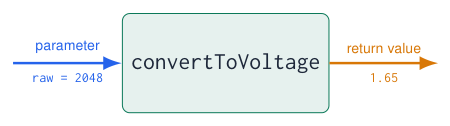
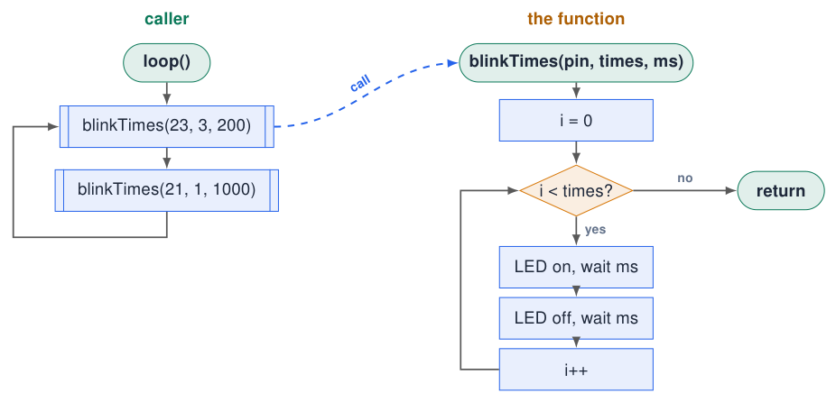
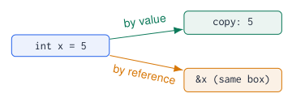
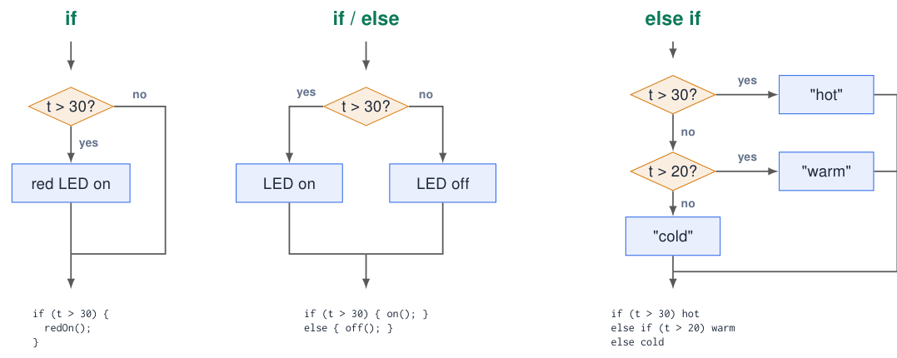
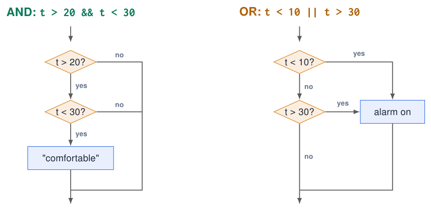
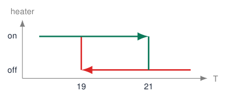
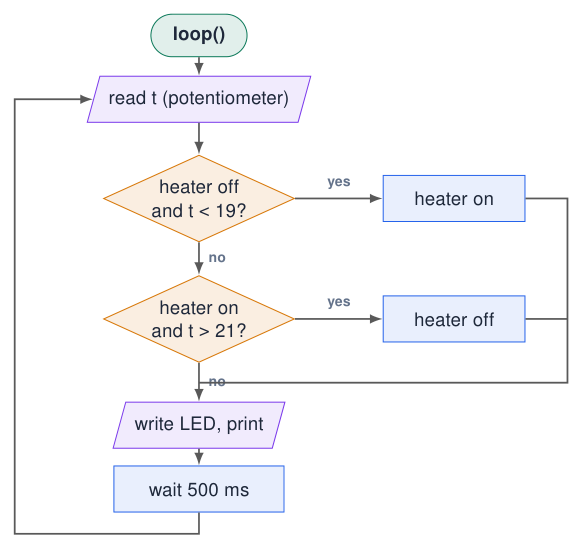

# Functions and Decisions

## Functions: give a name to a job

[Try simulation: Functions](https://costawess.github.io/Programming-Dashboard/web/simulations/course_topics_lab.html?topic=functions){ .md-button .lecture-simulation }

- A **function** is a block of code with a name that you can **call** whenever you need it.

- You already use many: `pinMode()`, `digitalWrite()`, `Serial.println()`, `setup()`, `loop()`.

- It can take **parameters** (input) and **return** a value (output), or neither.

- Benefits: less repetition, readable code, test one piece at a time, reuse in the next project.

{ .lecture-figure loading=lazy }

name(parameters) {  
// code  
}

*Sources: [Embedded Programming, lectures 1–6](references.md#ep-lectures)*

## Functions without parameters and return value

```cpp title="all_leds.ino"
const int LEDS[] = {23, 22, 21, 4};
void turnOnAllLeds() {
  digitalWrite(23, HIGH);
  digitalWrite(22, HIGH);
  digitalWrite(21, HIGH);
  digitalWrite(4, HIGH);
}
void turnOffAllLeds() {
  digitalWrite(23, LOW);
  digitalWrite(22, LOW);
  digitalWrite(21, LOW);
  digitalWrite(4, LOW);
}
void setup() {
  for (int pin : LEDS) pinMode(pin, OUTPUT);
}
void loop() {
  turnOnAllLeds();
  delay(500);
  turnOffAllLeds();
  delay(500);
}
```

[Download this example](examples/functions-decisions/all_leds.ino){ download }

- `void`: returns nothing.

- Empty `()`: takes no parameters.

- The **definition** (with the body) can be anywhere in the `.ino` file.

- The **call** `turnOnAllLeds();` runs the body, then continues on the next line.

- `loop()` now reads like the flowchart: on, wait, off, wait.

!!! info "Naming"
    
    Functions **do** something: use a verb: `readHumidity()`, `setColor()`, `isPressed()`.


*Sources: Example from lecture 2 [Embedded Programming, lectures 1–6](references.md#ep-lectures)*

## Parameters: functions with input

[Try simulation: Functions](https://costawess.github.io/Programming-Dashboard/web/simulations/course_topics_lab.html?topic=functions){ .md-button .lecture-simulation }

```cpp title="blink_times.ino"
void blinkTimes(int pin, int times, int ms) {
  for (int i = 0; i < times; i++) {
    digitalWrite(pin, HIGH);
    delay(ms);
    digitalWrite(pin, LOW);
    delay(ms);
  }
}

void setup() {
  pinMode(23, OUTPUT);
  pinMode(21, OUTPUT);
}

void loop() {
  blinkTimes(23, 3, 200);   // blue: 3 fast blinks
  blinkTimes(21, 1, 1000);  // red: 1 slow blink
}
```

[Download this example](examples/functions-decisions/blink_times.ino){ download }

- Parameters are **local variables** that receive a copy of the values in the call.

- The **order** and **type** must match: pin, times, ms.

- One function, many behaviours: that is reuse.

!!! warning "Pass by value"
    
    Changing `times` inside the function does **not** change the variable of the caller: the function works on a copy.


## Flowchart: calling a function

[Try simulation: Functions](https://costawess.github.io/Programming-Dashboard/web/simulations/course_topics_lab.html?topic=functions){ .md-button .lecture-simulation }

[Try simulation: Arduino to flowchart](https://costawess.github.io/Programming-Dashboard/web/simulations/arduino_flowchart_converter.html){ .md-button .lecture-simulation }

{ .lecture-figure loading=lazy }

- The box with **double side lines** is a **function call** (“predefined process”).

- The function has its **own** flowchart: it starts with its name and ends with **return**.

- After **return** the caller continues with the **next** box.

- Two calls with different parameters, one flowchart for the function.

## Return values: functions with output

[Try simulation: Functions](https://costawess.github.io/Programming-Dashboard/web/simulations/course_topics_lab.html?topic=functions){ .md-button .lecture-simulation }

```cpp title="convert.ino"
const int POT_PIN = 36;
float convertToVoltage(int adcValue) {
  return adcValue * 3.3 / 4095.0;    // 12-bit ADC
}
bool isAbove(float value, float limit) {
  return value > limit;
}
void setup() { Serial.begin(115200); }
void loop() {
  int raw = analogRead(POT_PIN);
  float voltage = convertToVoltage(raw);
  Serial.printf("raw=%d  V=%.2f\n", raw, voltage);
  if (isAbove(voltage, 2.0)) {
    Serial.println("Above 2 V!");
  }
  delay(500);
}
```

[Download this example](examples/functions-decisions/convert.ino){ download }

- The **return type** before the name says what comes back: `float`, `bool`, `int` …

- `return` ends the function immediately and hands back the value.

- The call can be used like a value: in an assignment, a print, a condition.

!!! warning "From an Uno example?"
    
    `* 5.0 / 1023.0` is for a 10-bit, 5 V Uno. ESP32: `* 3.3 / 4095.0`.


*Sources: Adapted from lecture 2 [Embedded Programming, lectures 1–6](references.md#ep-lectures)*

## Kinds of functions: input and output

[Try simulation: Functions](https://costawess.github.io/Programming-Dashboard/web/simulations/course_topics_lab.html?topic=functions){ .md-button .lecture-simulation }

<div class="tabular">

L3.0cm L5.4cm L4.6cm **Kind** & **Signature (example)** & **Call**  
no input, no output & `void printLine()` & `printLine();`  
input, no output & `void setLeds(bool r, bool g)` & `setLeds(true, false);`  
no input, output & `int readPot()` & `int v = readPot();`  
input and output & `float circleArea(float r)` & `float a = circleArea(2.5);`  
array as input & `float average(const float g[], int n)` & `average(grades, 5)`  
several outputs & `void minMax(const float v[], int n,`  
`\ \ float &lo, float &hi)` & `minMax(grades, 5, lo, hi);`  

</div>

!!! info "Info"
    
    **Inputs** = parameters of any type (`int`, `float`, `bool`, `char`, `String`, arrays, references). **Output** = exactly one return value or `void`; more results via reference parameters.


## Example: geometric figures

[Try simulation: Functions](https://costawess.github.io/Programming-Dashboard/web/simulations/course_topics_lab.html?topic=functions){ .md-button .lecture-simulation }

```cpp title="geometry.ino"
// PI is already defined by Arduino.h
float circleArea(float r)             { return PI * r * r; }
float circleCircumference(float r)    { return 2 * PI * r; }
float rectangleArea(float w, float h) { return w * h; }
float triangleArea(float b, float h)  { return 0.5 * b * h; }

float cylinderVolume(float r, float h) {
  return circleArea(r) * h;           // a function using a function
}

void setup() {
  Serial.begin(115200);
  Serial.printf("circle r=2:       %.2f\n", circleArea(2));
  Serial.printf("circumference:    %.2f\n", circleCircumference(2));
  Serial.printf("rectangle 3 x 4:  %.2f\n", rectangleArea(3, 4));
  Serial.printf("triangle 6, 2:    %.2f\n", triangleArea(6, 2));
  Serial.printf("cylinder r=1 h=5: %.2f\n", cylinderVolume(1, 5));
  float total = circleArea(1) + rectangleArea(2, 3);  // in an expression
  Serial.printf("total area:       %.2f\n", total);
}
void loop() {}
```

[Download this example](examples/functions-decisions/geometry.ino){ download }

- Each function has **one job** and a name that says it.

- Different numbers of parameters: 1 (`r`) or 2 (`w`, `h`).

- A call is a **value**: use it in a print, an assignment or an expression.

- Functions can call other functions: `cylinderVolume()` reuses `circleArea()`.

!!! tip "Test like a mathematician"
    
    Check each function with values you can compute by hand: $r = 1 \Rightarrow \pi$.


## Overloading and default parameters

```cpp title="overloading.ino"
// same name, different parameter lists: overloading
float area(float r)          { return PI * r * r; }   // circle
float area(float w, float h) { return w * h; }        // rectangle
float area(float a, float b, float c) {               // triangle (Heron)
  float s = (a + b + c) / 2;
  return sqrt(s * (s - a) * (s - b) * (s - c));
}
// default values: the caller may leave the last parameters out
void blink(int pin, int times = 1, int ms = 200) {
  for (int i = 0; i < times; i++) {
    digitalWrite(pin, HIGH); delay(ms); digitalWrite(pin, LOW); delay(ms);
  }
}
void setup() {
  Serial.begin(115200);
  pinMode(23, OUTPUT);
  Serial.println(area(1.0));            // circle:    3.14
  Serial.println(area(2.0, 3.0));       // rectangle: 6.00
  Serial.println(area(3.0, 4.0, 5.0));  // triangle:  6.00
  blink(23);  blink(23, 3);  blink(23, 3, 50);
}
void loop() {}
```

[Download this example](examples/functions-decisions/overloading.ino){ download }

- **Overloading**: one name, several versions. The compiler picks the version by the **number and types** of the arguments.

- **Default parameters**: values used when the caller leaves them out; they must be the **last** parameters.

!!! warning "Ambiguous calls"
    
    `area(2, 3)` with `int` arguments still works (converted to `float`), but two overloads that fit equally well give a compile error.


## Example: average grade of a group of students

```cpp title="grades.ino"
float average(const float g[], int n) {        // array in, float out
  float sum = 0;
  for (int i = 0; i < n; i++) sum += g[i];
  return sum / n;
}
bool passed(float grade) { return grade >= 5.5; }   // float in, bool out
char letter(float grade) {                          // float in, char out
  if (grade >= 8.0) return 'A';
  if (grade >= 7.0) return 'B';
  return grade >= 5.5 ? 'C' : 'F';
}
String verdict(float grade) { return passed(grade) ? "pass" : "fail"; }
void setup() {
  Serial.begin(115200);
  float grades[] = {7.5, 5.0, 8.2, 6.4, 9.1};
  int n = sizeof(grades) / sizeof(grades[0]);
  for (int i = 0; i < n; i++)
    Serial.printf("student %d: %.1f %c %s\n", i + 1, grades[i],
                  letter(grades[i]), verdict(grades[i]).c_str());
  Serial.printf("group average: %.2f\n", average(grades, n));
}
void loop() {}
```

[Download this example](examples/functions-decisions/grades.ino){ download }

- Four functions, four **return types**: `float`, `bool`, `char`, `String`.

- An **array** parameter needs its **length** as a second parameter: the function cannot know it.

- `const`: the function promises not to change the grades.

- `.c_str()` turns a `String` into text for `printf`.

!!! info "Dutch grades"
    
    Scale 1–10, pass from 5.5. The letters are only an example of a `char` result.


## More than one result: reference parameters

```cpp title="references.ino"
// & = reference: the function works on the caller's variable
void rectangle(float w, float h, float &area, float &perimeter) {
  area = w * h;
  perimeter = 2 * (w + h);
}
void minMax(const float v[], int n, float &lo, float &hi) {
  lo = hi = v[0];
  for (int i = 1; i < n; i++) {
    if (v[i] < lo) lo = v[i];
    if (v[i] > hi) hi = v[i];
  }
}
void setup() {
  Serial.begin(115200);
  float a, p;
  rectangle(3, 4, a, p);                        // a = 12, p = 14
  Serial.printf("area %.1f, perimeter %.1f\n", a, p);
  float grades[] = {7.5, 5.0, 8.2, 6.4, 9.1};
  float lowest, highest;
  minMax(grades, 5, lowest, highest);
  Serial.printf("lowest %.1f, highest %.1f\n", lowest, highest);
}
void loop() {}
```

[Download this example](examples/functions-decisions/references.ino){ download }

{ .lecture-figure loading=lazy }

- **By value** (default): the function gets a **copy**; changes stay inside.

- **By reference** (`&`): the function works on the **caller’s variable**: a way to return several results.

- Arrays are always passed as an **address**: use `const` if the function must not change them.

## Functions in embedded code: sensors and actuators

```cpp title="embedded_functions.ino"
const int LEDS[] = {23, 22, 21, 4};

int  readPotPercent()   { return map(analogRead(36), 0, 4095, 0, 100); }
bool isPressed(int pin) { return digitalRead(pin) == HIGH; }  // course board
void alarm(bool on)     { digitalWrite(2, on); }
void showLevel(int percent) {                    // 0..100 % -> 0..4 LEDs
  for (int i = 0; i < 4; i++) digitalWrite(LEDS[i], percent > i * 25);
}

void setup() {
  for (int i = 0; i < 4; i++) pinMode(LEDS[i], OUTPUT);
  pinMode(2, OUTPUT);
  pinMode(34, INPUT);
}

void loop() {
  int level = readPotPercent();
  showLevel(level);
  alarm(level > 90 || isPressed(34));
  delay(50);
}
```

[Download this example](examples/functions-decisions/embedded_functions.ino){ download }

- `loop()` now reads like a sentence: *read the level, show it, alarm if too high or pressed*.

- Hardware details (pins, ranges, active HIGH/LOW) are hidden **inside** the functions.

- Change the sensor or the board? Only one function changes.

- Each function can be **tested on its own** with Serial prints.

## Quiz: which signature?

1.  A function that converts Celsius to Fahrenheit.

    <details class="lecture-answer"><summary>Check your answer</summary><p><code>float celsiusToFahrenheit(float c)</code>   (returns <code>c * 9 / 5 + 32</code>)</p></details>

2.  A function that tells whether a number is even.

    <details class="lecture-answer"><summary>Check your answer</summary><p><code>bool isEven(int n)</code>   (returns <code>n % 2 == 0</code>)</p></details>

3.  A function that prints a separator line of dashes.

    <details class="lecture-answer"><summary>Check your answer</summary><p><code>void printLine()</code> or <code>void printLine(int length)</code></p></details>

4.  A function that computes both the average and the maximum of an array of `int`.

    <details class="lecture-answer"><summary>Check your answer</summary><p><code>void stats(const int v[], int n, float &amp;avg, int &amp;mx)</code></p></details>

5.  Why does `float average(float g[])` not know how many grades there are?

    <details class="lecture-answer"><summary>Check your answer</summary><p>An array parameter is only an address; pass the length as an extra parameter.</p></details>

## Scope of parameters and where to define functions

```cpp title="copy.ino"
void addTen(int x) {
  x = x + 10;            // changes the copy
  Serial.println(x);     // 15
}

int plusTen(int x) {
  return x + 10;         // returns a new value
}

void setup() {
  Serial.begin(115200);
  int n = 5;
  addTen(n);
  Serial.println(n);     // still 5
  n = plusTen(n);
  Serial.println(n);     // 15
}
void loop() {}
```

[Download this example](examples/functions-decisions/copy.ino){ download }

- To **change** a value of the caller, **return** the new value and assign it.

- The Arduino IDE adds **function prototypes** automatically, so in a `.ino` file the order of functions does not matter.

- In plain `.cpp` files you must declare a function **before** using it:  
  `int plusTen(int x);`

!!! tip "Good functions"
    
    Short (fits on the screen), does **one** thing, has a name that says what.


## if: making decisions

[Try simulation: Conditionals](https://costawess.github.io/Programming-Dashboard/web/simulations/course_topics_lab.html?topic=conditionals){ .md-button .lecture-simulation }

```cpp title="if.ino"
// if: do something only when true
if (temperature > 30) {
  digitalWrite(LED_RED, HIGH);
}

// if / else: choose between two
if (temperature > 30) {
  digitalWrite(LED_RED, HIGH);
} else {
  digitalWrite(LED_RED, LOW);
}

// else if: choose between many
if (temperature > 30) {
  Serial.println("hot");
} else if (temperature > 20) {
  Serial.println("warm");
} else {
  Serial.println("cold");
}
```

[Download this example](examples/functions-decisions/if.ino){ download }

- The **condition** in `( )` is `true` or `false`.

- Only the block of the **first** true condition runs; the rest is skipped.

- `else` catches everything that was not true before.

- Order matters: test the most specific case first.

!!! info "Flowchart link"
    
    Every `if` is a decision diamond; `else if` is a second diamond on the “no” exit.


*Sources: Examples from lecture 2 [Embedded Programming, lectures 1–6](references.md#ep-lectures)*

## Flowcharts: if, if / else and else if

[Try simulation: Conditionals](https://costawess.github.io/Programming-Dashboard/web/simulations/course_topics_lab.html?topic=conditionals){ .md-button .lecture-simulation }

[Try simulation: Arduino to flowchart](https://costawess.github.io/Programming-Dashboard/web/simulations/arduino_flowchart_converter.html){ .md-button .lecture-simulation }

{ .lecture-figure loading=lazy }

  
Every `if` is one **decision diamond**; `else if` is a new diamond on the *no* exit; all paths meet again below.

## Ternary operator: choose between two values

```cpp title="ternary.ino"
const int LED_PIN = 21;

void setup() {
  Serial.begin(115200);
  pinMode(LED_PIN, OUTPUT);
  int temperature = 32;

  // Choose a value with if / else:
  int ledState;
  if (temperature > 30) {
    ledState = HIGH;
  } else {
    ledState = LOW;
  }

  // The same choice with the ternary operator:
  ledState = (temperature > 30) ? HIGH : LOW;
  digitalWrite(LED_PIN, ledState);
  Serial.println(temperature > 30 ? "hot" : "OK");
}
void loop() {}
```

[Download this example](examples/functions-decisions/ternary.ino){ download }

!!! info "Conditional operator (ternary)"
    
    `condition ? a : b`


- **Ternary** means three operands: one condition and two alternatives.

- `true`: choose `a` (after `?`). `false`: choose `b` (after `:`).

- Only the **selected alternative** is evaluated.

- Produces a **value**: assign it, return it, or pass it to a function.

- Try 32: `HIGH`, prints `hot`. Try 25: `LOW`, prints `OK`.

!!! tip "Keep it readable"
    
    Prefer `if/else` for complex choices. Avoid nested ternaries.


## Comparison and logical operators

[Try simulation: Conditionals](https://costawess.github.io/Programming-Dashboard/web/simulations/course_topics_lab.html?topic=conditionals){ .md-button .lecture-simulation }

| **Op.** | **Meaning** | **Example (x = 5)** |
|:---|:---|:---|
| `==` | equal to | `x == 5` $\rightarrow$ true |
| `!=` | not equal | `x != 5` $\rightarrow$ false |
| `>` `<` | greater / less | `x > 3` $\rightarrow$ true |
| `>=` `<=` | or equal | `x <= 4` $\rightarrow$ false |
| `!` | not | `!(x > 3)` $\rightarrow$ false |
| `&&` | and | `x > 0 && x < 10` $\rightarrow$ true |
| `||` | or | `x < 0 || x > 10` $\rightarrow$ false |

|  A  |  B  | A `&&` B | A `||` B |
|:---:|:---:|:-----------------------:|:-----------------------:|
|  F  |  F  |            F            |            F            |
|  F  |  T  |            F            |            T            |
|  T  |  F  |            F            |            T            |
|  T  |  T  |          **T**          |            T            |

!!! warning "`=` is not `==`"
    
    `if (x = 0)` **assigns** 0 to x and is always false. The compiler only warns. Write `if (x == 0)`.


*Sources: [Embedded Programming, lectures 1–6](references.md#ep-lectures)*

## Combining conditions

[Try simulation: Conditionals](https://costawess.github.io/Programming-Dashboard/web/simulations/course_topics_lab.html?topic=conditionals){ .md-button .lecture-simulation }

```cpp title="conditions.ino"
// inside a range: AND
if (temperature > 20 && temperature < 30) {
  Serial.println("comfortable");
}

// outside a range: OR
if (temperature < 10 || temperature > 30) {
  digitalWrite(LED_RED, HIGH);      // alarm
}

// buttons: both, either, exactly one
bool k1 = digitalRead(34);
bool k2 = digitalRead(35);
if (k1 && k2)  Serial.println("both");
if (k1 || k2)  Serial.println("at least one");
if (k1 != k2)  Serial.println("exactly one");
if (!k1)       Serial.println("KEY1 released");
```

[Download this example](examples/functions-decisions/conditions.ino){ download }

- `&&`: **all** parts must be true.

- `||`: **at least one** part true.

- `!=` between two `bool`s is an **exclusive or**.

- Use brackets when mixing: `(a && b) || c`.

!!! warning "A classic bug"
    
    `if (t > 20 || t < 30)` is **always** true: every number is above 20 or below 30.


## Flowchart: combining conditions with && and \|\|

[Try simulation: Conditionals](https://costawess.github.io/Programming-Dashboard/web/simulations/course_topics_lab.html?topic=conditionals){ .md-button .lecture-simulation }

{ .lecture-figure loading=lazy }

- **AND** (`&&`): two decisions in a **row**; every *no* skips the action.

- **OR** (`||`): two ways to reach the action; one *yes* is enough.

- The second question is **skipped** when the first already decides (“short-circuit evaluation”).

## Example: a thermostat with hysteresis

[Try simulation: Hysteresis](https://costawess.github.io/Programming-Dashboard/web/simulations/hysteresis_lab.html){ .md-button .lecture-simulation }

[Try simulation: Heating and cooling](https://costawess.github.io/Programming-Dashboard/web/experiments/heating_cooling_lab.html){ .md-button .lecture-simulation }

```cpp title="thermostat.ino"
const int POT_PIN = 36;     // pot simulates 0..30 C
const int HEATER  = 21;     // red LED = heater
const float T_ON  = 19.0;   // switch on below
const float T_OFF = 21.0;   // switch off above
bool heaterOn = false;
float readTemperature() {
  return analogRead(POT_PIN) * 30.0 / 4095.0;
}
void setup() {
  Serial.begin(115200);
  pinMode(HEATER, OUTPUT);
}
void loop() {
  float t = readTemperature();
  if (!heaterOn && t < T_ON) {
    heaterOn = true;
  } else if (heaterOn && t > T_OFF) {
    heaterOn = false;
  }
  digitalWrite(HEATER, heaterOn);
  Serial.printf("T=%.1f heater=%d\n", t, heaterOn);
  delay(500);
}
```

[Download this example](examples/functions-decisions/thermostat.ino){ download }

{ .lecture-figure loading=lazy }

- One threshold would switch on/off many times per second around 20 °C (“chattering”).

- Two thresholds = **hysteresis**: stable switching.

- The decision depends on the **state** (`heaterOn`): a first taste of state machines.

## Flowchart: thermostat with hysteresis

[Try simulation: Hysteresis](https://costawess.github.io/Programming-Dashboard/web/simulations/hysteresis_lab.html){ .md-button .lecture-simulation }

[Try simulation: Arduino to flowchart](https://costawess.github.io/Programming-Dashboard/web/simulations/arduino_flowchart_converter.html){ .md-button .lecture-simulation }

{ .lecture-figure loading=lazy }

- The decisions use the input **and** the current **state** (`heaterOn`).

- Between 19 and 21 °C both answers are *no*: nothing changes, so the heater does not chatter.

- This is the same logic as the code on the previous section, box for box.

## Quiz: functions and decisions

1.  What is printed? `int x = 7; if (x > 5) { x = 2; } else if (x > 1) { x = 3; }` then `Serial.println(x);`

    <details class="lecture-answer"><summary>Check your answer</summary><p>2: only the first true block runs.</p></details>

2.  Write the condition “temperature between 18 and 24, inclusive”.

    <details class="lecture-answer"><summary>Check your answer</summary><p><code>t &gt;= 18 &amp;&amp; t &lt;= 24</code></p></details>

3.  What does a function with return type `void` return?

    <details class="lecture-answer"><summary>Check your answer</summary><p>Nothing. It is called for its effect (e.g. switching LEDs).</p></details>

4.  `float half(int x) { return x / 2; }` returns 3.0 for `half(7)`. Fix it.

    <details class="lecture-answer"><summary>Check your answer</summary><p><code>return x / 2.0;</code> (integer division otherwise).</p></details>

5.  Why does a thermostat need two thresholds?

    <details class="lecture-answer"><summary>Check your answer</summary><p>Hysteresis prevents rapid on/off switching when the temperature is near the setpoint.</p></details>

## Exercises: functions and decisions (1/2)

[Try simulation: Hysteresis](https://costawess.github.io/Programming-Dashboard/web/simulations/hysteresis_lab.html){ .md-button .lecture-simulation }

[Try simulation: Heating and cooling](https://costawess.github.io/Programming-Dashboard/web/experiments/heating_cooling_lab.html){ .md-button .lecture-simulation }

!!! example "Exercise 1 – Battery indicator"
    
    The potentiometer simulates a battery (0–3.3 V). Light 4 LEDs as a level bar: $>$ 3.0 V all, $>$ 2.5 V three, $>$ 2.0 V two, $>$ 1.5 V one, else blink red.


!!! example "Exercise 2 – Write the functions"
    
    `bool isInRange(int v, int lo, int hi)`, `int maxOf(int a, int b)`, `void setLeds(bool b, bool g, bool r, bool o)`. Test each one with Serial prints.


!!! example "Exercise 3 – Hysteresis night light"
    
    The pot is a light sensor: LED on below 30 %, off above 40 %. Print the state changes, not every reading.


## Exercises: functions and decisions (2/2)

!!! example "Exercise 4 – Geometry library"
    
    Write `sphereVolume(r)`, `cylinderSurface(r, h)` and an overloaded `perimeter()` for circle, rectangle and triangle. Test each with hand-calculated values.


!!! example "Exercise 5 – Grade report"
    
    For an array of 8 grades print: average, lowest, highest (reference parameters), the number of passes and the best student number.


## Further material: functions and decisions

### Read

- [Arduino language reference](https://docs.arduino.cc/language-reference/)

- [Learn C++: functions and if-statements](https://www.learncpp.com/)

### Watch

- [YouTube: Arduino functions tutorial](https://www.youtube.com/results?search_query=arduino+functions+tutorial)

- [YouTube: Arduino if else](https://www.youtube.com/results?search_query=arduino+if+else+tutorial)

### Try it

- [Functions](https://costawess.github.io/Programming-Dashboard/web/simulations/course_topics_lab.html?topic=functions)

- [Conditionals](https://costawess.github.io/Programming-Dashboard/web/simulations/course_topics_lab.html?topic=conditionals)

- [Hysteresis](https://costawess.github.io/Programming-Dashboard/web/simulations/hysteresis_lab.html)

- [Experiment: heating & cooling](https://costawess.github.io/Programming-Dashboard/web/experiments/heating_cooling_lab.html)
