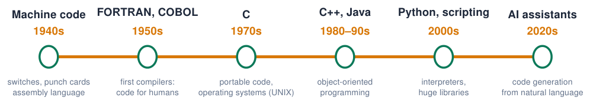
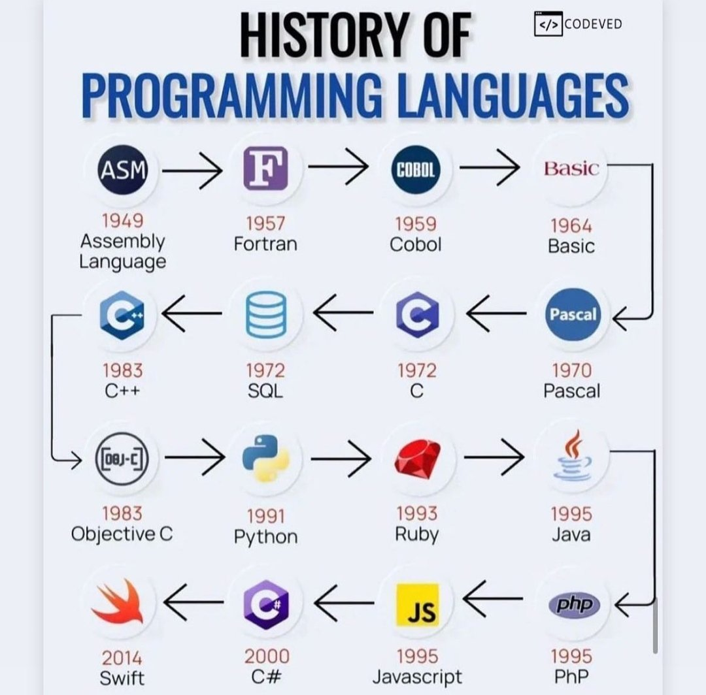
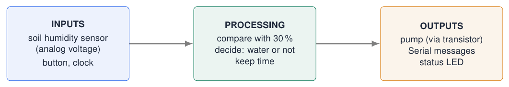
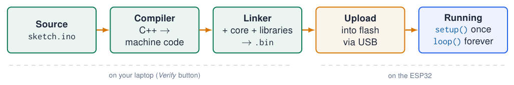

# How Programs Run

## A short history of programming

{ .lecture-figure loading=lazy }

!!! info "The trend"
    
    Each generation **hides details** of the machine so humans can think about the **problem** instead of the hardware.


!!! tip "Where are we?"
    
    Arduino sketches are written in **C++** (1985), built on **C** (1972). Still the language of embedded systems.


*Sources: [The C Programming Language](references.md#kernighan1988); [Embedded Programming, lectures 1–6](references.md#ep-lectures)*

## Programming languages: the original lecture overview

{ .lecture-figure loading=lazy }

- The original overview places assembly, FORTRAN, COBOL, BASIC, C, C++, Python, Java and other languages on a common timeline.

- Different languages suit different problems; they do not simply replace their predecessors.

- This course uses Arduino C++ to connect programming concepts to hardware.

- The marked C++ and Python entries invite a comparison of compiled firmware and interpreted programs.

!!! info "Discussion"
    
    Which names do you recognise? Which have you used, and for what purpose?


*Sources: Original figure, lecture 1 slide 14 [Embedded Programming, lectures 1–6](references.md#ep-lectures)*

## From client story to program

!!! warning "Version 1: what clients often say"
    
    *“I want my plant pots to take care of themselves. Make it happen.”*


!!! info "Version 2: a useful story"
    
    *“When the plant needs water, the pot should water it. I also want the pot to tell me what is going on, because I don’t always know if the soil is wet or dry. The system should check how wet the soil is, decide whether to water, and tell me what it did.”*


**Turn it into measurable requirements**

1.  **Needs water** = soil humidity $<$ 30 %.

2.  **Give water** = pump on for 10 s.

3.  **Report** humidity and action over Serial.

4.  Check again every minute.

!!! tip "Ask the client"
    
    What is “dry”? How much water? How often? What if the tank is empty? Vague words become **numbers**.


*Sources: Example from lecture 1 [Embedded Programming, lectures 1–6](references.md#ep-lectures)*

## Inputs, processing, outputs

{ .lecture-figure loading=lazy }

- Almost every embedded system follows this pattern: **read** $\rightarrow$ **decide** $\rightarrow$ **act**, forever.

- In Arduino this “forever” is the `loop()` function.

- Before coding: list every input and output with its **type** (digital, analog, bus) and **pin**.

## Level 1: source code

```cpp title="hello_source.ino"
void setup()
{
  Serial.begin(115200);
}

void loop()
{
  Serial.println("Hello!");
  delay(1000);
}
```

[Download this example](examples/how-programs-run/hello_source.ino){ download }

- **Human-readable** text: `.ino`, `.c`, `.cpp`, `.py`, `.java` …

- Written and read by people, with names, comments and structure.

- It **cannot run directly** on a computer or microcontroller: a CPU only understands numbers.

- It must be **compiled** to machine code (C, C++) or **interpreted** line by line (Python).

*Sources: [Embedded Programming, lectures 1–6](references.md#ep-lectures)*

## Level 2: assembly language

```text title="add.asm (AVR)"
.include "m328Pdef.inc"
.def a = r16
.def b = r17
.def c = r18
start:
    ldi a, 10      ; a = 10
    ldi b, 11      ; b = 11
    mov c, a       ; c = a
    add c, b       ; c = c + b
loop:
    rjmp loop      ; jump forever
```

[Download this example](examples/how-programs-run/add.asm-AVR.txt){ download }

- One line $\approx$ **one CPU instruction**: load, move, add, jump.

- Works directly with **registers** (`r16`, `r17`, …): tiny storage cells inside the CPU.

- **Processor specific**: this AVR code does not run on an ESP32 (Xtensa).

- The same in C: `int c = 10 + 11;`

!!! info "Why still learn this?"
    
    Understanding what the compiler produces helps with timing, memory and debugging.


*Sources: [Embedded Programming, lectures 1–6](references.md#ep-lectures)*

## Level 3: machine code

```cpp title="blink.hex (Intel HEX)"
:100000000C9434000C9451000C9451000C94510049
:100010000C9451000C9451000C9451000C9451001C
:100020000C9451000C9451000C9451000C946800F5
:100030000C9451000C9451000C9451000C945100FC
:100040000C9451000C9451000C9451000C945100EC
:100050000C9451000C9451000C9451000C945100DC
:100060000C9451000C94510011241FBECFEFD8E026
:10007000DEBFCDBF11E0A0E0B1E0EAE1F1E002C0F7
:1000800005900D92A030B107D9F711E0A0E0B1E0E2
:1000900001C01D92A230B107E1F70E9485000C94C7
:00000001FF
```

[Download this example](examples/how-programs-run/blink.hex-Intel-HEX.txt){ download }

- Instructions and data as **numbers**, shown here in hexadecimal.

- The **executable**: `.exe` (PC), `.hex` (Arduino Uno), `.bin` (ESP32).

- The Arduino IDE compiles your sketch into this file and **uploads it into flash memory**.

- Each line: length, address, type, data bytes, checksum.

*Sources: [Embedded Programming, lectures 1–6](references.md#ep-lectures)*

## From source code to a running program

{ .lecture-figure loading=lazy }

!!! info "Running process"
    
    The executable is loaded and started: it gets memory, CPU time and access to inputs and outputs. On the ESP32 the program starts again at **every power-up or reset**.


!!! tip "Compiled vs interpreted"
    
    **Compiled** (C/C++): translated once, runs fast, errors found before running. **Interpreted** (Python): translated while running, easier to try, slower.


## Three kinds of errors

!!! warning "Syntax error"
    
    The code breaks the **grammar** of the language. The compiler refuses it.


```cpp title="example.cpp"
Serial.println("Hi")  // missing ;
```

[Download this example](examples/how-programs-run/example.cpp){ download }

at **compile time**: easiest to fix.

!!! tip "Runtime error"
    
    Valid code that fails **while running**: crash, reboot, garbage.


```cpp title="example.cpp"
int a = 10;
int b = 0;
int c = a / b;   // divide by 0
```

[Download this example](examples/how-programs-run/example-f8ee89c2.cpp){ download }

**when it happens**: watch the Serial Monitor.

!!! note "Logic error"
    
    The program runs fine but does the **wrong thing**.


```cpp title="example.cpp"
int sum = 10 + 20 + 30;
int avg = sum / 4;  // 3 values!
```

[Download this example](examples/how-programs-run/example-e2df1d4a.cpp){ download }

only by **testing** against the requirements: hardest.

!!! info "Info"
    
    The compiler only catches the first kind. That is why every assignment has a **test / evaluation** part.


*Sources: Examples from lecture 1 [Embedded Programming, lectures 1–6](references.md#ep-lectures)*

## Quiz: what kind of error?

1.  `digitalwrite(2, HIGH);` does not compile.

    <details class="lecture-answer"><summary>Check your answer</summary><p>Syntax error: C++ is case sensitive, the function is <code>digitalWrite</code>.</p></details>

2.  The LED blinks twice per second, the requirement says once per second.

    <details class="lecture-answer"><summary>Check your answer</summary><p>Logic error: the program runs, but the delay values are wrong.</p></details>

3.  The board reboots every time you read element 1000 of a 10-element array.

    <details class="lecture-answer"><summary>Check your answer</summary><p>Runtime error: reading outside the array touches memory that is not yours.</p></details>

4.  `int x = 10` followed by `void setup()` gives *expected ’,’ or ’;’ before ’void’*.

    <details class="lecture-answer"><summary>Check your answer</summary><p>Syntax error: the missing <code>;</code> is on the line <strong>before</strong> the one the compiler points at.</p></details>

5.  The pump keeps running when the soil is already wet.

    <details class="lecture-answer"><summary>Check your answer</summary><p>Logic error, e.g. the comparison is <code>&gt;</code> instead of <code>&lt;</code>.</p></details>

## Exercises: from story to requirements

!!! example "Exercise 1 – Night light"
    
    Client: *“I want a light that switches on when it gets dark and off again in the morning.”* Write down: the inputs and outputs, at least 4 **measurable** requirements, and 3 questions you would ask the client.


!!! example "Exercise 2 – Classify"
    
    Write one example each of a syntax, runtime and logic error for a program that blinks an LED. Swap with a classmate and classify theirs.


!!! example "Exercise 3 – Reverse engineering"
    
    Open *File $\rightarrow$ Examples $\rightarrow$ 01.Basics $\rightarrow$ Blink*. Describe in plain words what it does, then list its inputs, processing and outputs.
