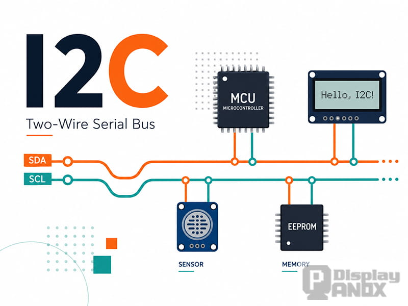
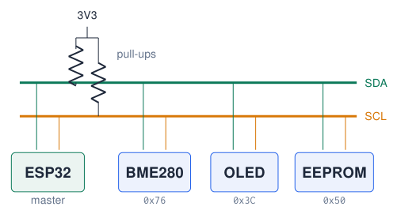
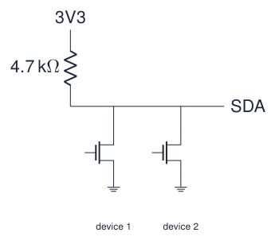
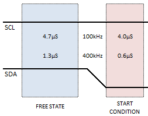
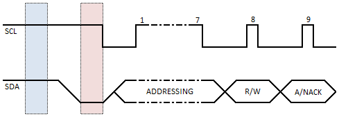
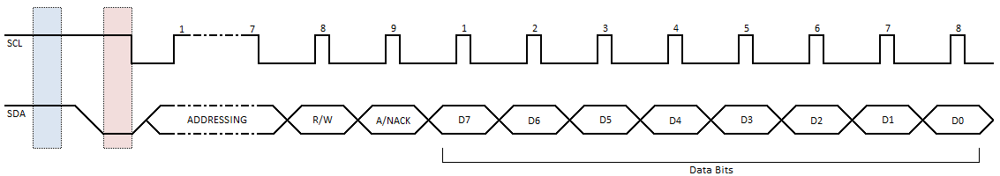
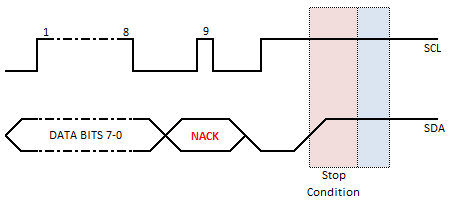
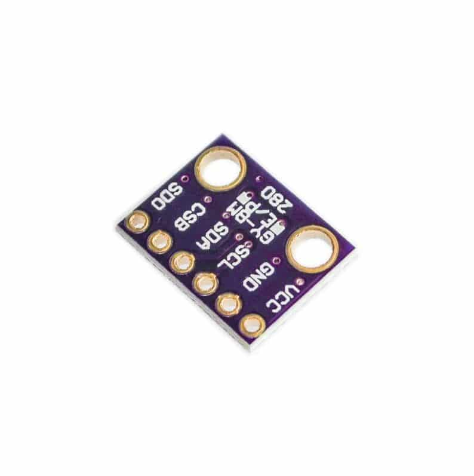

# The I2C Bus

## I2C at a glance

[Try simulation: I2C](https://costawess.github.io/Programming-Dashboard/web/simulations/course_topics_lab.html?topic=i2c){ .md-button .lecture-simulation }

{ .lecture-figure loading=lazy }

- **I<sup>2</sup>C**: **I**nter-**I**ntegrated **C**ircuit (Philips, 1982).

- **Serial** communication with **multiple devices** on the same wires.

- Only **two signal wires** (+ VCC and GND):

  - **SDA**: data

  - **SCL**: clock (timing)

- One **master** (controller), several **slaves** (targets), each with an **address**.

- Typical speeds: 100 kHz (standard), 400 kHz (fast).

*Sources: Figure: panoxdisplay.com, via lecture 5 [Embedded Programming, lectures 1–6](references.md#ep-lectures); [UM10204: I2C-bus specification and user manual, Rev. 7.0](references.md#nxp-i2c)*

## Master and slaves

!!! info "Master (e.g. the ESP32)"
    
    - controls the communication;
    
    - generates the clock signal on SCL;
    
    - starts every transfer;
    
    - requests data from a slave.


!!! tip "Slave (sensor, display, memory)"
    
    - only responds to master requests;
    
    - every I<sup>2</sup>C device has an **address** (7 bits);
    
    - other devices ignore requests not meant for them.


{ .lecture-figure loading=lazy }

Example: the BME280 answers to `0x76`. The ESP32 sends “0x76, give me register 0xF7”: only the BME280 reacts.

*Sources: [Embedded Programming, lectures 1–6](references.md#ep-lectures)*

## Pull-up resistors and open-drain lines

{ .lecture-figure loading=lazy }

- The **pull-up resistors** make the lines HIGH by default.

- Devices can only **pull the line LOW** (“open drain”); they never drive it HIGH.

- So two devices can never short-circuit each other, even if both talk at once.

- Pull-ups are often **already on the sensor board**.

- The internal ESP32 pull-ups ($\approx$ 45 k$\Omega$) are **too weak** for reliable I<sup>2</sup>C: use 2.2–10 k$\Omega$.

*Sources: [Embedded Programming, lectures 1–6](references.md#ep-lectures); [UM10204: I2C-bus specification and user manual, Rev. 7.0](references.md#nxp-i2c)*

## A transaction, step by step (1/2)

[Try simulation: I2C](https://costawess.github.io/Programming-Dashboard/web/simulations/course_topics_lab.html?topic=i2c){ .md-button .lecture-simulation }

**1. Start condition**  

{ .lecture-figure loading=lazy }

  
The master pulls **SDA LOW while SCL is HIGH**. All slaves start listening.

**2. Address + read/write**  

{ .lecture-figure loading=lazy }

  
The master sends the **7-bit address** and 1 bit: **R/W** (0 = write, 1 = read). The addressed slave answers with **ACK** (pulls SDA LOW).

!!! info "Rule"
    
    Data on SDA may only change while SCL is LOW. A change while SCL is HIGH is a START or STOP condition.


*Sources: Figures: Rheingold Heavy [I2C Signals](references.md#rheingold-i2c), via lecture 5*

## A transaction, step by step (2/2)

[Try simulation: I2C](https://costawess.github.io/Programming-Dashboard/web/simulations/course_topics_lab.html?topic=i2c){ .md-button .lecture-simulation }

**3. Data bytes**  

{ .lecture-figure loading=lazy }

  
8 bits per byte, most significant bit first; the receiver acknowledges **every** byte.

**4. Stop condition**  

{ .lecture-figure loading=lazy }

  
After the last byte the master releases **SDA HIGH while SCL is HIGH**: the bus is free. Or it sends a **repeated start** to continue.

{ .lecture-figure loading=lazy }

*Sources: Figures: Rheingold Heavy [I2C Signals](references.md#rheingold-i2c), via lecture 5*

## Worked example: the bytes on the wire

[Try simulation: I2C](https://costawess.github.io/Programming-Dashboard/web/simulations/course_topics_lab.html?topic=i2c){ .md-button .lecture-simulation }

**Read the chip ID of a BME280 at 0x76**

1.  START

2.  Address byte, write: $(0x76 \ll 1) \,|\, 0$ = `0xEC` $\rightarrow$ ACK

3.  Register number `0xD0` (chip ID) $\rightarrow$ ACK

4.  Repeated START

5.  Address byte, read: $(0x76 \ll 1) \,|\, 1$ = `0xED` $\rightarrow$ ACK

6.  Slave sends `0x60` (BME280) $\rightarrow$ master NACK

7.  STOP

!!! info "Why 0xEC?"
    
    The 7-bit address `0x76` = 111 0110 is shifted one place left to make room for the R/W bit: 1110 110**0** = `0xEC`.


!!! tip "BME280 or BMP280?"
    
    Chip ID `0x60` = BME280 (with humidity), `0x58` = BMP280 (no humidity). The modules look identical!


!!! warning "Datasheets"
    
    Some datasheets give the 8-bit form (0xEC/0xED), libraries use the 7-bit form (0x76).


*Sources: [BME280 Combined humidity and pressure sensor, datasheet](references.md#bosch-bme280); [UM10204: I2C-bus specification and user manual, Rev. 7.0](references.md#nxp-i2c)*

## I2C: scanning the bus and reading a register

```cpp title="i2c_scanner.ino"
#include <Wire.h>

void setup() {
  Serial.begin(115200);
  Wire.begin(19, 18);      // course board SDA, SCL
  Wire.setClock(400000);   // fast mode
  for (uint8_t a = 1; a < 127; a++) {
    Wire.beginTransmission(a);
    if (Wire.endTransmission() == 0)
      Serial.printf("Found 0x%02X\n", a);
  }
}

void loop() {}
```

[Download this example](examples/i2c/i2c_scanner.ino){ download }

```cpp title="i2c_register.ino"
uint8_t readReg(uint8_t dev, uint8_t reg) {
  Wire.beginTransmission(dev);
  Wire.write(reg);
  Wire.endTransmission(false);   // repeated start
  Wire.requestFrom(dev, (uint8_t) 1);
  return Wire.read();
}
// MPU-6050: readReg(0x68, 0x75) == 0x68
```

[Download this example](examples/i2c/i2c_register.ino){ download }

- 2 wires shared by many devices, each with a 7-bit address.

- Pull-ups (2.2–10 k$\Omega$) to **3.3 V**; most breakout boards have them.

- In practice: use the sensor’s library.

*Sources: [Espressif: GPIO Matrix and Pin Mux](https://docs.espressif.com/projects/arduino-esp32/en/latest/tutorials/io_mux.html)*

## The BME280 sensor: wiring

{ .lecture-figure loading=lazy }

<div class="tabular">

@l l L4.6cm@ **BME280** & **Course board** & **Note**  
VIN / VCC & 3V3 & **not** 5 V unless the module has a regulator  
GND & GND & common ground  
SCL & `18` & I<sup>2</sup>C header  
SDA & `19` & I<sup>2</sup>C header  
SDO & GND $\rightarrow$ `0x76` & to VCC $\rightarrow$ `0x77`  
CSB & VCC (or open) & selects I<sup>2</sup>C mode  

</div>

- Measures **temperature**, **humidity** and **pressure**.

- Check the schematic of **your** board for the SDA/SCL pins!

*Sources: [BME280 Combined humidity and pressure sensor, datasheet](references.md#bosch-bme280); [Embedded Programming, lectures 1–6](references.md#ep-lectures)*

## The BME280 sensor: code

```cpp title="bme280.ino"
#include <Wire.h>
#include <Adafruit_BME280.h>

Adafruit_BME280 bme;                 // uses Wire by default

void setup() {
  Serial.begin(115200);
  Wire.begin(19, 18);                // course board SDA, SCL
  if (!bme.begin(0x76)) {            // 0x77 if SDO is HIGH
    Serial.println("BME280 not found: check wiring/address");
    while (true) delay(10);
  }
}

void loop() {
  float t = bme.readTemperature();          // Celsius
  float h = bme.readHumidity();             // %
  float p = bme.readPressure() / 100.0F;    // Pa -> hPa
  Serial.printf("T=%.2f C  RH=%.1f %%  p=%.1f hPa\n", t, h, p);
  delay(2000);
}
```

[Download this example](examples/i2c/bme280.ino){ download }

- Library: *Adafruit BME280* (+ *Adafruit Unified Sensor*).

- `bme.begin(0x76)` uses the `Wire` bus you started.

- Check the return value: `false` = no answer at that address.

!!! tip "Test the connection first"
    
    Run the I<sup>2</sup>C scanner: it must list `0x76` before the library can work.


*Sources: [Adafruit BME280 Library](references.md#adafruit-bme280); [Embedded Programming, lectures 1–6](references.md#ep-lectures)*

## Troubleshooting I2C

<div class="tabular">

@L5cm L8.3cm@ **Symptom** & **Check**  
Scanner finds **nothing** & power and GND; SDA/SCL swapped; wrong pins in `Wire.begin()`; no pull-ups  
Found `0x77` instead of `0x76` & SDO is connected to VCC: change the address in `begin()`  
Found, but no humidity / wrong values & it is a BMP280 (chip ID `0x58`), not a BME280  
Works, then randomly fails & long or loose wires, missing pull-ups, too high clock: try 100 kHz  
Two devices, one disappears & both have the **same address**: change one (address pin) or use a second bus  

</div>

!!! info "Second bus"
    
    The ESP32 has two I<sup>2</sup>C controllers: `TwoWire Wire1 = TwoWire(1); Wire1.begin(25, 26);`


## Quiz: I2C

1.  Which two signal lines does I<sup>2</sup>C use, and what does each carry?

    <details class="lecture-answer"><summary>Check your answer</summary><p>SDA (data) and SCL (clock).</p></details>

2.  How does a slave know a message is meant for it?

    <details class="lecture-answer"><summary>Check your answer</summary><p>The master sends the 7-bit address first; only the device with that address answers (ACK).</p></details>

3.  Why do I<sup>2</sup>C lines need pull-up resistors?

    <details class="lecture-answer"><summary>Check your answer</summary><p>Devices can only pull the lines LOW; the resistors provide the HIGH level.</p></details>

4.  What byte appears on the wire when the master wants to **read** from address `0x3C`?

    <details class="lecture-answer"><summary>Check your answer</summary><p><span class="arithmatex">\((0x3C \ll 1) | 1\)</span> = <code>0x79</code>.</p></details>

5.  How many addresses does a 7-bit address field allow?

    <details class="lecture-answer"><summary>Check your answer</summary><p>128 (some are reserved: about 112 usable).</p></details>

## Exercises: I2C

!!! example "Exercise 1 – Bus inventory"
    
    Connect the BME280 and the OLED to the I<sup>2</sup>C header at the same time. Run the scanner and print a name for each known address.


!!! example "Exercise 2 – Without library"
    
    Read the chip ID register (`0xD0`) with only the `Wire` functions. Decide: BME280 or BMP280?


!!! example "Exercise 3 – Weather station"
    
    Show temperature, humidity and pressure on the OLED every 2 s; light the red LED if the humidity is above 70 %.


## Further material: I2C

### Read

- [I2C signals (Rheingold Heavy)](https://rheingoldheavy.com/i2c-signals/)

- [I2C communication interface](https://www.panoxdisplay.com/knowledge/i2c-communication-interface.html)

- [I2C (SparkFun)](https://learn.sparkfun.com/tutorials/i2c)

- [Arduino-ESP32 I2C API](https://docs.espressif.com/projects/arduino-esp32/en/latest/api/i2c.html)

- [NXP I2C specification UM10204](https://www.nxp.com/docs/en/user-guide/UM10204.pdf)

### Watch

- [YouTube: I2C explained](https://www.youtube.com/results?search_query=i2c+protocol+explained)

- [YouTube: ESP32 BME280](https://www.youtube.com/results?search_query=esp32+bme280+arduino+ide)

### Try it

- [I2C simulation](https://costawess.github.io/Programming-Dashboard/web/simulations/course_topics_lab.html?topic=i2c)

- [BME280 datasheet](https://www.bosch-sensortec.com/media/boschsensortec/downloads/datasheets/bst-bme280-ds002.pdf)
