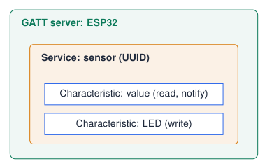

# Going Further: MQTT and Bluetooth

## Why MQTT for IoT?

- HTTP is **request/response**: the client must ask every time.

- MQTT is **publish/subscribe**: devices send messages to **topics** on a **broker**; everyone subscribed receives them immediately.

- Very small overhead: ideal for sensors and battery devices.

- Topics are hierarchical text: `hanze/lab3/board12/temperature`

<div class="tabular">

@l L3.6cm@ **Term** & **Meaning**  
Broker & server that distributes messages  
Publish & send a message to a topic  
Subscribe & receive messages of a topic  
Wildcards & `+` one level, `#` all levels  
QoS & delivery guarantee 0, 1, 2  

</div>

!!! warning "Public test brokers"
    
    `test.mosquitto.org` is open to everyone: never send personal data, use unique topic names.


*Sources: [PubSubClient: A client library for the Arduino that provides support for MQTT](references.md#pubsubclient)*

## MQTT: publish / subscribe for IoT

```cpp title="mqtt.ino (1/2)"
#include <WiFi.h>
#include <PubSubClient.h>
WiFiClient net;
PubSubClient mqtt(net);
const int LED_PIN = 2;
void onMessage(char* topic, byte* payload, unsigned int len) {
  String msg;
  for (unsigned int i = 0; i < len; i++) msg += (char) payload[i];
  digitalWrite(LED_PIN, msg == "ON" ? HIGH : LOW);
}
void setup() {
  pinMode(LED_PIN, OUTPUT);
  /* ... connect to Wi-Fi ... */
  mqtt.setServer("test.mosquitto.org", 1883);
  mqtt.setCallback(onMessage);
}
```

[Download this example](examples/iot-mqtt-ble/mqtt.ino-1of2.txt){ download }

```cpp title="mqtt.ino (2/2)"
void loop() {
  if (!mqtt.connected()) {
    if (mqtt.connect("esp32-hanze-01"))
      mqtt.subscribe("hanze/lab/led");
    else { delay(2000); return; }
  }
  mqtt.loop();
  static unsigned long t0 = 0;
  if (millis() - t0 > 5000) {       // every 5 s
    t0 = millis();
    mqtt.publish("hanze/lab/light",
                 String(analogRead(34)).c_str());
  }
}
```

[Download this example](examples/iot-mqtt-ble/mqtt.ino-2of2.txt){ download }

{ .lecture-figure loading=lazy }

  
Devices **publish** and **subscribe** to *topics* via a broker.

*Sources: [PubSubClient: A client library for the Arduino that provides support for MQTT](references.md#pubsubclient)*

## Bluetooth Low Energy in one slide

- **BLE**: short range ($\approx$ 10 m), very low energy, direct to a phone.

- A **GATT server** (the ESP32) offers **services**; each service has **characteristics** (values).

- A characteristic can be **read**, **written** or send **notifications**.

- Services and characteristics are identified by **UUIDs**.

{ .lecture-figure loading=lazy }

## Bluetooth Low Energy: a notifying sensor

```cpp title="ble_notify.ino"
#include <BLEDevice.h>
#include <BLEServer.h>
#include <BLE2902.h>
#define SERVICE_UUID "4fafc201-1fb5-459e-8fcc-c5c9c331914b"
#define CHAR_UUID    "beb5483e-36e1-4688-b7f5-ea07361b26a8"
BLECharacteristic *ch;
void setup() {
  BLEDevice::init("ESP32-Hanze");
  BLEServer  *server = BLEDevice::createServer();
  BLEService *svc    = server->createService(SERVICE_UUID);
  ch = svc->createCharacteristic(CHAR_UUID,
         BLECharacteristic::PROPERTY_READ | BLECharacteristic::PROPERTY_NOTIFY);
  ch->addDescriptor(new BLE2902());     // lets clients enable notify
  svc->start();
  BLEDevice::getAdvertising()->addServiceUUID(SERVICE_UUID);
  BLEDevice::startAdvertising();
}
void loop() {
  int value = analogRead(34);
  ch->setValue(value);
  ch->notify();                         // push to connected phone
  delay(1000);
}
```

[Download this example](examples/iot-mqtt-ble/ble_notify.ino){ download }

- **GATT**: a server exposes *services*, which contain *characteristics*.

- UUIDs identify them (generate your own).

- Test with *nRF Connect* on a phone.

- Much lower energy than Wi-Fi, short range.

!!! note "Flash size"
    
    BLE stack is large: pick *Huge APP* partition if the sketch does not fit.


## Exercises: MQTT and BLE

!!! example "Exercise 1 – Class dashboard"
    
    Every student publishes the potentiometer value to `hanze/ep/<name>/pot`. Subscribe to `hanze/ep/+/pot` with MQTT Explorer and watch the whole class.


!!! example "Exercise 2 – Remote LEDs"
    
    Subscribe to `hanze/ep/<name>/led` and switch the 4 LEDs with messages like `"1010"`.


!!! example "Exercise 3 – BLE control"
    
    Add a writable characteristic to the BLE example that switches the blue LED from nRF Connect.


## Further material: MQTT and Bluetooth

### Read

- [MQTT.org](https://mqtt.org/)

- [PubSubClient library](https://github.com/knolleary/pubsubclient)

- [Arduino-ESP32 BLE API](https://docs.espressif.com/projects/arduino-esp32/en/latest/api/ble.html)

### Watch

- [YouTube: MQTT explained](https://www.youtube.com/results?search_query=mqtt+explained)

- [YouTube: ESP32 BLE server](https://www.youtube.com/results?search_query=esp32+ble+server+arduino)

### Try it

- [MQTT Explorer](https://mqtt-explorer.com/)

- [nRF Connect for mobile](https://www.nordicsemi.com/Products/Development-tools/nRF-Connect-for-mobile)
