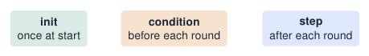
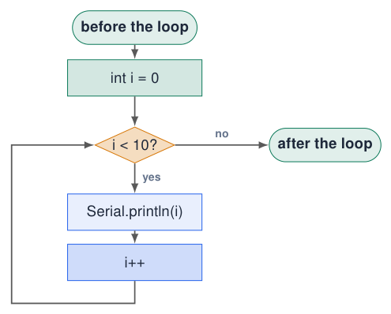
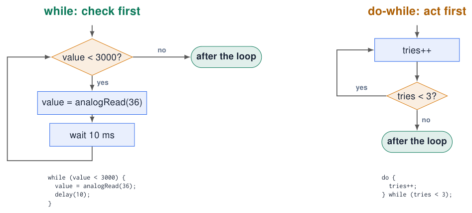
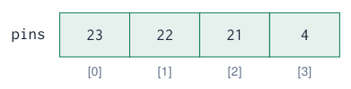

# Loops and Arrays

## The for loop: repeat a known number of times

[Try simulation: Loops](https://costawess.github.io/Programming-Dashboard/web/simulations/course_topics_lab.html?topic=loops){ .md-button .lecture-simulation }

(int i = 0; i \< 10; i++) { … }  

{ .lecture-figure loading=lazy }

```cpp title="for.ino"
for (int i = 0; i < 10; i++) {
  Serial.println(i);      // 0 1 2 ... 9
}
```

[Download this example](examples/loops-arrays/for.ino){ download }

1.  `int i = 0`: create the counter.

2.  `i < 10`? If false: leave the loop.

3.  Run the body.

4.  `i++`: add 1, back to step 2.

!!! info "Counting"
    
    Start at 0 and use `<`: the body runs exactly 10 times (0 … 9). This matches array indices.


*Sources: [Embedded Programming, lectures 1–6](references.md#ep-lectures)*

## Flowchart: the for loop

[Try simulation: Loops](https://costawess.github.io/Programming-Dashboard/web/simulations/course_topics_lab.html?topic=loops){ .md-button .lecture-simulation }

[Try simulation: Arduino to flowchart](https://costawess.github.io/Programming-Dashboard/web/simulations/arduino_flowchart_converter.html){ .md-button .lecture-simulation }

{ .lecture-figure loading=lazy }

(int i = 0; i \< 10; i++) {  
Serial.println(i);  
}  

1.  init runs **once**.

2.  condition is checked **before every** round.

3.  The **body** runs, then the step; back to 2.

4.  Condition false $\Rightarrow$ continue **after** the loop.

!!! tip "Zero rounds"
    
    If the condition is false at the start, the body never runs.


## for loops in practice

[Try simulation: Loops](https://costawess.github.io/Programming-Dashboard/web/simulations/course_topics_lab.html?topic=loops){ .md-button .lecture-simulation }

```cpp title="for_examples.ino"
// blink 5 times
for (int i = 0; i < 5; i++) {
  digitalWrite(23, HIGH); delay(100);
  digitalWrite(23, LOW);  delay(100);
}

// count down 10, 9, ... 1
for (int i = 10; i > 0; i--) {
  Serial.println(i);
}

// even numbers 0, 2, ... 20
for (int i = 0; i <= 20; i += 2) {
  Serial.println(i);
}
```

[Download this example](examples/loops-arrays/for_examples.ino){ download }

```cpp title="nested.ino"
// nested loops: multiplication table
for (int row = 1; row <= 5; row++) {
  for (int col = 1; col <= 5; col++) {
    Serial.printf("%4d", row * col);
  }
  Serial.println();
}
```

[Download this example](examples/loops-arrays/nested.ino){ download }

- The step can be anything: `i--`, `i += 2`, `i *= 2`.

- **Nested** loops: the inner loop runs completely for every round of the outer loop (5 $\times$ 5 = 25 prints).

- `%4d` prints a number in a 4-character column.

## The while loop: repeat until something happens

[Try simulation: Loops](https://costawess.github.io/Programming-Dashboard/web/simulations/course_topics_lab.html?topic=loops){ .md-button .lecture-simulation }

```cpp title="while.ino"
// keep reading until the pot is high
int value = analogRead(36);
while (value < 3000) {
  value = analogRead(36);
  delay(10);
}
Serial.println("Threshold reached");

// wait until KEY1 is pressed
while (digitalRead(34) == LOW) {
  // do nothing: just wait
}

// do-while: body runs at least once
int tries = 0;
do {
  tries++;
} while (tries < 3);
```

[Download this example](examples/loops-arrays/while.ino){ download }

- `for`: you know **how many** times.

- `while`: you repeat **until** a condition changes.

- The condition must be able to change **inside** the loop, otherwise it never ends.

- `break` leaves a loop early; `continue` skips to the next round.

!!! warning "Loops can block your program"
    
    While the ESP32 waits in a `while`, nothing else happens: no other button, no LED, no Wi-Fi. Prefer `if` + `millis()` (chapter *Time and Interrupts*).


*Sources: Examples from lecture 2 [Embedded Programming, lectures 1–6](references.md#ep-lectures)*

## Flowcharts: while vs do-while

[Try simulation: Loops](https://costawess.github.io/Programming-Dashboard/web/simulations/course_topics_lab.html?topic=loops){ .md-button .lecture-simulation }

[Try simulation: Arduino to flowchart](https://costawess.github.io/Programming-Dashboard/web/simulations/arduino_flowchart_converter.html){ .md-button .lecture-simulation }

{ .lecture-figure loading=lazy }

  
**while**: the diamond comes **first**: 0 or more rounds. **do-while**: the body comes first: **at least one** round.

## Arrays: many values under one name

```cpp title="array_intro.ino"
// without arrays: 5 names
int value1, value2, value3, value4, value5;

// with an array: 1 name, 5 elements
int values[5];

// declare and fill at once
int pins[] = {23, 22, 21, 4};   // size 4

values[0] = 120;          // first element
values[4] = 980;          // last element
int first = pins[0];      // 23
```

[Download this example](examples/loops-arrays/array_intro.ino){ download }

{ .lecture-figure loading=lazy }

- An **array** stores several values of the **same type** next to each other in memory.

- The **index** in `[ ]` selects an element and starts at **0**.

- An array of size N has indices 0 … N$-$<!-- -->1.

- The size is fixed when you declare it.

!!! warning "Out of bounds"
    
    `values[5]` on a 5-element array is **not checked**: it reads or overwrites other memory $\Rightarrow$ strange bugs or a crash.


## Arrays + loops: a perfect team

[Try simulation: Loops](https://costawess.github.io/Programming-Dashboard/web/simulations/course_topics_lab.html?topic=loops){ .md-button .lecture-simulation }

```cpp title="samples.ino"
const int N = 10;
int samples[N];

void setup() {
  Serial.begin(115200);

  for (int i = 0; i < N; i++) {     // fill
    samples[i] = analogRead(36);
    delay(20);
  }

  long sum = 0;                     // average
  int minV = samples[0];
  int maxV = samples[0];
  for (int i = 0; i < N; i++) {
    sum += samples[i];
    if (samples[i] < minV) minV = samples[i];
    if (samples[i] > maxV) maxV = samples[i];
  }
  Serial.printf("avg=%ld min=%d max=%d\n",
                sum / N, minV, maxV);
}

void loop() {}
```

[Download this example](examples/loops-arrays/samples.ino){ download }

- The loop counter `i` is used as the **index**.

- One loop to **fill**, one loop to **process**.

- `sum` is a `long`: 10 $\times$ 4095 fits in an `int` on the ESP32, but not on an Uno.

- Min/max: start with the first element, then compare every other one.

!!! tip "Why average?"
    
    ADC readings are noisy. The average of 10 samples is much more stable than one sample.


*Sources: Adapted from lecture 2 [Embedded Programming, lectures 1–6](references.md#ep-lectures)*

## Example: LED chaser with an array of pins

```cpp title="chaser.ino"
const int LEDS[] = {23, 22, 21, 4};
const int N = sizeof(LEDS) / sizeof(LEDS[0]);  // 4
void setup() {
  for (int i = 0; i < N; i++) {
    pinMode(LEDS[i], OUTPUT);
  }
}
void loop() {
  for (int i = 0; i < N; i++) {          // forward
    digitalWrite(LEDS[i], HIGH);
    delay(120);
    digitalWrite(LEDS[i], LOW);
  }
  for (int i = N - 2; i > 0; i--) {      // back
    digitalWrite(LEDS[i], HIGH);
    delay(120);
    digitalWrite(LEDS[i], LOW);
  }
}
```

[Download this example](examples/loops-arrays/chaser.ino){ download }

- Compare with the 4-LED example in *Digital I/O*: same behaviour, much less code.

- Adding a fifth LED = adding **one number** to the array.

- `sizeof(array) / sizeof(element)` computes the number of elements automatically.

!!! info "Data-driven code"
    
    The **data** (pin list) is separate from the **logic** (the loops). This idea comes back in every larger program.


## Example: a moving-average filter

```cpp title="moving_average.ino"
const int N = 16;
int buffer[N];          // last N readings
int pos = 0;            // where the next one goes
long sum = 0;

void setup() { Serial.begin(115200); }

void loop() {
  int raw = analogRead(36);
  sum -= buffer[pos];         // remove oldest
  buffer[pos] = raw;          // store newest
  sum += raw;
  pos = (pos + 1) % N;        // wrap around
  int filtered = sum / N;

  Serial.printf("raw:%d,filtered:%d\n", raw, filtered);
  delay(20);
}
```

[Download this example](examples/loops-arrays/moving_average.ino){ download }

- A **circular buffer**: `pos` runs 0 … 15, 0 … 15 thanks to `% N`.

- Keep a running `sum`: subtract the oldest, add the newest. No inner loop needed.

- Open the **Serial Plotter**: the filtered line is smooth but reacts slower.

!!! tip "Trade-off"
    
    Larger N = smoother but slower. Choose N for your signal.


## SOS refactoring: from literal timings to named data

**Step 1: a list of on/off durations**

```cpp title="sos_literal_data.ino"
// Alternating LED-on and LED-off times, ms.
const int durations[] = {
  500, 500, 500, 500, 500, 500,
  1500, 500, 1500, 500, 1500, 500,
  500, 500, 500, 500, 500, 500
};
```

[Download this example](examples/loops-arrays/sos_literal_data.ino){ download }

- The array removes repeated output code.

- Changing speed still requires many edits.

**Step 2: define timing in one place**

```cpp title="sos_named_data.ino"
const int DOT = 500;
const int DASH = 3 * DOT;
const int GAP = DOT;
const int durations[] = {
  DOT, GAP, DOT, GAP, DOT, GAP,
  DASH, GAP, DASH, GAP, DASH, GAP,
  DOT, GAP, DOT, GAP, DOT, GAP
};
```

[Download this example](examples/loops-arrays/sos_named_data.ino){ download }

- A single constant controls the speed.

- Dot/dash names reveal the intended pattern.

*Sources: Lecture 4, slides 15–16; pedagogical blink pattern [Embedded Programming, lectures 1–6](references.md#ep-lectures)*

## SOS refactoring: derive timings from the message

```cpp title="sos_derived_data.ino"
const char pattern[] = "...---...";
const int SYMBOLS = sizeof(pattern) - 1;
const int DOT = 500, DASH = 3 * DOT;
int onTimes[SYMBOLS];

void setup() {
  for (int i = 0; i < SYMBOLS; i++) {
    if (pattern[i] == '.') {
      onTimes[i] = DOT;
    } else {
      onTimes[i] = DASH;
    }
  }
}
void loop() {
  // Use onTimes[] to play the pattern.
}
```

[Download this example](examples/loops-arrays/sos_derived_data.ino){ download }

- Step 3: write the message once and calculate its timings.

- `sizeof(pattern) - 1` excludes the terminating zero character.

- Changing the message automatically changes the array size.

- `strlen(pattern)` is another way to find a text’s length.

- The next example calculates each on-time while playing instead of storing it.

!!! info "Exercise"
    
    Change the pattern to dot–dash–dot without changing the loop logic.


*Sources: Lecture 4, slide 17 [Embedded Programming, lectures 1–6](references.md#ep-lectures)*

## Example: SOS in Morse code, data-driven

```cpp title="sos.ino"
const int LED_PIN = 21;
const int DOT  = 200;                 // ms: one place to tune
const int DASH = 3 * DOT;
const char *pattern = "...---...";    // S O S

void setup() { pinMode(LED_PIN, OUTPUT); }

void loop() {
  for (int i = 0; i < strlen(pattern); i++) {
    int onTime = (pattern[i] == '.') ? DOT : DASH;
    digitalWrite(LED_PIN, HIGH);
    delay(onTime);
    digitalWrite(LED_PIN, LOW);
    delay(DOT);                       // gap between symbols
  }
  delay(7 * DOT);                     // gap between words
}
```

[Download this example](examples/loops-arrays/sos.ino){ download }

- A text is an **array of characters**; `strlen()` gives its length.

- The pattern is **data**: change it to any Morse message without touching the logic.

- `cond ? a : b` is a short `if/else` that returns a value.

- All timing derives from `DOT`: change the speed in one place.

*Sources: Efficiency example from lecture 4 [Embedded Programming, lectures 1–6](references.md#ep-lectures)*

## Quiz: loops and arrays

1.  How often does `for (int i = 0; i <= 10; i++)` run?

    <details class="lecture-answer"><summary>Check your answer</summary><p>11 times (0 … 10 inclusive).</p></details>

2.  What does `for (int i = 10; i > 0; i -= 3) Serial.print(i);` print?

    <details class="lecture-answer"><summary>Check your answer</summary><p>10, 7, 4, 1</p></details>

3.  What is the last valid index of `int a[8];`?

    <details class="lecture-answer"><summary>Check your answer</summary><p>7</p></details>

4.  What is wrong? `int x = 0; while (x < 10) { Serial.println(x); }`

    <details class="lecture-answer"><summary>Check your answer</summary><p><code>x</code> never changes: an infinite loop. Add <code>x++;</code></p></details>

5.  Why is a `while` that waits for a button a problem in a bigger program?

    <details class="lecture-answer"><summary>Check your answer</summary><p>It blocks: nothing else (LEDs, sensors, Wi-Fi) runs while waiting.</p></details>

## Exercises: loops and arrays

[Try simulation: Seven-segment displays](https://costawess.github.io/Programming-Dashboard/web/experiments/dual_seven_segment.html){ .md-button .lecture-simulation }

[Try simulation: Maze](https://costawess.github.io/Programming-Dashboard/web/experiments/maze.html){ .md-button .lecture-simulation }

!!! example "Exercise 1 – Bar graph"
    
    Read the pot and light 0–4 LEDs as a bar graph using an array of pins and one `for` loop.


!!! example "Exercise 2 – Statistics"
    
    Store the last 20 readings of the pot; every second print min, max, average and the difference max$-$min (noise).


!!! example "Exercise 3 – Your name in Morse"
    
    Extend the SOS example with a lookup table for the letters of your name.


!!! example "Exercise 4 – Binary counter"
    
    Count 0–15 on the 4 LEDs: LED *k* is on when bit *k* of the counter is 1. Hint: `(n >> k) & 1`.


## Further material: loops and arrays

### Read

- [Arduino language reference: for, while, arrays](https://docs.arduino.cc/language-reference/)

- [Learn C++: loops and arrays](https://www.learncpp.com/)

### Watch

- [YouTube: Arduino for loop](https://www.youtube.com/results?search_query=arduino+for+loop+tutorial)

- [YouTube: Arduino arrays](https://www.youtube.com/results?search_query=arduino+arrays+tutorial)

### Try it

- [Loops](https://costawess.github.io/Programming-Dashboard/web/simulations/course_topics_lab.html?topic=loops)

- [Experiment: seven-segment displays](https://costawess.github.io/Programming-Dashboard/web/experiments/dual_seven_segment.html)

- [Experiment: maze](https://costawess.github.io/Programming-Dashboard/web/experiments/maze.html)
