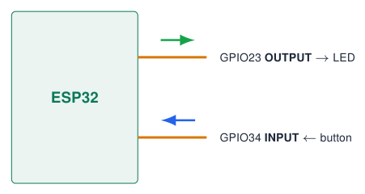
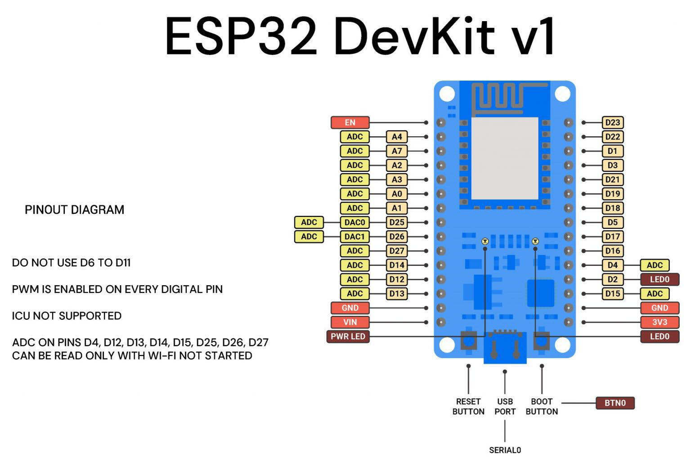
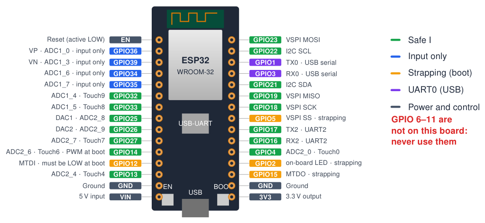
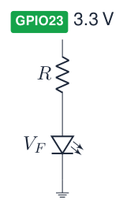

# Pinout and Forbidden Pins

## What is a GPIO?

- **G**eneral **P**urpose **I**nput/**O**utput: a pin your program controls.

- As **output**: the pin is 0 V (`LOW`) or 3.3 V (`HIGH`).

- As **input**: the program reads whether the voltage is low or high.

- Most pins have **extra functions**: ADC, touch, PWM, UART, I2C, SPI …

- In code you use the **GPIO number**, not the physical pin position.

{ .lecture-figure loading=lazy }

!!! tip "Labels on the board"
    
    “D23” on the DevKit silkscreen means GPIO23 $\Rightarrow$ in code: `23`.

## How to read a pinout diagram

{ .lecture-figure loading=lazy }

1.  Find the **orientation**: USB connector, antenna, buttons.

2.  Each pin shows its **name** (D23, VP, TX0) and **functions** (ADC, DAC, touch).

3.  **Power pins** (3V3, VIN, GND) cannot be used as I/O.

4.  Read the **notes**: forbidden pins, Wi-Fi conflicts.

5.  Different boards have **different pinouts**: always use the one of **your** board.

## ESP32 DevKit V1 (30-pin) pinout

{ .lecture-figure loading=lazy }

*Sources: [ESP32 Series Datasheet](references.md#esp32-datasheet); [ESP32 Pinout Reference: Which GPIO pins should you use?](references.md#rnt-pinout)*

## Forbidden pins and boot-sensitive pins

!!! warning "`GPIO 6–11` Forbidden"
    
    Connected to the internal **SPI flash** (SD0–SD3, CMD, CLK). Using them crashes the chip. Exposed only on 38-pin boards.

!!! tip "`GPIO 0, 2, 5, 12, 15` Strapping pins"
    
    Sampled at reset to choose boot mode / flash voltage. External pull-ups / pull-downs can make the board **fail to boot or to upload**.

!!! note "`GPIO 34, 35, 36, 39` Input only"
    
    No output driver and **no internal pull-up / pull-down**. Use external resistors.

*Sources: [ESP32 Series Datasheet](references.md#esp32-datasheet); [ESP-IDF Programming Guide: GPIO & RTC GPIO (ESP32)](references.md#esp-idf-gpio); [ESP32 Pinout Reference: Which GPIO pins should you use?](references.md#rnt-pinout)*

## Risky pins: think twice

**`GPIO 1, 3` UART0**

TX0 / RX0 are wired to the USB bridge: used for **upload and `Serial`**. Debug text appears on TX at boot.

!!! tip "`ADC2` Wi-Fi conflict"
    
    ADC2 (GPIO 0, 2, 4, 12–15, 25–27) **cannot be read while Wi-Fi is on**. Use ADC1 (GPIO 32–39).

!!! tip "`GPIO 14` and `GPIO 5, 15`"
    
    Output a short PWM / HIGH pulse at boot: avoid them for relays or motors.

!!! warning "`5 V` Never on a GPIO"
    
    I/O pins are **3.3 V only**. Use a level shifter or a divider.

*Sources: [ESP32 Series Datasheet](references.md#esp32-datasheet); [ESP-IDF Programming Guide: GPIO & RTC GPIO (ESP32)](references.md#esp-idf-gpio); [ESP32 Pinout Reference: Which GPIO pins should you use?](references.md#rnt-pinout)*

## Strapping pins: what happens at reset

c c L4.6cm L4.8cm **Pin** & **Default** & **Function at reset** & **Rule of thumb**  
`GPIO0` & pull-up & HIGH = run from flash, LOW = **download mode** & Do not hold LOW at reset (BOOT button does this on purpose)  
`GPIO2` & pull-down & Must be LOW / floating to enter download mode & Avoid pull-ups; LED is fine  
`GPIO12` & pull-down & Selects flash voltage: HIGH = **1.8 V** & Never HIGH at boot with 3.3 V flash $\rightarrow$ boot loop  
`GPIO15` & pull-up & LOW silences the boot log on UART0 & Keep HIGH or floating  
`GPIO5` & pull-up & SDIO slave timing & Keep HIGH or floating  

!!! info "Typical symptom"
    
    “`Failed to connect to ESP32: Timed out waiting for packet header`” or a reboot loop $\rightarrow$ check what is connected to the strapping pins.

*Sources: [ESP32 Series Datasheet](references.md#esp32-datasheet); [ESP32 Hardware Design Guidelines](references.md#esp32-hw-design)*

## Electrical limits and pin cheat sheet

**Electrical rules**

- Logic level **3.3 V**; $V_{IH} \geq 0.75\,V_{DD}$, $V_{IL} \leq 0.25\,V_{DD}$.

- Source up to $\approx$ 40 mA per pin (absolute), keep loads **$\leq$ 12–20 mA**: use transistors / drivers for relays, motors, LED strips.

- Internal pull-up / pull-down $\approx$ 45 k$\Omega$.

- ADC: 0–3.1 V with 11 dB attenuation, **non-linear** near the ends; use `analogReadMilliVolts()`.

- VIN accepts 5 V; 3V3 pin supplies small sensors only.

**Which pin for what?**  

@L1.9cm L4.5cm@ Digital out & `4` `13` `16` `17` `18` `19` `21`  
& `22` `23` `25` `26` `27` `32` `33`  
Analog in & `32--39` (ADC1, works with Wi-Fi)  
Analog out & `25` `26` (DAC)  
I2C & SDA `21` SCL `22`  
SPI (VSPI) & `23` `19` `18` `5`  
UART2 & RX `16` TX `17`  
Touch & `4` `13` `27` `32` `33`  

*Sources: [ESP32 Series Datasheet](references.md#esp32-datasheet); [ESP32 Pinout Reference: Which GPIO pins should you use?](references.md#rnt-pinout)*

## Worked example: the series resistor of an LED

{ .lecture-figure loading=lazy }

1.  Ohm’s law over the resistor: $R = \dfrac{V_{pin} - V_F}{I}$

2.  Blue LED: $V_F \approx 3.0$ V; wanted current $I = 5$ mA.

3.  $R = (3.3 - 3.0) / 0.005 = 60\,\Omega$ $\rightarrow$ the board uses 47 $\Omega$ (6.4 mA).

4.  Red LED: $V_F \approx 2.0$ V $\Rightarrow$ $R = 1.3/0.005 = 260\,\Omega$ $\rightarrow$ 255 $\Omega$ on the board.

!!! warning "Never without a resistor"
    
    Without $R$ the current is limited only by the pin: the LED and the GPIO can be damaged.

## Quiz: choose the right pin

1.  You need an extra output for a relay module. Is GPIO12 a good choice?

    

Check your answer

No: GPIO12 is a strapping pin; a pull-up on it at boot selects 1.8 V flash. Take e.g. GPIO25 or 26.

2.  A potentiometer must be read while Wi-Fi is active. Which pins are allowed?

    

Check your answer

ADC1 pins: GPIO 32--39 (on the course board: the AD1/AD2 terminals, GPIO36/39).

3.  Can you write `digitalWrite(35, HIGH)`?

    

Check your answer

No effect: GPIO 34--39 are input only.

4.  The board does not boot when your circuit is attached, but works when it is removed. First suspect?

    

Check your answer

Something connected to a strapping pin (0, 2, 5, 12, 15).

5.  Why should GPIO 6–11 never appear in your code?

    

Check your answer

They are connected to the internal SPI flash that holds your program.

## Exercises: pins

!!! example "Exercise 1 – Pin plan"
    
    Design a weather station with 1 button, 2 LEDs, a potentiometer, an I2C sensor and a buzzer. Choose a GPIO for each and justify why the pin is safe.

!!! example "Exercise 2 – Resistors"
    
    Calculate the series resistor for a green LED ($V_F = 2.2$ V) at 4 mA, and choose the nearest E12 value (…, 220, 270, 330, …).

!!! example "Exercise 3 – Find the bug"
    
    A student connects a button between GPIO35 and GND and uses `INPUT_PULLUP`. The readings are random. Explain why and fix the circuit.

## Further material: pinout

### Read

- [ESP32 pinout reference](https://randomnerdtutorials.com/esp32-pinout-reference-gpios/)

- [Arduino-ESP32 GPIO API](https://docs.espressif.com/projects/arduino-esp32/en/latest/api/gpio.html)

- [ESP32 hardware design guidelines](https://docs.espressif.com/projects/esp-hardware-design-guidelines/en/latest/esp32/)

### Watch

- [YouTube: ESP32 pinout explained](https://www.youtube.com/results?search_query=esp32+devkit+pinout+explained)

- [YouTube: strapping pins ESP32](https://www.youtube.com/results?search_query=esp32+strapping+pins)

### Try it

- [Digital input & output (dashboard)](../dashboard.md?lab=simulations/course_topics_lab.html&topic=foundations)

- [Falstad circuit simulator](https://www.falstad.com/circuit/)
