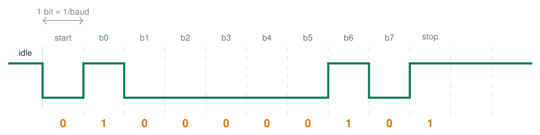
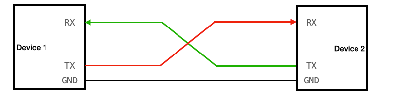
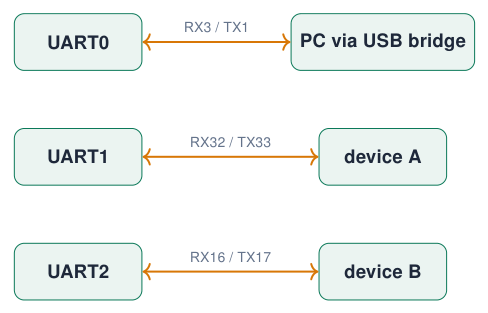
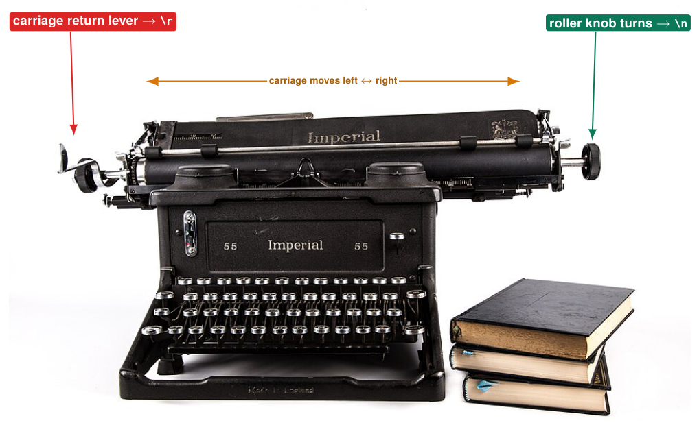
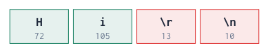
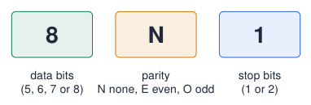
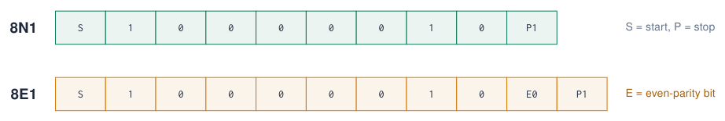
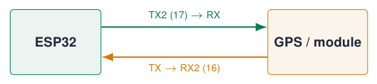
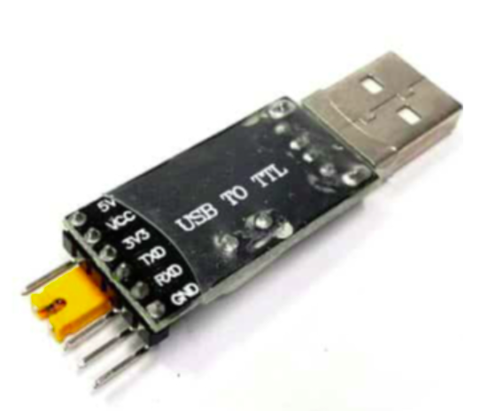
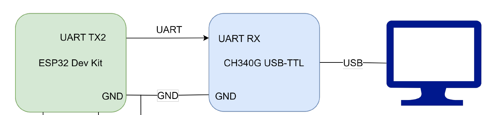

# Serial Communication (UART)

## Why serial communication?

[Try simulation: UART](../dashboard.md?lab=simulations/course_topics_lab.html&topic=uart){ .md-button .lecture-simulation }

**A microcontroller talks to a computer to**

- **debug**: “where is my program now?”

- **display** sensor values;

- check the **program state**;

- receive **commands**;

- communicate with **another device**: GPS, another microcontroller, a modem.

**Serial vs UART**

- **Serial** is the concept: bits are sent **one after the other** over one wire.

- **UART** (Universal Asynchronous Receiver/Transmitter) is the hardware and protocol that does it.

- I<sup>2</sup>C and SPI are also serial, but we call them by their own names.

!!! info "Asynchronous"
    
    There is **no clock wire**: both sides must agree on the speed in advance (the **baud rate**).


*Sources: [Embedded Programming, lectures 1–6](references.md#ep-lectures); [UART](references.md#adams-uart)*

## The UART frame: one byte on the wire

[Try simulation: UART](../dashboard.md?lab=simulations/course_topics_lab.html&topic=uart){ .md-button .lecture-simulation }

{ .lecture-figure loading=lazy }

- Line idles **HIGH**. A **start bit** (LOW) wakes up the receiver.

- 8 data bits, **least significant bit first**: here `'A'` = 65 = `0x41` = 0100 0001.

- A **stop bit** (HIGH) ends the frame. “8N1” = 8 data bits, no parity, 1 stop bit.

!!! info "Baud rate math"
    
    115 200 baud $\Rightarrow$ 1 bit $\approx$ 8.7 μs.  
    1 byte = 10 bits $\Rightarrow$ $\approx$ 11 500 bytes/s.  
    9600 baud $\Rightarrow$ only 960 bytes/s.


*Sources: [UART](references.md#adams-uart)*

## RX, TX and the UARTs of the ESP32

[Try simulation: UART](../dashboard.md?lab=simulations/course_topics_lab.html&topic=uart){ .md-button .lecture-simulation }

{ .lecture-figure loading=lazy }

  

- **TX** (transmit) of one side goes to **RX** (receive) of the other: **crossed**.

- A **common GND** is required: voltages are measured against it.

- Both sides must use the same **voltage level** (3.3 V on the ESP32).

<div class="tabular">

@l l L2.6cm@ **UART** & **RX / TX here** & **Arduino name / use**  
UART0 & 3 / 1 & `Serial`: USB bridge, upload, Serial Monitor  
UART1 & 32 / 33 & `Serial1`: pins selected explicitly  
UART2 & 16 / 17 & `Serial2`: course-board UART terminal  

</div>

!!! tip "GPIO matrix"
    
    Any UART can be routed to other pins: `Serial1.begin(9600, SERIAL_8N1, 25, 26);`


*Sources: Figure: lecture 2 [Embedded Programming, lectures 1–6](references.md#ep-lectures)*

## How many UARTs do we have, and which ones?

The classic ESP32 has **three independent hardware UART controllers**.

<div class="tabular">

@L1.5cm L2.0cm L3.0cm L5.0cm@ **Controller** & **Arduino object** & **RX / TX used here** & **Use on the course board**  
UART0 & `Serial` & GPIO3 / GPIO1 & USB–UART bridge: upload and Serial Monitor  
UART1 & `Serial1` & GPIO32 / GPIO33 & Additional device; example pins selected explicitly  
UART2 & `Serial2` & GPIO16 / GPIO17 & RX2 / TX2 screw terminal on the carrier board  

</div>

!!! info "Three controllers, usually two additional links"
    
    Keep UART0 for USB debugging; UART1 and UART2 can serve two other devices. `HardwareSerial sensor(2)` names UART2, not a fourth UART. Counts and available pins differ between ESP32-family chips and modules.


*Sources: Classic ESP32 UART count and Arduino objects [ESP32 Series Datasheet](references.md#esp32-datasheet); [Arduino ESP32: Serial (UART)](references.md#arduino-esp32-serial)*

## UART number and pin number are different choices

**Three serial paths on one board**

{ .lecture-figure loading=lazy }

- The GPIO matrix routes UART signals to selected suitable pins.

- In `begin(baud, format, RX, TX)`, the last two numbers choose those pins.

- The USB socket on this DevKit reaches UART0 through a bridge; it is not a fourth UART.

- Cross TX to RX and connect a common ground; use compatible 3.3 V logic.

!!! warning "Avoid assumptions from old tutorials"
    
    GPIO9/10 are connected to flash on WROOM-32. Do not reuse them for UART1. Choose pins explicitly instead of relying on an example’s defaults.


*Sources: UART routing and module pin restrictions [ESP32-WROOM-32 Datasheet, Version 3.8](references.md#esp32-wroom32-datasheet); [Arduino ESP32: Serial (UART)](references.md#arduino-esp32-serial); [Espressif: GPIO Matrix and Pin Mux](https://docs.espressif.com/projects/arduino-esp32/en/latest/tutorials/io_mux.html)*

## Explicit setup: USB debug plus two external UARTs

```cpp title="three_uarts.ino"
void setup() {
  Serial.begin(115200);  // UART0 -> USB bridge
  Serial1.begin(9600, SERIAL_8N1, 32, 33);
  Serial2.begin(115200, SERIAL_8N1, 16, 17);

  Serial.println("Debug on UART0");
  Serial1.println("Hello device A");
  Serial2.println("Hello device B");
}

void loop() {
  // Each port has its own available/read/write.
}
```

[Download this example](examples/serial-uart/three_uarts.ino){ download }

- `Serial1`: RX32 and TX33 are deliberate choices.

- `Serial2`: RX16 and TX17 match the course-board terminal.

- The baud rates of the three UARTs can differ; each link’s two ends must agree.

!!! note "Installed core 3.3.11"
    
    Its generic ESP32 defaults are UART1 RX26/TX27 and UART2 RX4/TX25. Older examples often use other defaults. Explicit pin arguments keep this sketch tied to our wiring.


*Sources: API and installed core 3.3.11 HardwareSerial.h [Arduino ESP32: Serial (UART)](references.md#arduino-esp32-serial); [Arduino ESP32 Core 3.3.11: HardwareSerial.h](references.md#arduino-esp32-core-pins)*

## The most used Serial functions

<div class="tabular">

l L8.6cm **Function** & **What it does**  
`Serial.begin(115200)` & start the UART at a baud rate (in `setup()`)  
`Serial.print(x)` / `println(x)` & send text or a number; `println` adds `\ r\ n`  
`Serial.print(x, HEX)` & print a number in HEX, BIN or DEC  
`Serial.printf("T=%.1f\ n", t)` & formatted print (ESP32 only): `%d` int, `%f` float, `%s` text  
`Serial.available()` & number of received bytes waiting in the buffer  
`Serial.read()` & take one byte from the buffer ($-$<!-- -->1 if empty)  
`Serial.readStringUntil('\ n')` & read text up to the end of a line (with timeout)  
`Serial.parseInt()` & read a number from the text  
`Serial.write(b)` & send a raw byte  

</div>

*Sources: [Arduino Language Reference](references.md#arduino-reference)*

## r and n: a lesson from the typewriter

[Try simulation: ASCII characters](../dashboard.md?lab=simulations/ascii_char_lab.html){ .md-button .lecture-simulation }

{ .lecture-figure loading=lazy }

**Finishing a line took two movements**

1.  **Carriage return**: push the carriage back to the left margin.  
    $\Rightarrow$ `'\ r'`, **CR**, ASCII **13**

2.  **Line feed**: turn the roller one line up, so you do not type over the old line.  
    $\Rightarrow$ `'\ n'`, **LF**, ASCII **10**

- Teleprinters (the first serial terminals) copied the typewriter: two separate **control characters**.

- They still travel over every UART today.

!!! info "So `Serial.println('Hi')` sends 4 bytes"
    
    `'H'` 72 `'i'` 105 `'\ r'` 13 `'\ n'` 10


*Sources: Photo: Dr. Luke, Imperial typewriter, CC0, via Wikimedia Commons*

## Line endings in practice

| **Who**              | **Ends a line with**          |
|:---------------------|:------------------------------|
| `Serial.println()`  | `\ r\ n` (CR + LF) |
| Windows text files   | `\ r\ n`           |
| Linux, macOS         | `\ n`           |
| Classic Mac OS (old) | `\ r`           |

**Serial Monitor: line ending setting**

- *No Line Ending*: only what you typed

- *New Line*: adds `\ n`

- *Carriage Return*: adds `\ r`

- *Both NL & CR*: adds `\ r\ n`

!!! warning "Why `trim()`?"
    
    With *Both NL & CR*, `readStringUntil('\ n')` returns `"ON\ r"`: it is not equal to `"ON"`. `trim()` removes the invisible `\ r`.


```cpp title="show_bytes.ino"
// Shows every byte you send from the
// Serial Monitor: try every line ending!
void setup() {
  Serial.begin(115200);
}
void loop() {
  while (Serial.available()) {
    int b = Serial.read();
    Serial.printf("%3d  0x%02X  %c\n",
                  b, b, b >= 32 ? b : '.');
  }
}
```

[Download this example](examples/serial-uart/show_bytes.ino){ download }

Typing `Hi` with *Both NL & CR* prints:  

{ .lecture-figure loading=lazy }

## Example: commands from the Serial Monitor

```cpp title="commands.ino"
const int LED_GREEN = 22;

void setup() {
  Serial.begin(115200);
  pinMode(LED_GREEN, OUTPUT);
  Serial.println("Type ON or OFF");
}

void loop() {
  if (Serial.available()) {
    String cmd = Serial.readStringUntil('\n');
    cmd.trim();             // remove \r and spaces
    cmd.toUpperCase();      // on = ON
    if (cmd == "ON") {
      digitalWrite(LED_GREEN, HIGH);
      Serial.println("LED on");
    } else if (cmd == "OFF") {
      digitalWrite(LED_GREEN, LOW);
      Serial.println("LED off");
    } else {
      Serial.println("Unknown command: " + cmd);
    }
  }
}
```

[Download this example](examples/serial-uart/commands.ino){ download }

1.  Is there data? `available()`

2.  Read one line up to `'\ n'`.

3.  Clean it: `trim()`, `toUpperCase()`.

4.  Compare and act: `if / else if`.

5.  Always answer: the user sees what happened.

!!! tip "Serial Monitor setting"
    
    Set the line ending to *Newline*, otherwise `readStringUntil('\ n')` waits for its timeout (1 s).


## Example: plotting several values

```cpp title="plotter.ino"
const int POT = 36;

void setup() { Serial.begin(115200); }

void loop() {
  int raw = analogRead(POT);
  float volts = raw * 3.3 / 4095.0;
  int percent = map(raw, 0, 4095, 0, 100);

  // label:value pairs, comma separated
  Serial.printf("raw:%d,percent:%d,mV:%d\n",
                raw, percent, (int)(volts * 1000));
  delay(50);
}
```

[Download this example](examples/serial-uart/plotter.ino){ download }

- Open *Tools $\rightarrow$ Serial Plotter*.

- Each `label:value` becomes a line with a legend.

- One complete set per line, ending with `\ n`.

- Do not print other text at the same time: it confuses the plotter.

!!! info "Debugging with graphs"
    
    Noise, spikes, slow drift and bouncing buttons are much easier to see in a graph than in numbers.


## What does SERIAL_8N1 mean?

[Try simulation: UART](../dashboard.md?lab=simulations/course_topics_lab.html&topic=uart){ .md-button .lecture-simulation }

Serial2.begin(9600, SERIAL_8N1, 16, 17);  

{ .lecture-figure loading=lazy }

  

- The **frame format**: how each byte is packed on the wire, besides the baud rate.

- `Serial.begin(115200)` uses `SERIAL_8N1` by default.

- Both devices must use the **same** format, exactly like the baud rate; otherwise you get garbage or framing errors.

<div class="tabular">

@l c L3.0cm@ **Format** & **bits/byte** & **Typical use**  
`SERIAL_8N1` & 10 & almost everything: PC, GPS, modules  
`SERIAL_8E1` & 11 & industrial (Modbus RTU)  
`SERIAL_7E1` & 10 & old terminals, some meters  
`SERIAL_8N2` & 11 & slow or picky receivers  

</div>

!!! info "Bits per byte"
    
    start (1) + data (8) + parity (0) + stop (1) = **10** bits.  
    9600 baud with 8N1 $\Rightarrow$ 960 bytes/s; with 8E1 only 872 bytes/s.


*Sources: [UART](references.md#adams-uart); [Arduino ESP32 Core Documentation](references.md#arduino-esp32-docs)*

## Parity: a simple error check

[Try simulation: UART](../dashboard.md?lab=simulations/course_topics_lab.html&topic=uart){ .md-button .lecture-simulation }

{ .lecture-figure loading=lazy }

- **Even parity**: the sender adds 1 bit so that the total number of **1s** (data + parity) is **even**.

- **Odd parity**: the total number of 1s is odd.

- The receiver counts again: a mismatch means a bit was flipped by noise.

- Detects **one** wrong bit, cannot correct it; two flipped bits go unnoticed.

| **Char**                 | **Data bits** | **1s** | **E bit** |
|:-------------------------|:--------------|:------:|:---------:|
| `'A'` 0x41 | 0100 0001     |   2    |     0     |
| `'C'` 0x43 | 0100 0011     |   3    |     1     |
| `'U'` 0x55 | 0101 0101     |   4    |     0     |

!!! tip "In practice"
    
    Short cables on a board: `SERIAL_8N1`. Long, noisy industrial lines: parity (8E1) plus checksums in the message.


## UART: talking to another device

```cpp title="uart_bridge.ino"
// UART2 on GPIO16 (RX2) / GPIO17 (TX2)
void setup() {
  Serial.begin(115200);                      // USB / PC
  Serial2.begin(9600, SERIAL_8N1, 16, 17);   // baud, frame, RX, TX
}

void loop() {
  while (Serial2.available()) Serial.write(Serial2.read());  // device -> PC
  while (Serial.available())  Serial2.write(Serial.read());  // PC -> device
}
```

[Download this example](examples/serial-uart/uart_bridge.ino){ download }

{ .lecture-figure loading=lazy }

- 3 UARTs; pins are **remappable** through the GPIO matrix.

- Cross the lines: TX $\rightarrow$ RX.

- Common ground!

- 5 V module? Add a level shifter on its TX line.

## HardwareSerial: give your UART a name

```cpp title="hardware_serial.ino"
HardwareSerial device(2);     // use UART2

void setup() {
  Serial.begin(115200);                       // USB
  device.begin(9600, SERIAL_8N1, 16, 17);     // RX=16, TX=17
}

void loop() {
  if (device.available()) {
    String line = device.readStringUntil('\n');
    line.trim();               // remove \r and spaces
    Serial.print("Received: ");
    Serial.println(line);
  }
}
```

[Download this example](examples/serial-uart/hardware_serial.ino){ download }

- `HardwareSerial device(2)` creates an object for UART number 2.

- `Serial2` is exactly the same thing, just pre-declared.

- The name is up to you: `gps`, `myUARTtoLaptop` …

- On the course board: the **UART terminal** (TX2/RX2).

*Sources: Example from lecture 2 [Embedded Programming, lectures 1–6](references.md#ep-lectures)*

## USB–TTL adapters

{ .lecture-figure loading=lazy }

- Converts **USB** from a computer to **UART** signals at logic level (“TTL” is a historic name).

- The DevKit has one built in (CP2102/CH340): that is how `Serial` reaches your laptop.

- An extra adapter on UART2 gives you a **second** serial port on the laptop, e.g. to log data while the Serial Monitor shows debug text.

!!! warning "Set the adapter to 3.3 V"
    
    Many adapters have a 5 V/3.3 V jumper. 5 V on the ESP32 RX pin can damage it.


{ .lecture-figure loading=lazy }

*Sources: Figures: lectures 2 and 5 [Embedded Programming, lectures 1–6](references.md#ep-lectures)*

## Example: two ESP32 boards talking

```cpp title="board_A_sender.ino"
// Board A: sends the state of KEY1
void setup() {
  pinMode(34, INPUT);
  Serial2.begin(9600, SERIAL_8N1, 16, 17);
}

void loop() {
  bool pressed = digitalRead(34);
  Serial2.println(pressed ? "1" : "0");
  delay(100);
}
```

[Download this example](examples/serial-uart/board_A_sender.ino){ download }

```cpp title="board_B_receiver.ino"
// Board B: lights the blue LED
void setup() {
  pinMode(23, OUTPUT);
  Serial2.begin(9600, SERIAL_8N1, 16, 17);
}

void loop() {
  if (Serial2.available()) {
    String msg = Serial2.readStringUntil('\n');
    msg.trim();
    digitalWrite(23, msg == "1");
  }
}
```

[Download this example](examples/serial-uart/board_B_receiver.ino){ download }

{ .lecture-figure loading=lazy }

*Sources: Lecture 1 content: interfacing with other microcontrollers [Embedded Programming, lectures 1–6](references.md#ep-lectures)*

## Quiz: UART

1.  The Serial Monitor shows strange characters. What do you check first?

    <details class="lecture-answer"><summary>Check your answer</summary><p>The baud rate in the monitor vs. <code>Serial.begin()</code>.</p></details>

2.  Two boards are connected TX–TX and RX–RX. What happens?

    <details class="lecture-answer"><summary>Check your answer</summary><p>Nothing arrives: both transmit on the same wire. Cross the lines: TX <span class="arithmatex">\(\rightarrow\)</span> RX.</p></details>

3.  Why must both boards share GND?

    <details class="lecture-answer"><summary>Check your answer</summary><p>A voltage is a difference: without a common reference the receiver cannot tell HIGH from LOW.</p></details>

4.  How long does it take to send 100 bytes at 9600 baud?

    <details class="lecture-answer"><summary>Check your answer</summary><p><span class="arithmatex">\(100 \times 10\)</span> bits <span class="arithmatex">\(/ 9600 \approx 0.10\)</span> s.</p></details>

5.  Why can you not use GPIO 1 and 3 for your own sensor?

    <details class="lecture-answer"><summary>Check your answer</summary><p>They are UART0: upload and Serial Monitor go through them.</p></details>

## Exercises: UART

!!! example "Exercise 1 – Command parser"
    
    Extend the command example: `LED <n> ON/OFF` for n = 1–4, `STATUS` prints all LED states, `HELP` lists the commands.


!!! example "Exercise 2 – Remote dimmer"
    
    Board A sends its potentiometer value every 100 ms; board B sets the brightness of an LED (see PWM in the next chapter).


!!! example "Exercise 3 – Two terminals"
    
    Connect a USB–TTL adapter to UART2. Send debug text to `Serial` and measurements in CSV format to `Serial2`; open both in two terminal programs.


## Further material: UART

### Read

- [UART (V. Hunter Adams)](https://vanhunteradams.com/Protocols/UART/UART.html)

- [Serial communication (SparkFun)](https://learn.sparkfun.com/tutorials/serial-communication)

- [Arduino-ESP32 Serial API](https://docs.espressif.com/projects/arduino-esp32/en/latest/api/serial.html)

### Watch

- [YouTube: UART explained](https://www.youtube.com/results?search_query=uart+communication+explained)

- [YouTube: ESP32 Serial2 example](https://www.youtube.com/results?search_query=esp32+serial2+uart+arduino)

### Try it

- [UART simulation](../dashboard.md?lab=simulations/course_topics_lab.html&topic=uart)
