# SPI and the Logic Analyzer

## SPI at a glance

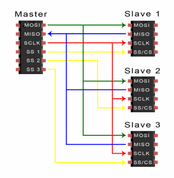{ .lecture-figure loading=lazy }

- **S**erial **P**eripheral **I**nterface: fast serial bus with a **clock**.

- **Full duplex**: data goes in **both directions at the same time** (I<sup>2</sup>C is half duplex).

- No addresses: each slave has its own **chip-select** (CS / SS) line.

- Speeds of 10–80 MHz: displays, SD cards, flash memory, fast ADCs.

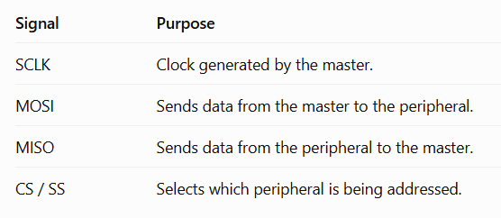{ .lecture-figure loading=lazy }

*Sources: Figures: lecture 6 [Embedded Programming, lectures 1–6](references.md#ep-lectures); [Basics of the SPI Communication Protocol](references.md#circuitbasics-spi)*

## How an SPI transfer works

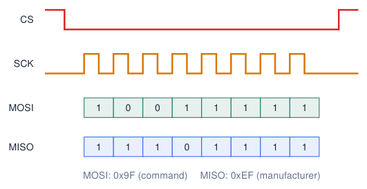{ .lecture-figure loading=lazy }

1.  Master pulls **CS LOW**: “you, listen”.

2.  Master generates 8 clock pulses on **SCK**.

3.  With every pulse one bit goes out on **MOSI** (master out, slave in) and one bit comes in on **MISO**.

4.  After the last byte: **CS HIGH**.

!!! info "Exchange"
    
    SPI always **exchanges** bytes: `SPI.transfer(x)` sends `x` and returns the received byte.


## SPI modes and settings

<div class="tabular">

@l c c L2.6cm@ **Mode** & **CPOL** & **CPHA** & **Clock idle / sample**  
`SPI_MODE0` & 0 & 0 & idle LOW, rising edge  
`SPI_MODE1` & 0 & 1 & idle LOW, falling edge  
`SPI_MODE2` & 1 & 0 & idle HIGH, falling edge  
`SPI_MODE3` & 1 & 1 & idle HIGH, rising edge  

</div>

**SPISettings(speed, order, mode)**

- **Speed**: maximum clock the slave accepts (datasheet), e.g. 1 MHz to start.

- **Bit order**: `MSBFIRST` for almost every device.

- **Mode**: most devices use mode 0; check the datasheet.

!!! warning "Wrong mode"
    
    Data shifted by one bit, or all `0xFF`/`0x00`: first suspect the mode and the CS wiring.


## SPI: fast, full-duplex

```cpp title="spi_id.ino"
#include <SPI.h>
const int CS_PIN = 5;

void setup() {
  Serial.begin(115200);
  pinMode(CS_PIN, OUTPUT);
  digitalWrite(CS_PIN, HIGH);
  SPI.begin(18, 19, 23, CS_PIN);    // SCK, MISO, MOSI, SS

  SPI.beginTransaction(SPISettings(1000000, MSBFIRST, SPI_MODE0));
  digitalWrite(CS_PIN, LOW);
  SPI.transfer(0x9F);               // JEDEC "read ID"
  uint8_t maker = SPI.transfer(0x00);
  digitalWrite(CS_PIN, HIGH);
  SPI.endTransaction();

  Serial.printf("Manufacturer ID: 0x%02X\n", maker);
}

void loop() {}
```

[Download this example](examples/spi-logic-analyzer/spi_id.ino){ download }

|      | **VSPI** | **HSPI** |
|:-----|:--------:|:--------:|
| SCK  |    18    |    14    |
| MISO |    19    |    12    |
| MOSI |    23    |    13    |
| SS   |    5     |    15    |

- Displays, SD cards, external flash, fast ADCs.

- One **CS** line per device.

- Up to 80 MHz on IO_MUX pins.

*Sources: [Espressif: GPIO Matrix and Pin Mux](https://docs.espressif.com/projects/arduino-esp32/en/latest/tutorials/io_mux.html)*

## Original SPI diagrams: individual selects and daisy chain

**Individual chip-selects**

{ .lecture-figure loading=lazy }

- SCK, MOSI and MISO are shared.

- Each device has a separate select wire.

- Only the selected device drives MISO.

**Daisy chain: a different arrangement**

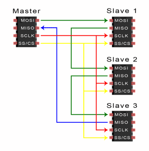{ .lecture-figure loading=lazy }

- Devices pass serial data to the next device.

- The chain shares clock and select.

- Requires devices that support chaining; check the datasheet.

*Sources: Both original diagrams: lecture 6 slide 14 [Embedded Programming, lectures 1–6](references.md#ep-lectures); [Basics of the SPI Communication Protocol](references.md#circuitbasics-spi)*

## UART vs I2C vs SPI

|  | **UART** | **I<sup>2</sup>C** | **SPI** |
|:---|:--:|:--:|:--:|
| Signal wires | 2 (TX, RX) | 2 (SDA, SCL) | 3 + 1 CS per slave |
| Clock | no (agreed baud) | yes | yes |
| Devices | 2 (point to point) | many (addresses) | many (chip selects) |
| Duplex | full | half | full |
| Typical speed | 9.6–921 kbit/s | 100–400 kHz | 1–80 MHz |
| Distance | metres (RS-232/485) | short, on a board | short, on a board |
| Typical use | PC, GPS, modules | sensors, small displays | displays, SD card, flash |

!!! tip "Which one?"
    
    Usually the **device decides**: read the datasheet. Many sensors support both I<sup>2</sup>C and SPI (e.g. the BME280).


*Sources: [Espressif: GPIO Matrix and Pin Mux](https://docs.espressif.com/projects/arduino-esp32/en/latest/tutorials/io_mux.html)*

## The logic analyzer: seeing your signals

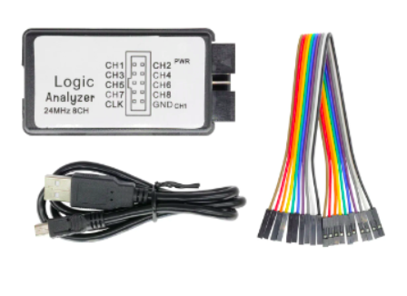{ .lecture-figure loading=lazy }

- Records digital signals (HIGH/LOW) on several channels at the same time.

- **Hardware debugging** vs software debugging: you see what really happens on the wires.

- Debug **communication** (UART, I<sup>2</sup>C, SPI are decoded into bytes) and **timing** problems.

- Cheap 8-channel, 24 MHz analyzers + free **PulseView** software (sigrok).

!!! tip "Installation (Windows)"
    
    Install PulseView; if needed, assign **WinUSB** to the analyzer using **Zadig**. Select `fx2lafw` in PulseView. Older builds may also need the Visual C++ 2010 runtime (x86/x64).


*Sources: [Embedded Programming, lectures 1–6](references.md#ep-lectures); [PulseView: a Qt based logic analyzer, oscilloscope and MSO GUI for sigrok](references.md#sigrok-pulseview)*

## Capturing a transaction, step by step

1.  Connect **GND** of the analyzer to GND of the circuit (always first!).

2.  Connect channels to the signals: CH0 = SCL, CH1 = SDA (or CS, SCK, MOSI, MISO).

3.  Choose the **sample rate**: start around 10$\times$ the bus clock/bit rate or more; also set the **sample count** for the required time window.

4.  Set a supported **trigger**: e.g. falling CS (SPI). Falling SDA is a candidate for I<sup>2</sup>C START; verify that SCL is HIGH.

5.  **Capture**, then add a **protocol decoder**.

| **Signal**             | **Sample rate** |
|:-----------------------|:----------------|
| I<sup>2</sup>C 100 kHz | $\geq$ 1 MHz    |
| I<sup>2</sup>C 400 kHz | $\geq$ 4 MHz    |
| UART 115 200 baud      | 2 MHz to start  |
| SPI 1 MHz              | 12 MHz to start |
| PWM 5 kHz              | $\geq$ 500 kHz  |

!!! info "Why a trigger?"
    
    A trigger selects an event to align the capture with. Available conditions and pre-trigger history depend on the device/driver. Start with no trigger if unsure.


*Sources: [Embedded Programming, lectures 1–6](references.md#ep-lectures); [PulseView: a Qt based logic analyzer, oscilloscope and MSO GUI for sigrok](references.md#sigrok-pulseview)*

## Inside a logic analyzer: voltage becomes sampled bits

1.  A probe observes a signal relative to **GND**.

2.  The input threshold classifies it as **0 or 1**.

3.  A sampling clock records all enabled channels at regular intervals.

4.  Software draws the samples. A **decoder** interprets their pattern as bytes or bus events.

!!! info "Two different clocks"
    
    The ESP32 produces the signal. The analyzer’s independent sample clock observes it: $\Delta t=1/f_s$. At $f_s=1\,\mathrm{MHz}$, samples are $1\,\text{\textmu s}$ apart.


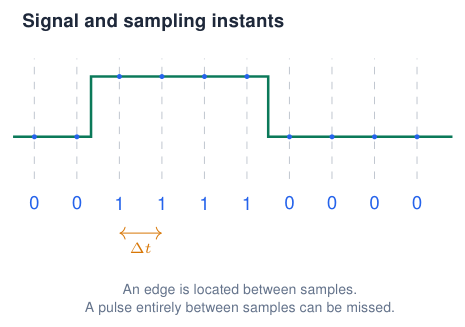{ .lecture-figure loading=lazy }

!!! tip "What the trace can tell you"
    
    Measure levels, order and timing. Use an **oscilloscope** to inspect voltage shape, noise and rise time.


## PulseView: connect the instrument and name the inputs

1.  Connect the analyzer by USB; power the ESP32 normally.

2.  Select the real device instead of **Demo device**. For the common FX2 analyzer: **Connect to Device** $\rightarrow$ **fx2lafw** $\rightarrow$ USB $\rightarrow$ Scan $\rightarrow$ select the device.

3.  Connect analyzer **GND to board GND**, then the signal probes.

4.  Enable the required inputs. Rename **D0/D1** to the signal names to make their role visible.

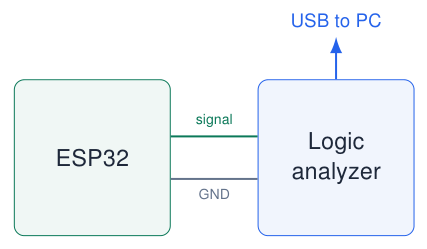{ .lecture-figure loading=lazy }

!!! info "Input names are not GPIO numbers"
    
    **D0** means analyzer channel 0. It may be clipped to **GPIO23**, GPIO17 or any chosen signal.


Windows: assign **WinUSB to the analyzer** in Zadig if needed; keep the ESP32 USB–UART driver. Select `fx2lafw` in PulseView. Check input limits for 3.3 V logic; probes observe signals and do not power the circuit.

*Sources: [PulseView manual: device selection and Windows installation](https://sigrok.org/doc/pulseview/0.4.2/manual.html)*

## Choose both sample rate and recording length

$\Delta t=\dfrac{1}{f_s}\qquad T_{\rm capture}=\dfrac{N_s}{f_s}\qquad N_s=f_s\,T_{\rm capture}$

$f_s$: samples per second$N_s$: sample instants per channel$T_{\rm capture}$: recorded time

<div class="tabular">

@L3.2cmL2.5cmL2.9cmL3.8cm@ **Example signal** & **Sample rate** & **Sample count** & **Resulting window**  
Blink: 1 Hz & 10 kHz & 50 k samples & 5 s: several full cycles  
UART: 115200 baud & 2 MHz & 200 k samples & 100 ms: many byte frames  
I<sup>2</sup>C: 100 kHz & 2 MHz & 200 k samples & 100 ms: one short transaction  
I<sup>2</sup>C: 400 kHz & 8 MHz & 800 k samples & 100 ms: same time, more data  

</div>

!!! tip "Resolve the shortest feature"
    
    Start around **10 samples per bit/clock period or more** for decoding; increase for short pulses and timing detail. At 115200 baud, 2 MHz gives about 17 samples per bit.


!!! info "Faster is not a longer recording"
    
    With 100 k samples: 1 MHz records 100 ms; 10 MHz records only 10 ms. Choose the closest supported values and recalculate the window.


## Blink capture: wire it, set it, run it

```cpp title="blink-capture.ino"
const int LED = 23; // blue course-board LED

void setup() {
  pinMode(LED, OUTPUT);
}

void loop() {
  digitalWrite(LED, HIGH);
  delay(250);
  digitalWrite(LED, LOW);
  delay(750);
}
```

[Download this example](examples/spi-logic-analyzer/blink-capture.ino){ download }

**Probe at the GPIO side of the LED resistor**

- Analyzer GND $\rightarrow$ board GND.

- D0 $\rightarrow$ **GPIO23**; rename it **LED**.

| **PulseView setting** | **Value**                    |
|:----------------------|:-----------------------------|
| Enabled input         | D0                           |
| Sample rate           | 10 kHz                       |
| Samples               | 50 k ($=5$ s)                |
| Trigger               | D0 rising edge, if available |
| Protocol decoder      | none needed                  |

Click **Run**, then **Zoom to Fit**. If an edge trigger is unavailable, start without a trigger: the signal repeats.

## Read Blink: period, frequency and duty cycle

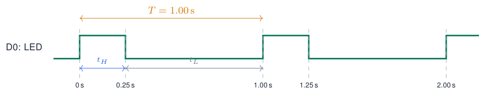{ .lecture-figure loading=lazy }

- Enable **cursors**; place them on two consecutive **rising edges** to measure $T$.

- Rising to falling gives $t_H\approx250$ ms.

- Falling to rising gives $t_L\approx750$ ms.

!!! info "Calculate from the trace"
    
    $T=t_H+t_L=1\,\mathrm{s}$
    
    $f=1/T=1\,\mathrm{Hz}$
    
    $D=t_H/T\times100\%=25\%$


!!! tip "Optional analyzer: PWM decoder"
    
    Add the **PWM** decoder; map its **Data** input to D0 and choose **active-high** polarity. Compare its duty-cycle annotations with your cursors. These describe the electrical HIGH time; an active-low LED would be on during LOW.


*Sources: [sigrok PWM decoder](https://sigrok.org/wiki/Protocol_decoder:Pwm); illustrative waveform, nominal delays*

## UART capture: generate a byte you can recognise

```cpp title="uart-capture.ino"
void setup() {
  // UART2: baud, format, RX, TX
  Serial2.begin(115200, SERIAL_8N1, 16, 17);
}

void loop() {
  Serial2.write('A'); // one byte: 0x41
  delay(20);
}
```

[Download this example](examples/spi-logic-analyzer/uart-capture.ino){ download }

!!! info "What is sent?"
    
    `write('A')` sends one byte. `println("A")` adds CR and LF: `0x41 0x0D 0x0A`. Capture on TX2, not on the USB cable.


**The analyzer listens in parallel**

- GND $\rightarrow$ board GND.

- D0 $\rightarrow$ **GPIO17 (ESP32 TX2)**.

- Optional D1 $\rightarrow$ **GPIO16 (ESP32 RX2)** to observe a second device’s replies. Leave it unassigned for this example.

| **Capture setting** | **Value**                     |
|:--------------------|:------------------------------|
| Sample rate         | 2 MHz                         |
| Samples             | 200 k ($=100$ ms)             |
| Trigger             | D0 falling edge, if available |
| Expected idle state | HIGH                          |

The falling edge marks the **start bit**. Click **Run**; zoom in on one burst before adding the decoder.

*Sources: [Arduino-ESP32 Serial API](https://docs.espressif.com/projects/arduino-esp32/en/latest/api/serial.html)*

## Configure the UART analyzer: the settings must match the sender

Add **UART**; click its decoder row to edit the channel mapping and options.

| **Decoder field**       | **This example**   |
|:------------------------|:-------------------|
| TX                      | D0 (GPIO17)        |
| RX                      | unassigned         |
| Baud rate               | 115200             |
| Frame: data/parity/stop | 8 / none / 1 (8N1) |
| Bit order               | LSB first          |
| Invert TX               | no                 |
| Data format             | ASCII or hex       |
| Sample point            | 50% (default)      |

!!! info "There is no clock wire"
    
    The decoder uses the **baud rate** to locate bit centres after the start edge. $T_{\rm bit}=1/115200\approx8.68\,\text{\textmu s}$. One 8N1 frame has 10 bits: about 86.8 .


!!! tip "Check the result"
    
    Expect repeated **A** or **0x41**, without framing errors. Changing the decoder to 9600 does not change the captured wire: it only interprets it incorrectly. The **2 MHz sample rate is not the 115200 baud rate**.


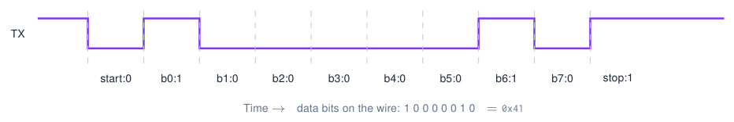{ .lecture-figure loading=lazy }

*Sources: [sigrok UART decoder options](https://github.com/sigrokproject/libsigrokdecode/blob/master/decoders/uart/pd.py); illustrative 8N1 frame*

## I2C capture: read a BME280 chip ID

```cpp title="i2c-capture.ino"
#include <Wire.h>
void setup() {
  Serial.begin(115200);
  Wire.begin(19, 18); // course board: SDA, SCL
  Wire.setClock(100000);
}
void loop() {
  Wire.beginTransmission(0x76);
  Wire.write(0xD0);   // chip-ID register
  if (Wire.endTransmission(false) == 0) {
    if (Wire.requestFrom((uint8_t)0x76,
                         (size_t)1, true) == 1) {
      Serial.printf("ID: 0x%02X\n", Wire.read());
    }
  }
  delay(1000);
}
```

[Download this example](examples/spi-logic-analyzer/i2c-capture.ino){ download }

**Probe the existing bus in parallel**

- GND $\rightarrow$ board GND.

- **D0 $\rightarrow$ GPIO18 (SCL)**.

- **D1 $\rightarrow$ GPIO19 (SDA)**.

- Sensor on the same bus, with 3.3 V pull-ups; both lines idle HIGH.

!!! info "Capture settings"
    
    Both inputs enabled; **2 MHz**, **4 M samples** $=2$ s, **no trigger**: capture a complete repeating transaction. For a short 100 ms window use 200 k samples; if supported, trigger on SDA falling with SCL HIGH and retain pre-trigger samples to include START.


Use address 0x76 or 0x77 to match the sensor. Run separately from SPI/LED sketches sharing these pins.

*Sources: [Arduino-ESP32 I2C API](https://docs.espressif.com/projects/arduino-esp32/en/latest/api/i2c.html); BME280 register 0xD0*

## Configure the I2C analyzer: map clock and data

Add the **I<sup>2</sup>C** decoder; open its settings and verify the assignments yourself.

<div class="tabular">

@L3.4cmL2.9cm@ **Decoder field** & **This example**  
SCL & D0: GPIO18  
SDA & D1: GPIO19  
Displayed slave address format & **shifted**: 7-bit address  

</div>

!!! info "No baud-rate field is needed"
    
    I<sup>2</sup>C carries its own clock on **SCL**. The decoder reads SDA at the clock edges; the capture sample rate still has to resolve both lines.


**Why does 0x76 sometimes appear as 0xEC?**

- The wire sends **7 address bits + R/W**.

- Write byte: $(\texttt{0x76}\ll1)|0=\texttt{0xEC}$.

- Read byte: $(\texttt{0x76}\ll1)|1=\texttt{0xED}$.

- **shifted** displays **0x76** plus Write/Read. **unshifted** displays the raw address byte, **0xEC/0xED**.

!!! tip "Inspect the first event"
    
    START = SDA falling **while SCL is HIGH**. A falling SDA edge during SCL LOW is normally a data transition. A simple SDA-edge trigger cannot distinguish them.


*Sources: [sigrok I2C decoder: channel mapping and address-format options](https://github.com/sigrokproject/libsigrokdecode/blob/master/decoders/i2c/pd.py)*

## Read the decoded transaction: who sends each part?

Expected BME280 chip-ID read at address **0x76**, register **0xD0**:

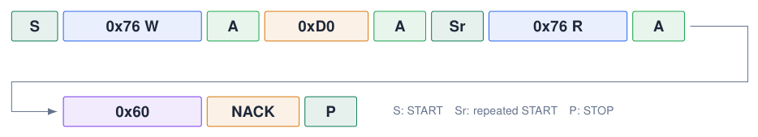{ .lecture-figure loading=lazy }

1.  ESP32 writes the register number **0xD0**. Sensor ACKs the address and register.

2.  `endTransmission(false)` keeps the bus for the **repeated START** before reading.

3.  Sensor sends **0x60**: BME280 ID.

!!! info "ACK is the ninth clock pulse"
    
    The receiver drives **LOW = ACK** or leaves **HIGH = NACK**. The ESP32 sends **NACK after the final read byte** to end the read: here it is expected, not an error.


Measure adjacent SCL rising edges inside a byte: $T_{\rm SCL}\approx10\,\text{\textmu s}$, so $f_{\rm SCL}\approx100$ kHz. Exclude gaps between bytes.

*Sources: [Bosch BME280 datasheet](https://www.bosch-sensortec.com/media/boschsensortec/downloads/datasheets/bst-bme280-ds002.pdf); illustrative decoder annotations*

## Capture first, decode second: fix the right setting

<div class="tabular">

@L3.0cmL4.3cmL5.1cm@ **What you see** & **Likely reason** & **What to check/change**  
Flat trace & wrong probe, pin, GND, or no activity & Inspect the wiring and running sketch; remove the trigger for a first look.  
Waiting for trigger & chosen edge never occurs & Check the input/edge; arm before the transfer; try a repeating test signal.  
Pulses, no decoded text & missing channel mapping, too little zoom, or capture begins mid-frame & Open decoder settings; map the inputs; zoom in; capture a complete frame/START.  
UART garbage / framing errors & wrong baud, frame or inversion & Match 115200, 8N1, LSB first, no inversion; measure $T_{\rm bit}$ to verify baud.  
I<sup>2</sup>C NACK on address & wrong address, unpowered device, or wiring & Check 0x76/0x77, pull-ups and SCL/SDA; final read NACK is normal.  
Edges disappear / timing looks wrong & sample rate too low or window too short & Increase $f_s$ for detail and increase $N_s$ to retain the required time window.  

</div>

!!! tip "Keep evidence you can explain"
    
    Save the capture as **.sr** and retain the PulseView setup if saved alongside it. Record the probe-to-GPIO mapping, $f_s$, sample count, trigger and decoder settings. A decoder can be reconfigured on saved data; a missed pulse requires a new capture.


*Sources: [PulseView manual: decoding, cursors and saved sessions](https://sigrok.org/doc/pulseview/0.4.2/manual.html)*

## What a decoded I2C capture looks like

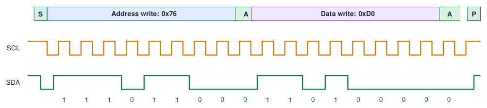{ .lecture-figure loading=lazy }

- The decoder groups the bits into **start, address, R/W, ACK, data**.

- Compare with what your code **should** send: `beginTransmission(0x76); write(0xD0);`

!!! tip "Typical findings"
    
    NACK after the address = wrong address or device not powered. No clock at all = wrong pins in `Wire.begin()`.


*Sources: Simplified drawing*

## Quiz: SPI and the logic analyzer

1.  Why does SPI need no addresses?

    <details class="lecture-answer"><summary>Check your answer</summary><p>Each slave has its own chip-select line: only the selected one listens.</p></details>

2.  How many signal wires for 3 SPI devices?

    <details class="lecture-answer"><summary>Check your answer</summary><p>SCK, MOSI, MISO + 3 CS = 6.</p></details>

3.  What does `SPI.transfer(0x00)` do?

    <details class="lecture-answer"><summary>Check your answer</summary><p>It sends a dummy byte to generate 8 clocks and returns the byte received from the slave.</p></details>

4.  You capture I<sup>2</sup>C at 100 kHz with 200 kHz sample rate. Problem?

    <details class="lecture-answer"><summary>Check your answer</summary><p>Too few samples per bit: edges are missed. Use <span class="arithmatex">\(\geq\)</span> 1 MHz.</p></details>

5.  What must you always connect first on a logic analyzer?

    <details class="lecture-answer"><summary>Check your answer</summary><p>GND.</p></details>

## Exercises: SPI and logic analyzer

!!! example "Exercise 1 – Measure your own signals"
    
    Capture the Blink example and measure the period. Then capture `ledcWrite()` PWM at different duty cycles and verify the duty with the analyzer.


!!! example "Exercise 2 – Decode I<sup>2</sup>C"
    
    Capture the BME280 chip-ID read. Identify every part: start, `0xEC`, ACK, `0xD0`, repeated start, `0xED`, `0x60`, NACK, stop.


!!! example "Exercise 3 – UART on the wire"
    
    Send the letter `'A'` on Serial2 at 115200 baud. Capture it, measure one bit time and decode the byte by hand.


## Further material: SPI and logic analyzer

### Read

- [Basics of SPI (Circuit Basics)](https://www.circuitbasics.com/basics-of-the-spi-communication-protocol/)

- [SPI (SparkFun)](https://learn.sparkfun.com/tutorials/serial-peripheral-interface-spi)

- [Arduino-ESP32 SPI API](https://docs.espressif.com/projects/arduino-esp32/en/latest/api/spi.html)

### Watch

- [YouTube: SPI explained](https://www.youtube.com/results?search_query=spi+protocol+explained)

- [YouTube: PulseView logic analyzer](https://www.youtube.com/results?search_query=pulseview+logic+analyzer+tutorial)

### Try it

- [PulseView (sigrok)](https://sigrok.org/wiki/PulseView)

- [Logic analyzer LOGIC8 (Okaphone)](https://www.okaphone.com/artikel.xhtml?id=496446)

## Complete project sketches

- [Blink Capture](examples/projects/logic-analyzer/blink-capture/blink-capture.ino){ download }
- [I2C Capture](examples/projects/logic-analyzer/i2c-capture/i2c-capture.ino){ download }
- [Uart Capture](examples/projects/logic-analyzer/uart-capture/uart-capture.ino){ download }
