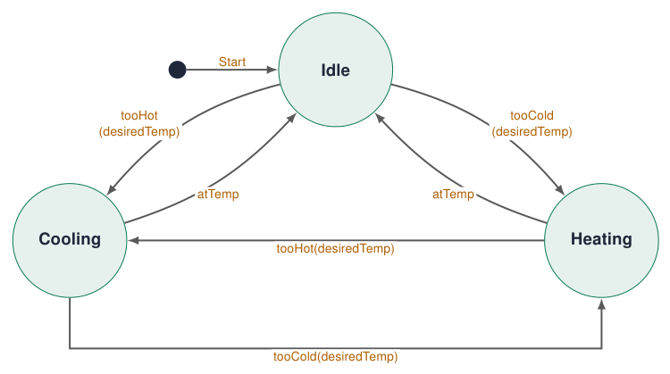
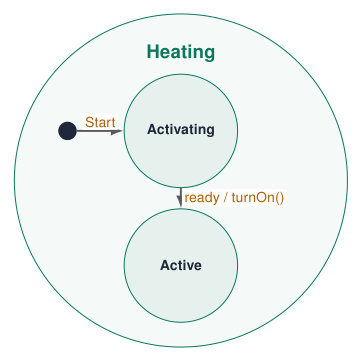
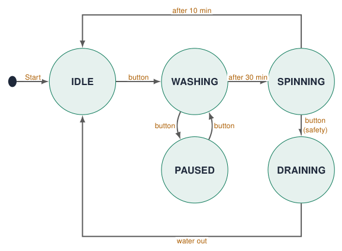
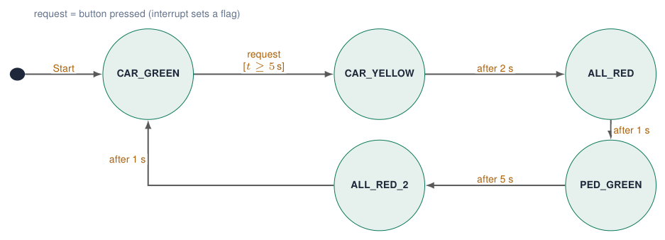
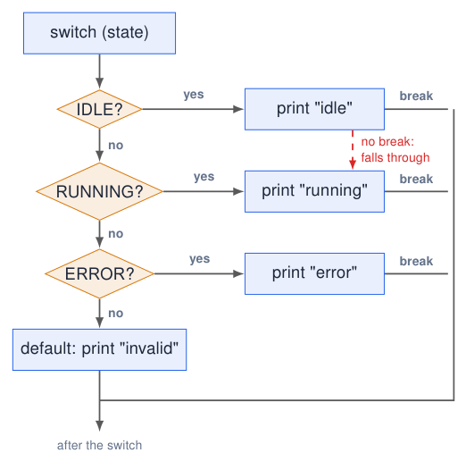
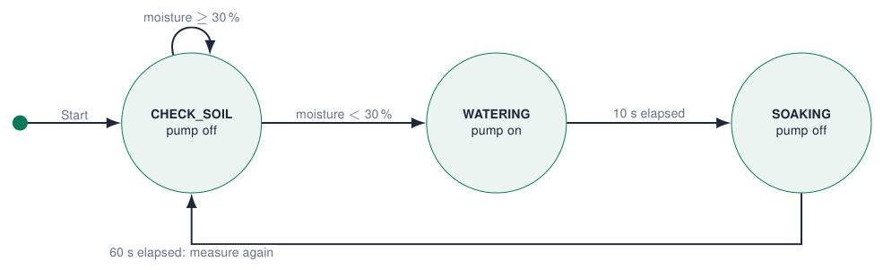
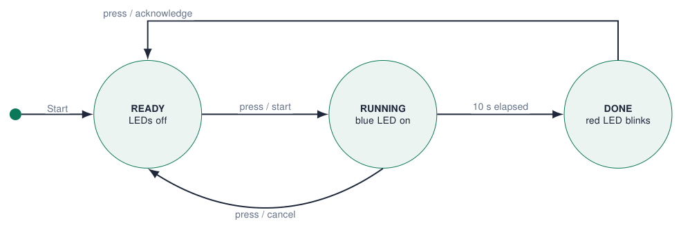

# State Machines

## Why state machines?

[Try simulation: State machines](https://costawess.github.io/Programming-Dashboard/web/simulations/course_topics_lab.html?topic=state_machines){ .md-button .lecture-simulation }

[Try simulation: Coffee machine, step by step](https://costawess.github.io/Programming-Dashboard/web/simulations/coffee_machine.html){ .md-button .lecture-simulation }

- Real systems have **modes**: a washing machine is idle, washing, paused, spinning …

- In each mode the **same input** means something **different**: the start button starts, pauses or resumes.

- A **state machine** explicitly models the mutually exclusive modes of a system and the **events** that cause **transitions** between them.

!!! info "Benefits"
    
    - easier to **read**
    
    - easier to **debug** (print the state!)
    
    - easier to **expand** (add a state)
    
    - more **reliable**: impossible combinations cannot happen


!!! warning "Without"
    
    Complex programs become a long list of `if`s and flags that nobody understands any more.


*Sources: [Embedded Programming, lectures 1–6](references.md#ep-lectures)*

## Flags gone wrong

```cpp title="flags.ino"
bool carGreen;
bool carRed;
bool pedestrianGreen;
bool pedestrianRed;
```

[Download this example](examples/state-machines/flags.ino){ download }

4 booleans $\Rightarrow$ $2^4 = 16$ combinations. Only a few are valid. What does this mean?

```cpp title="invalid.ino"
carGreen        = true;
carRed          = true;    // both?!
pedestrianGreen = true;    // danger!
pedestrianRed   = false;
```

[Download this example](examples/state-machines/invalid.ino){ download }

- Nothing in the code **prevents** an impossible or dangerous combination.

- Every new feature adds flags and `if`s that must be kept consistent by hand.

**Better: one variable for the state**

```cpp title="one_state.ino"
enum State { NORMAL, ORANGE, PED_GREEN, ALL_RED };
State state = NORMAL;
```

[Download this example](examples/state-machines/one_state.ino){ download }

The system is always in **exactly one** state.

*Sources: Example from lecture 6 [Embedded Programming, lectures 1–6](references.md#ep-lectures)*

## State diagrams: the design

[Try simulation: Coffee machine, step by step](https://costawess.github.io/Programming-Dashboard/web/simulations/coffee_machine.html){ .md-button .lecture-simulation }

{ .lecture-figure loading=lazy }

*Sources: Redrawn with circular states from the temperature-control example [Mastering State Diagrams in UML: A Comprehensive Guide](references.md#vp-state-diagrams), via lecture 5*

## Read a state diagram: states, events and guards

- **States**: circles, named after what the system **is** or **does**.

- **Transitions**: arrows labelled with the **event** (and optional condition / action):  
  `event [guard] / action`

- **Start**: black dot and an arrow to the initial state. It marks where execution begins; it is not a normal event.

- Specific **behaviour per state**: what is on, what is checked.

!!! tip "The hardest part"
    
    Converting the user story into states. Underline the verbs (“waits”, “heats”, “alarms”) and the events (“button”, “after 5 s”, “too hot”).


*Sources: Notation from the temperature-control example [Mastering State Diagrams in UML: A Comprehensive Guide](references.md#vp-state-diagrams), via lecture 5*

## Diagram notation: actions, nested states and finishing

{ .lecture-figure loading=lazy }

- `tooCold(desiredTemp)`: event with a parameter.

- `ready / turnOn()`: the event triggers an action on the transition.

- Heating can contain **nested states**. Its own Start arrow selects Activating when Heating is entered.

!!! info "An optional final state"
    
    A dot inside a circle marks the end of a process. Controllers that keep running may have no final state.


*Sources: Notation from the original temperature-control diagram [Mastering State Diagrams in UML: A Comprehensive Guide](references.md#vp-state-diagrams), via lecture 5; redrawn*

## Example: a washing machine

[Try simulation: State machines](https://costawess.github.io/Programming-Dashboard/web/simulations/course_topics_lab.html?topic=state_machines){ .md-button .lecture-simulation }

{ .lecture-figure loading=lazy }

| **State + event** | **$\rightarrow$ new state** |
|:------------------|:----------------------------|
| IDLE + button     | WASHING                     |
| WASHING + button  | PAUSED                      |
| PAUSED + button   | WASHING                     |
| SPINNING + button | DRAINING                    |
| DRAINING + button | (ignore)                    |

**current state + event $\rightarrow$ transition / action**: the same button has 4 meanings.

*Sources: Example from lecture 6 [Embedded Programming, lectures 1–6](references.md#ep-lectures)*

## A different event: the washing-machine stop request

The previous example uses a start/pause button. The original lecture also asks what a **stop request** should do in different states:

| **Current state** | **Event**    | **Action / next state**       |
|:------------------|:-------------|:------------------------------|
| IDLE              | stop request | do nothing; remain IDLE       |
| WASHING           | stop request | pause; go to PAUSED           |
| SPINNING          | stop request | stop spinning; go to DRAINING |

!!! info "State + event determines the response"
    
    Decide which events the system has before writing the switch cases. A start request in IDLE and a stop request in IDLE need different actions.


*Sources: Lecture 6, slide 6 [Embedded Programming, lectures 1–6](references.md#ep-lectures)*

## Example: a pedestrian crossing

[Try simulation: Traffic lights](https://costawess.github.io/Programming-Dashboard/web/experiments/traffic_lights.html){ .md-button .lecture-simulation }

[Try simulation: Intersection controller](https://costawess.github.io/Programming-Dashboard/web/experiments/intersection_controller.html){ .md-button .lecture-simulation }

{ .lecture-figure loading=lazy }

!!! info "Read it"
    
    Cars stay green until a pedestrian presses the button **and** the green phase lasted at least 5 s (guard).


!!! tip "Safety by design"
    
    Pedestrians are green only in PED_GREEN (cars red). In CAR_GREEN/YELLOW they stay red. Both ALL_RED states keep everyone red, preventing conflicting greens.


*Sources: Car vs pedestrian example, lecture 5 [Embedded Programming, lectures 1–6](references.md#ep-lectures)*

## enum: names for numbers

```cpp title="enum.ino"
// magic numbers: what is state 2?
int state = 0;
if (state == 2) { /* ... */ }

// enum: a type with named values
enum State {
  IDLE,       // 0
  RUNNING,    // 1
  ERROR       // 2
};

State currentState = IDLE;
if (currentState == ERROR) { /* ... */ }

Serial.println(currentState);   // prints 0
```

[Download this example](examples/state-machines/enum.ino){ download }

- An **enumeration** is a data type that gives **names to integer values**.

- The compiler numbers them 0, 1, 2, … automatically.

- `if (state == ERROR)` explains itself; `if (state == 2)` does not.

- Adding a state = adding a name to the list.

!!! tip "Printing names"
    
    Serial prints the number. For readable logs write a small function `const char* stateName(State s)` with a `switch`.


*Sources: Examples from lecture 6 [Embedded Programming, lectures 1–6](references.md#ep-lectures)*

## switch / case

[Try simulation: State machines](https://costawess.github.io/Programming-Dashboard/web/simulations/course_topics_lab.html?topic=state_machines){ .md-button .lecture-simulation }

```cpp title="switch.ino"
switch (currentState) {
  case IDLE:
    Serial.println("System idle");
    break;
  case RUNNING:
    Serial.println("System running");
    break;
  case ERROR:
    Serial.println("System error");
    break;
  default:
    Serial.println("INVALID STATE");
    break;
}
```

[Download this example](examples/state-machines/switch.ino){ download }

- Runs the block that matches the **value** of one variable.

- `switch`: “handle every possible value of this variable”.  
  `if`: “check whether this particular condition is true”.

- `break` ends the case. Without it, execution **falls through** into the next case!

- `default`: all other values.

!!! warning "Only integers and enums"
    
    `switch` works with `int`, `char` and `enum`, not with `String` or `float`.


*Sources: Examples from lecture 6 [Embedded Programming, lectures 1–6](references.md#ep-lectures)*

## Flowchart: switch / case

[Try simulation: State machines](https://costawess.github.io/Programming-Dashboard/web/simulations/course_topics_lab.html?topic=state_machines){ .md-button .lecture-simulation }

[Try simulation: Arduino to flowchart](https://costawess.github.io/Programming-Dashboard/web/simulations/arduino_flowchart_converter.html){ .md-button .lecture-simulation }

{ .lecture-figure loading=lazy }

- A `switch` is a **chain of comparisons** with one variable: `state == IDLE?`, `== RUNNING?` …

- `break` jumps to **after the switch**.

- Forgotten `break`: the next case runs too (red dashed arrow).

- `default`: when no case matched.

## default: expect the unexpected

```cpp title="default.ino"
enum State { NORMAL, ORANGE, PED_GREEN, ALL_RED };
State state = NORMAL;

void loop() {
  switch (state) {
    case NORMAL:    /* ... */ break;
    case ORANGE:    /* ... */ break;
    case PED_GREEN: /* ... */ break;
    case ALL_RED:   /* ... */ break;
    default:
      Serial.println("INVALID STATE");
      state = ALL_RED;      // go to a safe state
      break;
  }
}
```

[Download this example](examples/state-machines/default.ino){ download }

- Memory corruption, a bug or a cast like `state = (State) 99;` can create an impossible value.

- `default` **handles the unexpected value**: log it and go to a **safe** state.

- Safety-critical systems always define what happens when “this cannot happen” happens.

*Sources: Example from lecture 6 [Embedded Programming, lectures 1–6](references.md#ep-lectures)*

## Implementing the washing machine: events

```cpp title="washing_machine.ino"
enum State { IDLE, WASHING, PAUSED, SPINNING, DRAINING };
State state = IDLE;
const int KEY1 = 34;
bool lastKey = LOW;
void onButton() {                 // event: one button press
  switch (state) {
    case IDLE:     state = WASHING;  break;
    case WASHING:  state = PAUSED;   break;
    case PAUSED:   state = WASHING;  break;
    case SPINNING: state = DRAINING; break;   // safety stop
    default:       break;                     // DRAINING: ignore
  }
  Serial.printf("new state: %d\n", state);
}
void setup() { Serial.begin(115200); pinMode(KEY1, INPUT); }

void loop() {
  bool key = digitalRead(KEY1);
  if (key == HIGH && lastKey == LOW) onButton();   // rising edge
  lastKey = key;
  delay(20);                                       // simple debounce
}
```

[Download this example](examples/state-machines/washing_machine.ino){ download }

- The `switch` is the **transition table** of the diagram, written in C++.

- The event (button press) is detected in one place (edge detection) and handled in one function.

- Timed transitions (after 30 min) come next.

!!! tip "Print every transition"
    
    The Serial log shows exactly what the machine did: debugging becomes reading.


## Implementing the crossing: states with time (1/2)

```cpp title="crossing.ino (part 1)"
enum State { CAR_GREEN, CAR_YELLOW, ALL_RED, PED_GREEN, ALL_RED_2 };

// lights per state:          car red, orange, green, ped green
const bool LIGHTS[5][4] = { {0, 0, 1, 0},     // CAR_GREEN
                            {0, 1, 0, 0},     // CAR_YELLOW
                            {1, 0, 0, 0},     // ALL_RED
                            {1, 0, 0, 1},     // PED_GREEN
                            {1, 0, 0, 0} };   // ALL_RED_2
const int PINS[4] = {21, 4, 22, 23};          // red, orange, green, blue
const int KEY1 = 34;

State state = CAR_GREEN;
unsigned long stateStart = 0;           // when we entered the state
volatile bool requested = false;        // set by the ISR

void IRAM_ATTR onKey1() { requested = true; }

void enterState(State s) {              // the ONLY place where
  state = s;                            // the state changes
  stateStart = millis();
  for (int i = 0; i < 4; i++) digitalWrite(PINS[i], LIGHTS[s][i]);
  Serial.printf("-> state %d\n", s);
}
```

[Download this example](examples/state-machines/crossing.ino-part-1.txt){ download }

- `LIGHTS`: a **2-D array**, one row per state. The outputs of every state are **data**, easy to check against the diagram.

- `stateStart` remembers **when** the state began: timed transitions compare `millis() - stateStart`.

- `enterState()`: **one** place where the state changes, so lights, timing and logging are never forgotten.

- The button only sets a **flag** in the ISR. Blue LED = pedestrian green.

## Implementing the crossing: states with time (2/2)

[Try simulation: Intersection controller](https://costawess.github.io/Programming-Dashboard/web/experiments/intersection_controller.html){ .md-button .lecture-simulation }

```cpp title="crossing.ino (part 2)"
void setup() {
  Serial.begin(115200);
  for (int i = 0; i < 4; i++) pinMode(PINS[i], OUTPUT);
  pinMode(KEY1, INPUT);
  attachInterrupt(digitalPinToInterrupt(KEY1), onKey1, RISING);
  enterState(CAR_GREEN);
}

void loop() {
  unsigned long t = millis() - stateStart;    // time in state
  switch (state) {
    case CAR_GREEN:
      if (requested && t >= 5000) enterState(CAR_YELLOW);
      break;
    case CAR_YELLOW: if (t >= 2000) enterState(ALL_RED);   break;
    case ALL_RED:    if (t >= 1000) enterState(PED_GREEN); break;
    case PED_GREEN:
      if (t >= 5000) { requested = false; enterState(ALL_RED_2); }
      break;
    case ALL_RED_2:  if (t >= 1000) enterState(CAR_GREEN); break;
  }
}
```

[Download this example](examples/state-machines/crossing.ino-part-2.txt){ download }

- Each `case` = one state of the diagram: only its **transitions** (the lights were set on entry).

- No `delay()`: the loop runs freely, so the button and anything else stay responsive.

- Compare the code line by line with the diagram: they must match.

!!! info "Race condition avoided"
    
    The ISR only sets `requested`; all state changes happen in `loop()` via `enterState()`.


## Worked example: watering a plant, state diagram

A non-blocking version of the plant-pot story: water below 30 %, then allow time for absorption.

{ .lecture-figure loading=lazy }

!!! info "Run it on the course board"
    
    A potentiometer on AD1 simulates 0–100 % moisture; the blue LED represents the pump. A real pump needs a suitable driver, and a real moisture sensor needs calibration.


*Sources: Worked extension of the plant-pot story [Embedded Programming, lectures 1–6](references.md#ep-lectures)*

## Plant controller: states, entry action and setup

```cpp title="plant-watering.ino (1/2)"
// Course-board demo: a potentiometer on AD1 simulates soil moisture.
// The blue LED represents the pump; no pump is connected to a GPIO.
enum WaterState { CHECK_SOIL, WATERING, SOAKING };
WaterState state = CHECK_SOIL;
const int SENSOR = 36, PUMP_LED = 23;
unsigned long enteredAt = 0;

void enterState(WaterState next, unsigned long now) {
  state = next;
  enteredAt = now;
  Serial.printf("state=%d\n", (int)state);
}

void setup() {
  Serial.begin(115200);
  pinMode(PUMP_LED, OUTPUT);
  digitalWrite(PUMP_LED, LOW);
  analogReadResolution(12);
}
```

[Download this example](examples/state-machines/plant-watering.ino-1of2.txt){ download }

- Diagram circles become enum values.

- `enterState()` stores both the state and its entry time.

- Every transition goes through this function.

- Serial reports each transition once.

- Startup leaves the simulated pump off.

## Plant controller: translate each arrow into a condition

```cpp title="plant-watering.ino (2/2)"
void loop() {
  unsigned long now = millis();
  switch (state) {
    case CHECK_SOIL: {
      int moisture = map(analogRead(SENSOR), 0, 4095, 0, 100);
      if (moisture < 30) enterState(WATERING, now);
      break;
    }
    case WATERING:
      if (now - enteredAt >= 10000UL)
        enterState(SOAKING, now);
      break;
    case SOAKING:
      if (now - enteredAt >= 60000UL)
        enterState(CHECK_SOIL, now);
      break;
    default:
      enterState(CHECK_SOIL, now);
      break;
  }
  digitalWrite(PUMP_LED, state == WATERING ? HIGH : LOW);
}
```

[Download this example](examples/state-machines/plant-watering.ino-2of2.txt){ download }

- `CHECK_SOIL`: decide whether watering is needed.

- `WATERING`: leave after 10 s.

- `SOAKING`: leave after 60 s.

- Outputs follow the resulting state on every iteration.

- No waiting loop and no `delay()`.

!!! example "Check the diagram"
    
    Try 50 %, then 20 %. Restore 50 % while watering: does it still finish the 10 s phase and then wait 60 s?


## Worked example: kitchen timer, state diagram

KEY1 starts a 10-second countdown, cancels it while running, and acknowledges the alarm.

{ .lecture-figure loading=lazy }

!!! tip "Define priority and event behaviour"
    
    A debounced press is a one-time event. Holding KEY1 does not restart the timer. If cancel and timeout coincide in RUNNING, this example gives cancel priority.


## Kitchen timer: create one debounced press event

```cpp title="kitchen-timer.ino (1/3)"
// Course board: KEY1 starts/cancels/acknowledges a fixed 10-second timer.
enum TimerState { READY, RUNNING, DONE };
TimerState state = READY;
const int BUTTON = 34, BLUE_LED = 23, RED_LED = 21;
const unsigned long DURATION = 10000UL;
unsigned long enteredAt = 0;

bool pressEvent(unsigned long now) {
  static bool lastRaw = false, stable = false;
  static unsigned long changedAt = 0;
  bool raw = digitalRead(BUTTON) == HIGH;
  if (raw != lastRaw) {
    lastRaw = raw;
    changedAt = now;
  }
  if (now - changedAt < 30UL || raw == stable) return false;
  stable = raw;
  return stable;  // true only on a debounced LOW-to-HIGH edge
}
```

[Download this example](examples/state-machines/kitchen-timer.ino-1of3.txt){ download }

- KEY1 uses the course-board external pull-down: pressed is HIGH.

- Record when the raw reading changes.

- Accept the new value after it stays stable for 30 ms.

- Return true only when the accepted value changes to HIGH.

- The same event has a different action in each state.

## Kitchen timer: initialise the hardware and state timer

```cpp title="kitchen-timer.ino (2/3)"
void enterState(TimerState next, unsigned long now) {
  state = next;
  enteredAt = now;
  Serial.printf("state=%d\n", (int)state);
}

void setup() {
  Serial.begin(115200);
  pinMode(BUTTON, INPUT);  // course-board external pull-down
  pinMode(BLUE_LED, OUTPUT);
  pinMode(RED_LED, OUTPUT);
  digitalWrite(BLUE_LED, LOW);
  digitalWrite(RED_LED, LOW);
}
```

[Download this example](examples/state-machines/kitchen-timer.ino-2of3.txt){ download }

- Use one function for every state entry.

- Reset elapsed time on each transition.

- Configure GPIO34 as `INPUT`.

- Configure both LEDs as outputs and start with them off.

- The next section contains the complete repeated state update.

## Kitchen timer: transition logic and outputs

```cpp title="kitchen-timer.ino (3/3)"
void loop() {
  unsigned long now = millis();
  bool pressed = pressEvent(now);
  switch (state) {
    case READY:
      if (pressed) enterState(RUNNING, now);
      break;
    case RUNNING:
      if (pressed) enterState(READY, now);  // cancel has priority
      else if (now - enteredAt >= DURATION) enterState(DONE, now);
      break;
    case DONE:
      if (pressed) enterState(READY, now);
      break;
    default:
      enterState(READY, now);
      break;
  }
  digitalWrite(BLUE_LED, state == RUNNING ? HIGH : LOW);
  bool flash = ((now - enteredAt) / 250UL) % 2 == 0;
  digitalWrite(RED_LED, state == DONE && flash ? HIGH : LOW);
}
```

[Download this example](examples/state-machines/kitchen-timer.ino-3of3.txt){ download }

- Read time and the button once per iteration.

- Compare every transition with the diagram.

- Use elapsed time for the alarm’s blink phase too.

!!! example "Test it"
    
    Start, hold the button, cancel, restart, wait for DONE, then acknowledge. Predict each LED before running the sketch.


## Quiz: state machines

1.  What is the difference between a **state** and an **event**?

    <details class="lecture-answer"><summary>Check your answer</summary><p>A state lasts (the system <em>is</em> in it); an event happens at a moment and can cause a transition.</p></details>

2.  What happens if you forget `break` after `case IDLE:`?

    <details class="lecture-answer"><summary>Check your answer</summary><p>Execution falls through into the next case: IDLE also runs the code of RUNNING.</p></details>

3.  Why store `stateStart` when entering a state?

    <details class="lecture-answer"><summary>Check your answer</summary><p>To implement timed transitions without <code>delay()</code>: <code>millis() - stateStart</code>.</p></details>

4.  The crossing must also accept a request during PED_GREEN without extending it. Where do you change the code?

    <details class="lecture-answer"><summary>Check your answer</summary><p>Only reset <code>requested</code> when leaving PED_GREEN (already the case) and keep the 5 s guard in CAR_GREEN.</p></details>

5.  Which state should `default` switch to in a traffic light?

    <details class="lecture-answer"><summary>Check your answer</summary><p>A safe state: all red (or blinking orange).</p></details>

## Exercises: state machines

[Try simulation: Coffee machine experiment](https://costawess.github.io/Programming-Dashboard/web/experiments/coffee_machine.html){ .md-button .lecture-simulation }

[Try simulation: Dual elevator](https://costawess.github.io/Programming-Dashboard/web/experiments/dual_elevator.html){ .md-button .lecture-simulation }

!!! example "Exercise 1 – Washing machine, complete"
    
    Add the timed transitions (use seconds instead of minutes) and show each state with an LED pattern. Draw the diagram first.


!!! example "Exercise 2 – Crossing, extended"
    
    Add PED_BLINK (pedestrian green blinks for 3 s before ALL_RED_2) and a night mode on KEY2 (orange blinking).


!!! example "Exercise 3 – Coffee machine"
    
    Design the state diagram of a coffee machine (idle, choose, heat, brew, ready, error: no water). Compare with the dashboard simulation, then implement it.


!!! example "Exercise 4 – The plant pot, revisited"
    
    Rewrite the plant pot as a state machine: MEASURE, WATERING, SOAKING (wait 5 min), REPORT, without `delay()`.


## Further material: state machines

### Read

- [Mastering state diagrams in UML](https://guides.visual-paradigm.com/mastering-state-diagrams-in-uml-a-comprehensive-guide/)

- [Arduino reference: switch...case](https://docs.arduino.cc/language-reference/)

### Watch

- [YouTube: finite state machines](https://www.youtube.com/results?search_query=finite+state+machine+arduino)

- [YouTube: state diagram tutorial](https://www.youtube.com/results?search_query=uml+state+diagram+tutorial)

### Try it

- [State machines](https://costawess.github.io/Programming-Dashboard/web/simulations/course_topics_lab.html?topic=state_machines)

- [Coffee machine, step by step](https://costawess.github.io/Programming-Dashboard/web/simulations/coffee_machine.html)

- [Experiment: intersection controller](https://costawess.github.io/Programming-Dashboard/web/experiments/intersection_controller.html)

- [Experiment: dual elevator](https://costawess.github.io/Programming-Dashboard/web/experiments/dual_elevator.html)

## Complete project sketches

- [Kitchen Timer](examples/projects/state-machines/kitchen-timer/kitchen-timer.ino){ download }
- [Plant Watering](examples/projects/state-machines/plant-watering/plant-watering.ino){ download }
