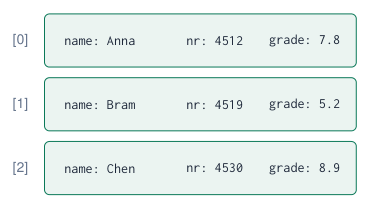
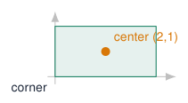

# Structs: Grouping Data

## Why structs?

**Without a struct: parallel arrays**  
String names\[\]   = {"Anna", "Bram", "Chen"};  
int    numbers\[\] = {4512, 4519, 4530};  
float  grades\[\]  = {7.8, 5.2, 8.9};  

- The data of **one** student is spread over three arrays.

- Sort or delete one array and forget another: the data no longer matches.

**With a struct: one record per student**  

{ .lecture-figure loading=lazy }

!!! info "Array vs struct"
    
    An **array** groups values of the **same** type. A **struct** groups values of **different** types that belong together: one **record**.


*Sources: [Introduction to structs, members, and member selection](references.md#learncpp-structs)*

## Declaring and using a struct

```cpp title="student.ino"
struct Student {          // a new type
  String name;            // members
  int    number;
  float  grade;
};                        // <- semicolon!
void setup() {
  Serial.begin(115200);
  Student a = {"Anna", 4512, 7.8};  // in order
  Student b;
  b.name   = "Bram";                // dot operator
  b.number = 4519;
  b.grade  = 5.2;
  b.grade += 0.5;                   // members are variables
  Student copy = a;                 // copies all members
  Serial.printf("%s (%d): %.1f\n",
                a.name.c_str(), a.number, a.grade);
}
void loop() {}
```

[Download this example](examples/structs/student.ino){ download }

- `struct Student { \dots{} };` defines a **new type**; it does not create a variable yet.

- `Student a;` creates a variable of that type.

- Access a member with the **dot**: `a.grade`.

- `= {\dots}` fills the members **in declaration order**.

- `=` between two structs copies **all** members.

!!! warning "Classic error"
    
    Forgetting the `;` after the closing `}` gives a confusing error on the **next** line.


*Sources: [Introduction to structs, members, and member selection](references.md#learncpp-structs)*

## Example: an array of students

```cpp title="student_list.ino"
struct Student { String name; int number; float grade; };
Student group[] = {
  {"Anna", 4512, 7.8}, {"Bram", 4519, 5.2},
  {"Chen", 4530, 8.9}, {"Dewi", 4544, 6.1} };
const int N = sizeof(group) / sizeof(group[0]);
float averageGrade(const Student g[], int n) {
  float sum = 0;
  for (int i = 0; i < n; i++) sum += g[i].grade;
  return sum / n;
}
int bestIndex(const Student g[], int n) {
  int best = 0;
  for (int i = 1; i < n; i++) if (g[i].grade > g[best].grade) best = i;
  return best;
}
void setup() {
  Serial.begin(115200);
  for (int i = 0; i < N; i++)
    Serial.printf("%-5s %.1f\n", group[i].name.c_str(), group[i].grade);
  Serial.printf("average %.2f, best: %s\n", averageGrade(group, N),
                group[bestIndex(group, N)].name.c_str());
}
void loop() {}
```

[Download this example](examples/structs/student_list.ino){ download }

- `group[i].grade`: first select the **element**, then the **member**.

- One array of structs replaces three parallel arrays: the data of a student always stays together.

- Functions take the whole array of records.

## Structs as parameters and return values

```cpp title="geometry_structs.ino"
struct Point {
  float x, y;
};
struct Rectangle {
  Point corner;                 // a struct inside a struct
  float width, height;
};
float area(const Rectangle &r) {        // const reference: no copy
  return r.width * r.height;
}
Point center(const Rectangle &r) {      // returns a struct
  return { r.corner.x + r.width / 2, r.corner.y + r.height / 2 };
}
float distance(Point a, Point b) {      // by value: small struct
  return sqrt(sq(a.x - b.x) + sq(a.y - b.y));
}
void setup() {
  Serial.begin(115200);
  Rectangle box = { {0, 0}, 4, 2 };      // corner (0,0), 4 x 2
  Point c = center(box);                 // (2, 1)
  Serial.printf("area %.1f, center (%.1f, %.1f)\n", area(box), c.x, c.y);
  Serial.printf("distance to origin %.2f\n", distance(c, {0, 0}));
}
void loop() {}
```

[Download this example](examples/structs/geometry_structs.ino){ download }

- A struct can be a **parameter** and a **return value**: an easy way to return several values at once.

- Structs can contain other structs: `box.corner.x`.

- Large structs: pass as `const Type &`: no copy, and the function cannot change it.

- `sq(x)` is the Arduino function for $x^2$.

{ .lecture-figure loading=lazy }

*Sources: [Passing and returning structs](references.md#learncpp-structs-passing)*

## Embedded example: a struct per LED

```cpp title="led_structs.ino"
struct Led {
  int pin;
  unsigned long interval;      // ms
  unsigned long last = 0;      // default values
  bool on = false;
};
Led leds[] = {                 // pin, interval
  {23, 250}, {22, 500}, {21, 1000}, {4, 2000},
};
const int N = sizeof(leds) / sizeof(leds[0]);
void update(Led &led) {        // reference: changes the LED
  if (millis() - led.last >= led.interval) {
    led.last = millis();
    led.on = !led.on;
    digitalWrite(led.pin, led.on);
  }
}
void setup() {
  for (int i = 0; i < N; i++) pinMode(leds[i].pin, OUTPUT);
}
void loop() {
  for (int i = 0; i < N; i++) update(leds[i]);
}
```

[Download this example](examples/structs/led_structs.ino){ download }

- Every LED keeps **its own** pin, speed, time stamp and state.

- Four LEDs, four speeds, **no** `delay()`, and one small function.

- A fifth LED: add one line to the array.

- Members can have **default values** (`last = 0`).

!!! info "Compare"
    
    The *Several independent timers* example needed separate variables for every LED. A struct makes the pattern scale.


## Embedded example: one measurement, one struct

```cpp title="measurement.ino"
#include <Wire.h>
#include <Adafruit_BME280.h>
Adafruit_BME280 bme;
struct Measurement {
  float temperature;     // C
  float humidity;        // %
  float pressure;        // hPa
  unsigned long time;    // ms since start
};
Measurement measure() {                 // returns all values at once
  Measurement m;
  m.temperature = bme.readTemperature();
  m.humidity    = bme.readHumidity();
  m.pressure    = bme.readPressure() / 100.0F;
  m.time        = millis();
  return m;
}
void print(const Measurement &m) {
  Serial.printf("t=%lus  T=%.1f C  RH=%.0f %%  p=%.1f hPa\n",
                m.time / 1000, m.temperature, m.humidity, m.pressure);
}
void setup() { Serial.begin(115200); Wire.begin(19, 18); bme.begin(0x76); }
void loop()  { print(measure()); delay(2000); }
```

[Download this example](examples/structs/measurement.ino){ download }

- One function **measures**, one function **prints**: the struct carries the data between them.

- Storing history? `Measurement log[60];` keeps the last 60 measurements.

!!! tip "Three ways to return several values"
    
    Reference parameters, a struct as return value, or a class. Choose what is clearest.


## struct, enum and class

```cpp title="state_record.ino"
enum State { IDLE, HEATING, ALARM };

struct Machine {              // state + data together
  State state = IDLE;
  unsigned long since = 0;    // when the state began
  float setpoint = 21.0;
};

Machine heater;

void enter(Machine &m, State s) {
  m.state = s;
  m.since = millis();
}
```

[Download this example](examples/structs/state_record.ino){ download }

<div class="tabular">

@l L4.2cm@ `enum` & a list of **names** for values (states, modes)  
`struct` & a group of **data**; members public by default  
`class` & data **+ behaviour**; members private by default  

</div>

- In C++, `struct` and `class` are almost the same; convention: `struct` for plain data records, `class` for objects with methods (like `Blinker`).

- Combined with `enum`, a struct keeps the state of a state machine and its data together.

*Sources: [Class declaration](references.md#cppreference-class)*

## Quiz: structs

1.  What is the difference between an array and a struct?

    <details class="lecture-answer"><summary>Check your answer</summary><p>Array: many values of the same type, by index. Struct: values of different types, by name.</p></details>

2.  Given `Student group[10];`, how do you read the grade of the third student?

    <details class="lecture-answer"><summary>Check your answer</summary><p><code>group[2].grade</code></p></details>

3.  What does `Student b = a;` do?

    <details class="lecture-answer"><summary>Check your answer</summary><p>It copies every member of <code>a</code> into the new struct <code>b</code>.</p></details>

4.  Why write `void print(const Measurement &m)` instead of `void print(Measurement m)`?

    <details class="lecture-answer"><summary>Check your answer</summary><p>No copy of the whole struct, and <code>const</code> guarantees the function does not change it.</p></details>

5.  The compiler complains on the line **after** your struct. Most likely cause?

    <details class="lecture-answer"><summary>Check your answer</summary><p>The missing <code>;</code> after the closing <code>}</code> of the struct.</p></details>

## Exercises: structs

!!! example "Exercise 1 – Class list"
    
    Make an array of 8 `Student` structs. Print the list sorted by grade (bubble sort: swap whole structs), the average and the number of passes.


!!! example "Exercise 2 – Geometry"
    
    Add `struct Circle { Point center; float r; }` and write `area()`, `contains(Circle c, Point p)` and `overlap(Circle a, Circle b)`.


!!! example "Exercise 3 – Button records"
    
    Make `struct Button { int pin; bool last; unsigned long lastChange; int presses; }` and use it to debounce and count both course-board keys with one function.


!!! example "Exercise 4 – Weather log"
    
    Keep the last 30 `Measurement`s in a circular buffer and print min, max and average temperature every minute.


## Further material: structs

### Read

- [Learn C++: introduction to structs](https://www.learncpp.com/cpp-tutorial/introduction-to-structs-members-and-member-selection/)

- [Learn C++: passing and returning structs](https://www.learncpp.com/cpp-tutorial/passing-and-returning-structs/)

- [cppreference: classes and structs](https://en.cppreference.com/w/cpp/language/class)

### Watch

- [YouTube: C++ structs explained](https://www.youtube.com/results?search_query=cpp+structs+explained)

### Try it

- [Memory layout (dashboard)](../dashboard.md?lab=simulations/memory_layout_lab.html)

- [Wokwi: ESP32 simulator](https://wokwi.com/projects/new/esp32)
