# Time and Interrupts

## delay() vs millis()

[Try simulation: Timers](https://costawess.github.io/Programming-Dashboard/web/simulations/course_topics_lab.html?topic=timers){ .md-button .lecture-simulation }

!!! warning "delay(ms)"
    
    - The program **stops** for that time: it is **blocking**.
    
    - During `delay(1000)` a button press is simply missed.
    
    - Fine for tiny examples, a problem in real systems.


!!! info "millis()"
    
    - Returns the number of **milliseconds since start-up** (`unsigned long`).
    
    - Like a clock on the wall: you **look** at it and continue working.
    
    - Wraps to 0 after $\approx$ 49.7 days (`micros()`: after 71 minutes).


{ .lecture-figure loading=lazy }

*Sources: [Embedded Programming, lectures 1–6](references.md#ep-lectures)*

## Non-blocking timing with millis()

[Try simulation: Timers](https://costawess.github.io/Programming-Dashboard/web/simulations/course_topics_lab.html?topic=timers){ .md-button .lecture-simulation }

```cpp title="nonblocking.ino"
const int LED_PIN = 2;
const unsigned long PERIOD_MS = 250;
unsigned long lastToggle = 0;
bool ledOn = false;

void setup() {
  pinMode(LED_PIN, OUTPUT);
  Serial.begin(115200);
}

void loop() {
  unsigned long now = millis();
  if (now - lastToggle >= PERIOD_MS) {  // overflow-safe
    lastToggle = now;
    ledOn = !ledOn;
    digitalWrite(LED_PIN, ledOn);
  }
  // loop stays free for other work: echo serial input
  if (Serial.available()) Serial.write(Serial.read());
}
```

[Download this example](examples/timing-interrupts/nonblocking.ino){ download }

!!! info "Why?"
    
    `delay()` freezes `loop()`: buttons, sensors and network are ignored meanwhile.


- Pattern: *“has enough time passed?”*

- `now - last >= period` works even when `millis()` wraps after $\approx$ 49 days.

- Several independent “timers” in one `loop()`.

## Flowchart: non-blocking timing with millis()

[Try simulation: Timers](https://costawess.github.io/Programming-Dashboard/web/simulations/course_topics_lab.html?topic=timers){ .md-button .lecture-simulation }

[Try simulation: Arduino to flowchart](https://costawess.github.io/Programming-Dashboard/web/simulations/arduino_flowchart_converter.html){ .md-button .lecture-simulation }

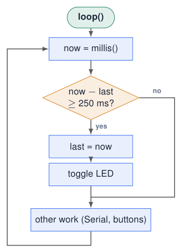{ .lecture-figure loading=lazy }

- There is **no waiting box**: if it is not time yet, the *no* exit simply continues.

- The whole loop takes microseconds and runs thousands of times per second.

- Several timers = several of these diamonds, each with its own `last` variable.

!!! warning "Compare with delay()"
    
    A `delay(250)` would be a box that blocks: during it, the other work never happens.


## Several independent timers

[Try simulation: Timers](https://costawess.github.io/Programming-Dashboard/web/simulations/course_topics_lab.html?topic=timers){ .md-button .lecture-simulation }

[Try simulation: Real-time challenge](https://costawess.github.io/Programming-Dashboard/web/experiments/real_time_challenge.html){ .md-button .lecture-simulation }

```cpp title="three_timers.ino"
const int LED_BLUE = 23, LED_RED = 21;
unsigned long lastBlue = 0, lastRed = 0, lastPrint = 0;
bool blueOn = false, redOn = false;
void setup() { Serial.begin(115200);
  pinMode(LED_BLUE, OUTPUT); pinMode(LED_RED, OUTPUT); }
void loop() {
  unsigned long now = millis();
  if (now - lastBlue >= 300) {          // every 300 ms
    lastBlue = now;
    blueOn = !blueOn;
    digitalWrite(LED_BLUE, blueOn);
  }
  if (now - lastRed >= 1000) {          // every 1 s
    lastRed = now;
    redOn = !redOn;
    digitalWrite(LED_RED, redOn);
  }
  if (now - lastPrint >= 2000) {        // every 2 s
    lastPrint = now;
    Serial.printf("uptime: %lu s\n", now / 1000);
  }
}
```

[Download this example](examples/timing-interrupts/three_timers.ino){ download }

- Each job has its **own** “last time” variable.

- The jobs do not wait for each other: impossible with `delay()`.

- `loop()` runs thousands of times per second and every round asks “is it time?”.

!!! tip "Pattern to memorise"
    
    `if (now - last >= interval) { last = now; \dots{} }`


*Sources: Lecture 2: function-specific timers [Embedded Programming, lectures 1–6](references.md#ep-lectures)*

## Polling vs interrupts

[Try simulation: Interrupts](https://costawess.github.io/Programming-Dashboard/web/simulations/interrupts.html){ .md-button .lecture-simulation }

**Polling: “has it happened yet?”**

- The program checks the input every round: `if (digitalRead(pin)) { \dots{} }`

- Simple, but if `loop()` is busy the event can be **missed** or handled **late**.

- Like checking the door every minute to see if someone is there.

**Interrupt: “handle this *now*!”**

- The **hardware** watches the pin and **interrupts** the CPU when it changes.

- The CPU pauses `loop()`, runs a short function (the ISR), and continues.

- Like a doorbell: you react only when it rings.

!!! info "Event-driven programming"
    
    Interrupts are used for fast or rare events: pulses from a sensor, a button that must never be missed, a timer tick, received data.


*Sources: [Embedded Programming, lectures 1–6](references.md#ep-lectures)*

## attachInterrupt(): connecting a pin to a function

[Try simulation: Interrupts](https://costawess.github.io/Programming-Dashboard/web/simulations/interrupts.html){ .md-button .lecture-simulation }

(digitalPinToInterrupt(pin), **isrName**, mode);  
(digitalPinToInterrupt(34), buttonISR, RISING);  

- “When pin 34 goes from LOW to HIGH, immediately run `buttonISR()`.”

- Notice: **no parentheses** after `buttonISR`! We pass the **address** of the function, we do not call it ourselves (`&buttonISR` means the same).

- Any GPIO of the ESP32 can trigger an interrupt.

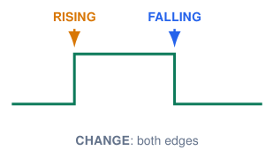{ .lecture-figure loading=lazy }

|                     |                        |
|:--------------------|:-----------------------|
| `RISING` | LOW $\rightarrow$ HIGH |
| `FALLING` | HIGH $\rightarrow$ LOW |
| `CHANGE` | any edge               |

*Sources: [Embedded Programming, lectures 1–6](references.md#ep-lectures)*

## Two button circuits: the same press, opposite edges

**Pull-down: active HIGH**

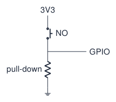{ .lecture-figure loading=lazy }

- Released: resistor holds the input `LOW`.

- Pressed: contact connects it to 3.3 V, so `HIGH`.

- Press = `RISING`; release = `FALLING`.

**Pull-up: active LOW**

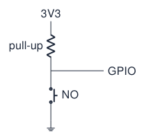{ .lecture-figure loading=lazy }

- Released: resistor holds the input `HIGH`.

- Pressed: contact connects it to GND, so `LOW`.

- Press = `FALLING`; release = `RISING`.

!!! info "NO = normally open"
    
    These contacts are open when the button is released. The course board uses the left-hand arrangement: KEY1/KEY2 are active HIGH.


*Sources: Course-board schematic; GPIO API [Embedded Programming, lectures 1–6](references.md#ep-lectures); [Arduino ESP32 Core Documentation](references.md#arduino-esp32-docs)*

## Choose the mode from contact type and wiring

**Normal** means the button is released: NO = open, NC = closed.

<div class="tabular">

@l L3.5cm c c l l@ **Contact** & **Circuit** & **Released** & **Pressed** & **Press** & **Release**  
NO & pull-down; contact to 3V3 & LOW & HIGH & `RISING` & `FALLING`  
NO & pull-up; contact to GND & HIGH & LOW & `FALLING` & `RISING`  
NC & pull-down; contact to 3V3 & HIGH & LOW & `FALLING` & `RISING`  
NC & pull-up; contact to GND & LOW & HIGH & `RISING` & `FALLING`  

</div>

!!! tip "Choose in this order"
    
    Identify the contact and resistor, determine the released and pressed levels, then select the edge for the event you want. A press does not always mean `FALLING`.


!!! info "Momentary versus latching"
    
    A momentary push button returns when released. A latching switch holds its new position; interrupt edges still follow the resulting GPIO voltage changes.


## Read the waveform: press, release or both?

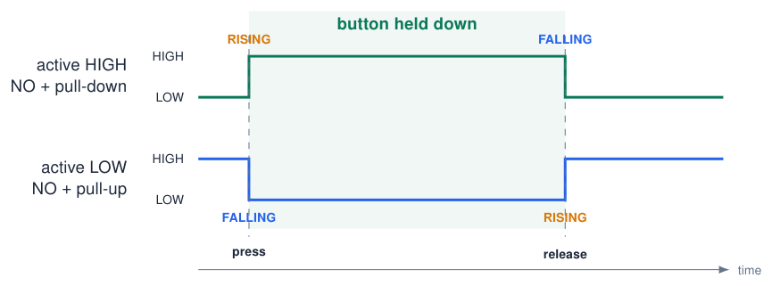{ .lecture-figure loading=lazy }

!!! warning "CHANGE detects both edges"
    
    An ideal press-and-release cycle produces two events with `CHANGE`. Holding the button produces no further edges. Contact bounce can produce extra events in any edge mode: choosing `RISING` or `FALLING` is not debounce.


## Configure the input and the interrupt separately

**Course board: KEY1 (GPIO34)**

```cpp title="course_button_setup.ino"
// Configuration fragment: NO button to 3V3,
// external pull-down already on the board.
void setup() {
  pinMode(34, INPUT);
  attachInterrupt(digitalPinToInterrupt(34),
                  onPress, RISING);
}
```

[Download this example](examples/timing-interrupts/course_button_setup.ino){ download }

- External pull-down: use `INPUT`. GPIO34/35 have no internal pull resistors.

- To handle release instead, choose `FALLING`.

**Breadboard: GPIO25 to GND**

```cpp title="pullup_button_setup.ino"
// Alternative configuration fragment:
// use an internal pull-up on GPIO25.
void setup() {
  pinMode(25, INPUT_PULLUP);
  attachInterrupt(digitalPinToInterrupt(25),
                  onPress, FALLING);
}
```

[Download this example](examples/timing-interrupts/pullup_button_setup.ino){ download }

- `INPUT_PULLUP`: released HIGH; pressing connects the input to GND.

- To handle release instead, choose `RISING`.

!!! info "Two different choices"
    
    An external pull-up/down already supplies the bias: use `INPUT`. `INPUT_PULLUP` and `INPUT_PULLDOWN` enable internal resistors; `attachInterrupt()` selects the edge. These alternative setup fragments assume a short ISR named `onPress`. Pass its name without parentheses; handle the signalled work in `loop()`.


*Sources: GPIO and interrupt configuration [Arduino ESP32 Core Documentation](references.md#arduino-esp32-docs); [ESP-IDF Programming Guide: GPIO & RTC GPIO (ESP32)](references.md#esp-idf-gpio)*

## What happens when an interrupt fires

[Try simulation: Interrupts](https://costawess.github.io/Programming-Dashboard/web/simulations/interrupts.html){ .md-button .lecture-simulation }

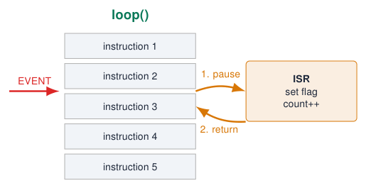{ .lecture-figure loading=lazy }

1.  The event happens (edge on the pin).

2.  The CPU finishes the current instruction and **stops** `loop()`.

3.  It saves where it was and runs the **ISR** (Interrupt Service Routine).

4.  It **returns** to exactly the next instruction of `loop()`.

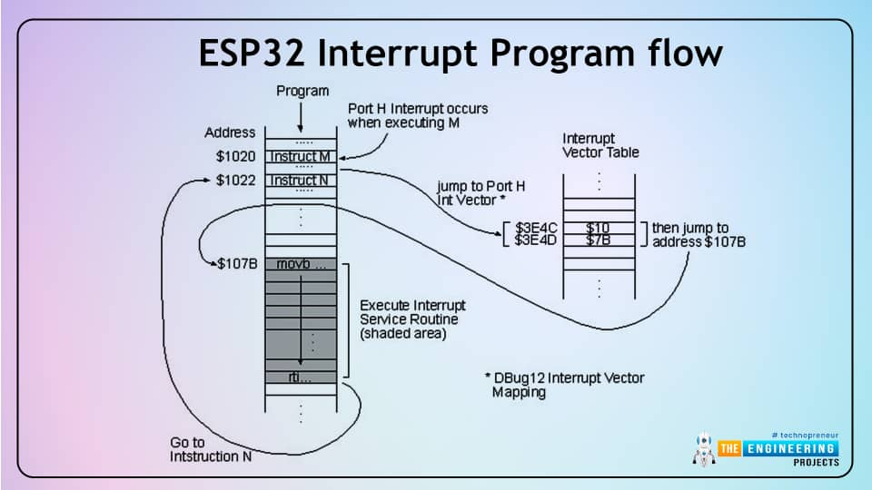{ .lecture-figure loading=lazy }

*Sources: Figure: The Engineering Projects [ESP32 Interrupts](references.md#tep-interrupts), via lecture 3*

## Writing a good ISR: volatile and IRAM_ATTR

volatile bool buttonPressed = false;  
void IRAM_ATTR buttonISR() {  
buttonPressed = true;  
}  
**volatile**

- Tells the compiler: this variable can change **unexpectedly** (in the ISR).

- Without it, the compiler may keep a copy in a register and `loop()` never sees the change.

- Not the same as “volatile memory” (RAM)!

**IRAM_ATTR**

- Puts the ISR in **internal RAM** instead of flash: it can run immediately, even while flash is busy.

- IRAM is small: only ISRs, not everything.

!!! warning "Keep ISRs short!"
    
    - Other code (and other interrupts) is waiting.
    
    - Timing of the rest may go wrong.
    
    - Long ISRs can **crash** the board (watchdog).
    
    - No `Serial.print()`, no `delay()`: set a flag, do the work in `loop()`.


*Sources: [Embedded Programming, lectures 1–6](references.md#ep-lectures); [ESP-IDF Programming Guide: GPIO & RTC GPIO (ESP32)](references.md#esp-idf-gpio)*

## Example: a button interrupt on the course board

[Try simulation: Interrupts](https://costawess.github.io/Programming-Dashboard/web/simulations/interrupts.html){ .md-button .lecture-simulation }

```cpp title="button_interrupt.ino"
const int KEY1 = 34;               // active HIGH
const int LED_GREEN = 22;
volatile bool pressedFlag = false;
volatile uint32_t pressCount = 0;
void IRAM_ATTR onKey1() {
  pressedFlag = true;              // short!
  pressCount++;
}
void setup() {
  Serial.begin(115200);
  pinMode(KEY1, INPUT);
  pinMode(LED_GREEN, OUTPUT);
  attachInterrupt(digitalPinToInterrupt(KEY1), onKey1, RISING);
}
void loop() {
  if (pressedFlag) {               // handle the event here
    pressedFlag = false;
    digitalWrite(LED_GREEN, !digitalRead(LED_GREEN));
    Serial.printf("presses: %lu\n", (unsigned long) pressCount);
  }
  delay(2000);   // ISR still counts rising edges while loop waits
}
```

[Download this example](examples/timing-interrupts/button_interrupt.ino){ download }

- `RISING`: the course-board buttons are active HIGH.

- The ISR only sets a flag and counts.

- `loop()` does the slow work (Serial, LED).

- The counter records **rising edges**, including bounce, during `delay(2000)`.

!!! tip "Experiment"
    
    Press several times during the delay: compare the edge count with the number of LED toggles. The Boolean flag merges events; debounce is still needed.


## Flowchart: main loop and interrupt

[Try simulation: Interrupts](https://costawess.github.io/Programming-Dashboard/web/simulations/interrupts.html){ .md-button .lecture-simulation }

[Try simulation: Arduino to flowchart](https://costawess.github.io/Programming-Dashboard/web/simulations/arduino_flowchart_converter.html){ .md-button .lecture-simulation }

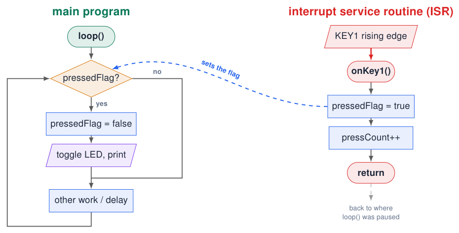{ .lecture-figure loading=lazy }

  
The ISR is a **separate, short** flowchart started by the hardware. It only sets a flag; the main program does the slow work.

## Bouncing: one press, many edges

[Try simulation: Button debouncing](https://costawess.github.io/Programming-Dashboard/web/simulations/debouncing_lab.html){ .md-button .lecture-simulation }

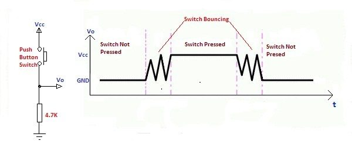{ .lecture-figure loading=lazy }

- Mechanical contacts **bounce** for 1–20 ms when pressed or released.

- An interrupt sees **every** bounce: one press can count as 3, 5, 10 presses.

- Hardware fix: RC filter (the course board has 220 pF; often 10 k$\Omega$ + 100 nF).

- Software fix: ignore new edges for a short time after an accepted one.

*Sources: Figure: electrosome.com, via lecture 3 [Embedded Programming, lectures 1–6](references.md#ep-lectures)*

## Debouncing in software

[Try simulation: Button debouncing](https://costawess.github.io/Programming-Dashboard/web/simulations/debouncing_lab.html){ .md-button .lecture-simulation }

**In the ISR (time stamp)**

```cpp title="debounce_isr.ino"
const unsigned long DEBOUNCE_MS = 50;
volatile unsigned long lastPressTime = 0;
volatile uint32_t presses = 0;
void IRAM_ATTR onKey1() {
  unsigned long now = millis();
  if (now - lastPressTime > DEBOUNCE_MS) {
    lastPressTime = now;
    presses++;          // valid press
  }
}
```

[Download this example](examples/timing-interrupts/debounce_isr.ino){ download }

**Polling (stable for 30 ms)**

```cpp title="debounce_poll.ino"
const int KEY1 = 34;
int stable = LOW, lastRead = LOW;
unsigned long lastChange = 0;
void loop() {
  int r = digitalRead(KEY1);
  if (r != lastRead) {             // moved
    lastChange = millis();
    lastRead = r;
  }
  if (millis() - lastChange > 30 && r != stable) {
    stable = r;                    // accepted
    if (stable == HIGH) Serial.println("press");
  }
}
```

[Download this example](examples/timing-interrupts/debounce_poll.ino){ download }

!!! info "Choose"
    
    ISR version: reacts instantly, ignores bounces after the first edge. Polling version: accepts a new state only after it has been stable for a while.


*Sources: [Embedded Programming, lectures 1–6](references.md#ep-lectures); [Arduino Language Reference](references.md#arduino-reference)*

## Flowchart: software debounce

[Try simulation: Button debouncing](https://costawess.github.io/Programming-Dashboard/web/simulations/debouncing_lab.html){ .md-button .lecture-simulation }

[Try simulation: Arduino to flowchart](https://costawess.github.io/Programming-Dashboard/web/simulations/arduino_flowchart_converter.html){ .md-button .lecture-simulation }

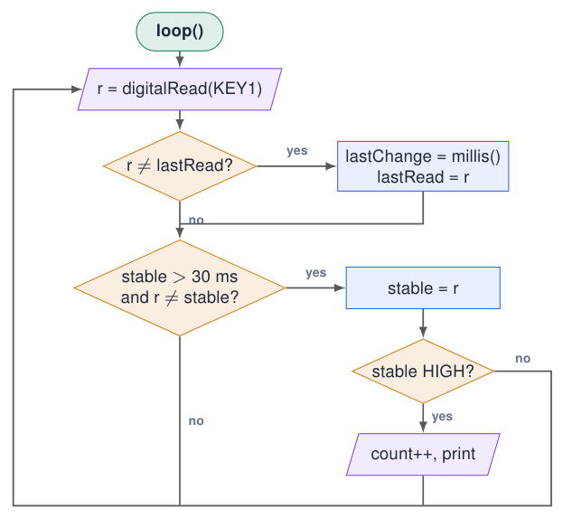{ .lecture-figure loading=lazy }

- First diamond: did the contact **move**? Then restart the stopwatch.

- Second diamond: has it been **stable** long enough **and** is it a new state?

- Only then count the press: the bounces never reach the third diamond.

## Hardware timers: interrupts from the clock

[Try simulation: Timers](https://costawess.github.io/Programming-Dashboard/web/simulations/course_topics_lab.html?topic=timers){ .md-button .lecture-simulation }

- A **timer** counts clock ticks, independent of `loop()`.

- When it reaches an alarm value, it fires an **interrupt**.

- Precise periodic events: sample a sensor exactly every 1 ms, generate a signal, a clock tick.

- The classic ESP32 used in this course has **4** general-purpose 64-bit hardware timers.

<div class="tabular">

@L4.4cm L3.4cm@ **Call** & **Meaning**  
`hw_timer_t *timer;` & pointer to a timer object  
`timerBegin(1000000)` & claim a timer, tick frequency in Hz (1 MHz = 1 μs)  
`timerAttachInterrupt(timer, &onTimer)` & run `onTimer()` at the alarm  
`timerAlarm(timer, 500000, true, 0)` & alarm at 500 000 ticks, auto-reload, repeat forever (0)  

</div>

!!! info "Period"
    
    period $=$ alarm value $/$ tick frequency $= 500\,000 / 1\,000\,000 = 0.5$ s


*Sources: [Embedded Programming, lectures 1–6](references.md#ep-lectures); [Arduino ESP32 Core Documentation](references.md#arduino-esp32-docs); [Espressif Timer API: 4 timers on ESP32](https://docs.espressif.com/projects/arduino-esp32/en/latest/api/timer.html)*

## Core 3.x: timerBegin() allocates an available timer

```cpp title="four_timers.ino"
hw_timer_t *timer1 = nullptr;
hw_timer_t *timer2 = nullptr;
hw_timer_t *timer3 = nullptr;
hw_timer_t *timer4 = nullptr;

void setup() {
  Serial.begin(115200);

  timer1 = timerBegin(1000000);
  timer2 = timerBegin(1000000);
  timer3 = timerBegin(1000000);
  timer4 = timerBegin(1000000);
}

void loop() {}
```

[Download this example](examples/timing-interrupts/four_timers.ino){ download }

- In **Arduino-ESP32 Core 3.x**, you do not manually select Timer 0, 1, 2 or 3. Each `timerBegin()` allocates an available timer.

- `1000000` is the **tick frequency in Hz**, not a timer number: 1 MHz, or 1 $\mu$s per tick.

- `timer1` to `timer4` are variable names, **not hardware timer IDs**.

- This example targets the **classic ESP32 with 4 timers**; all four must be available. Other ESP32 variants may have fewer.

!!! info "Allocation is separate from configuring an alarm"
    
    Check each returned pointer for `nullptr`: allocation can fail. Successful calls start the counters; no ISR runs until you configure an alarm and attach a handler. `timerEnd(timer1)` releases that timer for reuse.


*Sources: [Espressif Timer API](https://docs.espressif.com/projects/arduino-esp32/en/latest/api/timer.html); [Core 3.3.11: timerBegin() implementation](https://github.com/espressif/arduino-esp32/blob/3.3.11/cores/esp32/esp32-hal-timer.c)*

## Prescaler: divide the timer clock, not the CPU clock

**Classic ESP32: 4 hardware timers**, each with a 64-bit counter and a 16-bit prescaler.

$f_{\rm tick}=\dfrac{f_{\rm clock}}{P}
    \qquad T_{\rm tick}=\dfrac{P}{f_{\rm clock}}$

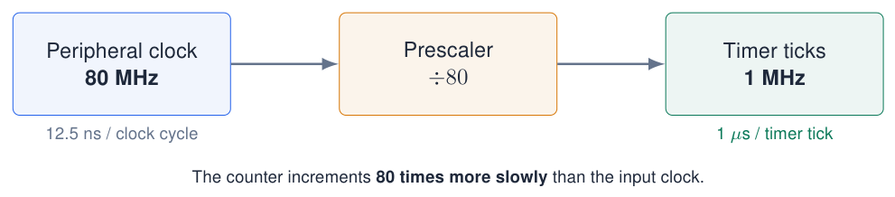{ .lecture-figure loading=lazy }

Arduino-ESP32 core 3.x: `timerBegin(1000000)` requests a 1 MHz tick rate; the driver selects the clock/divider. Here, an 80 MHz source gives $P=80$.

!!! info "The CPU keeps its own clock"
    
    The prescaler divides the clock **received by the timer peripheral**. It does **not** change the ESP32 CPU frequency.


*Sources: [Espressif Timer API: timer count, counter and prescaler](https://docs.espressif.com/projects/arduino-esp32/en/latest/api/timer.html); classic ESP32, APB-clock example*

## Prescaler trade-off: resolution versus counter range

Same 80 MHz source and same counter width; only the prescaler changes.

| **$P$** | **Tick frequency** | **Time resolution** | **Time to wrap (relative)** |
|--------:|-------------------:|--------------------:|----------------------------:|
|       8 |             10 MHz |          0.1 $\mu$s |                   $1\times$ |
|      80 |              1 MHz |            1 $\mu$s |                  $10\times$ |
|     800 |            100 kHz |           10 $\mu$s |                 $100\times$ |

!!! info "Small prescaler"
    
    Fast counting, short ticks: **finer time resolution**. The counter reaches its maximum sooner.


!!! tip "Large prescaler"
    
    Slow counting, long ticks: **coarser time resolution**, but a longer interval before the counter reaches its limit.


For a $B$-bit up-counter starting at zero: $\displaystyle T_{\rm wrap}=2^B T_{\rm tick}=\frac{2^B P}{f_{\rm clock}}$.

**Wrap is not an alarm:** wrap follows the largest counter value ($2^B-1$). A configured alarm can trigger and auto-reload much earlier, at $N$ ticks: $T_{\rm alarm}=N T_{\rm tick}$. The classic ESP32 counter has $B=64$.

*Sources: [Espressif Timer API](https://docs.espressif.com/projects/arduino-esp32/en/latest/api/timer.html); calculated examples for an 80 MHz timer clock*

## Ticks, frequency and timer intervals

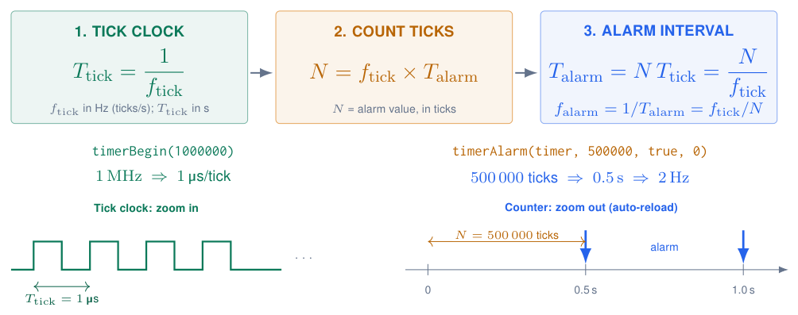{ .lecture-figure loading=lazy }

!!! info "Info"
    
    `timerBegin()` sets the **timer tick frequency**, not the CPU clock. If an LED toggles once per alarm, one full blink needs two alarms: $f_{\rm LED}=f_{\rm alarm}/2=1\,\mathrm{Hz}$ in this example.


*Sources: [Arduino-ESP32 Timer API (core 3.x)](https://docs.espressif.com/projects/arduino-esp32/en/latest/api/timer.html)*

## The timer counter: a sawtooth, an alarm and an ISR

$f_{\rm tick}=2000\,\mathrm{Hz}$; $N=2000$ ticks

$T_{\rm alarm}=N/f_{\rm tick}=1\,\mathrm{s}$; $f_{\rm ISR}=1\,\mathrm{Hz}$.

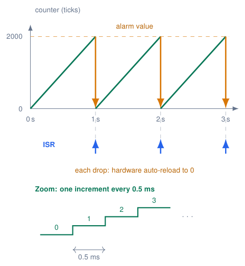{ .lecture-figure loading=lazy }

!!! info "What happens at the top?"
    
    Reaching 2000 triggers the alarm: hardware reloads 0 and requests the ISR. The ISR does **not** reset the counter. Ramps are simplified; interrupt latency is not drawn.


Open **Serial Plotter**, 115200 baud. **Count** climbs once per second; **ISR** is a short marker printed by the next `loop()` iteration.

*Sources: [Arduino-ESP32 Timer API](https://docs.espressif.com/projects/arduino-esp32/en/latest/api/timer.html); classic ESP32, core 3.x; illustrative timing*

## timerStop(), timerRestart() and timerStart()

Example: 1 MHz; alarm = 500 000 ticks = 0.5 s of **counting after a reset**.

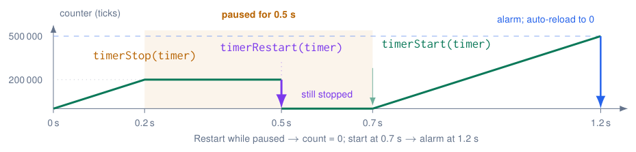{ .lecture-figure loading=lazy }

<div class="tabular">

@l L9.5cm@ **Call** & **Effect**  
`timerStop(timer);` & Pause counting; retain the current count and timer configuration.  
`timerStart(timer);` & Resume from the saved count; it does not reset the counter.  
`timerRestart(timer);` & Set the count to zero. A stopped timer still needs `timerStart()`.  

</div>

!!! info "Start at the right moment"
    
    `timerBegin()` starts counting immediately. To configure before running: **begin $\rightarrow$ stop $\rightarrow$ configure $\rightarrow$ restart $\rightarrow$ start**. Paused time does not count towards the next alarm.


*Sources: [Timer API](https://docs.espressif.com/projects/arduino-esp32/en/latest/api/timer.html); [Arduino-ESP32 3.3.11 implementation](https://github.com/espressif/arduino-esp32/blob/3.3.11/cores/esp32/esp32-hal-timer.c); illustrative timing*

## Hardware timers

```cpp title="hw_timer.ino"
hw_timer_t *timer = nullptr;
volatile bool tick = false;
const int LED_PIN = 2;
bool ledOn = false;
void ARDUINO_ISR_ATTR onTimer() { tick = true; }
void setup() {
  pinMode(LED_PIN, OUTPUT);
  timer = timerBegin(1000000);           // 1 MHz: 1 tick = 1 us
  timerStop(timer);                     // pause while configuring
  timerAttachInterrupt(timer, &onTimer);
  // 0.5 s alarm, auto-reload, repeat forever:
  timerAlarm(timer, 500000, true, 0);
  timerRestart(timer);                  // reset count to zero
  timerStart(timer);                    // start counting now
}

void loop() {
  if (tick) {
    tick = false;
    ledOn = !ledOn;
    digitalWrite(LED_PIN, ledOn);
  }
}
```

[Download this example](examples/timing-interrupts/hw_timer.ino){ download }

- 4 general-purpose 64-bit timers.

- Precise, jitter-free periodic events: sampling an ADC at a fixed rate, generating signals.

- Period $= \text{alarm} / f_{\text{timer}}$.

!!! note "API changed in core 3.x"
    
    Old: `timerBegin(0, 80, true)` + `timerAlarmWrite()` + `timerAlarmEnable()`.


*Sources: [Migration from Arduino ESP32 Core 2.x to 3.0](references.md#arduino-esp32-migration)*

## Ticker: timers made easy

[Try simulation: Timers](https://costawess.github.io/Programming-Dashboard/web/simulations/course_topics_lab.html?topic=timers){ .md-button .lecture-simulation }

```cpp title="ticker.ino"
#include <Ticker.h>

Ticker sensorTicker;
Ticker ledTicker;
const int LED_BLUE = 23;
bool ledOn = false;

void blinkLed() {
  ledOn = !ledOn;
  digitalWrite(LED_BLUE, ledOn);
}

void readSensor() {
  Serial.println(analogRead(36));
}

void setup() {
  Serial.begin(115200);
  pinMode(LED_BLUE, OUTPUT);
  ledTicker.attach(0.5, blinkLed);       // every 0.5 s
  sensorTicker.attach_ms(100, readSensor); // every 100 ms
}

void loop() {}       // empty: the tickers do the work
```

[Download this example](examples/timing-interrupts/ticker.ino){ download }

- `Ticker` is part of the ESP32 core: no installation.

- `attach(seconds, fn)`, `attach_ms(ms, fn)`: repeat.

- `once(seconds, fn)`: run once, e.g. a timeout.

- `detach()`: stop.

!!! warning "Still keep them short"
    
    Ticker callbacks run in a shared timer context: no long `delay()` inside, or other tickers are delayed.


*Sources: Example from lecture 3 [Embedded Programming, lectures 1–6](references.md#ep-lectures)*

## How precise is time?

- All timing comes from a **40 MHz quartz crystal**.

- A typical crystal has a tolerance of $\pm$<!-- -->10–20 ppm (parts per million).

- $20 \cdot 10^{-6} \times 86\,400$ s $\approx$ **1.7 s per day**.

- Prescalers, clock synchronisation and temperature effects: out of scope for this course.

!!! info "Need real clock time?"
    
    Use NTP over Wi-Fi (`configTime()`) or an external RTC chip (DS3231) instead of counting `millis()`.


!!! tip "millis() vs timer"
    
    `millis()`: good to $\approx$ 1 ms, depends on how often `loop()` checks. Hardware timer: **μs precise**, independent of `loop()`.


*Sources: [Embedded Programming, lectures 1–6](references.md#ep-lectures); [ESP32 Series Datasheet](references.md#esp32-datasheet)*

## Priorities, watchdogs and race conditions

**Priorities and watchdogs**

- Several interrupts can be pending: they are handled in order of **priority**.

- A **watchdog** timer checks that the system is still alive and that ISRs are not too long. If not: **reset**.

- Message: `Interrupt wdt timeout on CPU1` $\Rightarrow$ your ISR was too long or blocked.

**Race conditions**

- The result depends on the **timing or order** of events that use **shared data**.

- Two interrupts update the same variable.

- A timer event occurs while `loop()` is changing the state.

- Hard to find: the bug appears “sometimes”.

!!! info "Simple rules"
    
    Let **one** side write a shared variable; keep shared variables small (`bool`, 32-bit); use flags; do all real work in `loop()`.


*Sources: [Embedded Programming, lectures 1–6](references.md#ep-lectures)*

## Example: a race condition and its fix

**Bug: a pulse can be lost**

```cpp title="race_bug.ino"
volatile uint32_t pulses = 0;
void IRAM_ATTR onPulse() { pulses++; }

void loop() {
  delay(1000);
  Serial.println(pulses);  // ISR may fire...
  pulses = 0;              // ...here: lost!
}
```

[Download this example](examples/timing-interrupts/race_bug.ino){ download }

**Fix: only the ISR writes**

```cpp title="race_fixed.ino"
volatile uint32_t pulses = 0;
uint32_t lastPulses = 0;
void IRAM_ATTR onPulse() { pulses++; }

void loop() {
  delay(1000);
  uint32_t now = pulses;          // 1 read
  Serial.println(now - lastPulses);
  lastPulses = now;               // our copy
}
```

[Download this example](examples/timing-interrupts/race_fixed.ino){ download }

- Left: between printing and resetting, an interrupt can increment `pulses`; the reset erases it.

- Right: `loop()` never writes `pulses`. It reads it once (a 32-bit read is atomic on the ESP32) and works with the difference.

*Sources: Race conditions: lecture 6 [Embedded Programming, lectures 1–6](references.md#ep-lectures)*

## Quiz: time and interrupts

1.  Why is `now - last >= interval` better than `now >= last + interval`?

    <details class="lecture-answer"><summary>Check your answer</summary><p>The subtraction keeps working when <code>millis()</code> wraps around after 49.7 days.</p></details>

2.  What goes wrong if the ISR variable is not `volatile`?

    <details class="lecture-answer"><summary>Check your answer</summary><p>The compiler may cache it: <code>loop()</code> never sees the ISR's change.</p></details>

3.  `attachInterrupt(digitalPinToInterrupt(34), onKey(), RISING);` does not compile. Why?

    <details class="lecture-answer"><summary>Check your answer</summary><p><code>onKey()</code> calls the function; pass its address: <code>onKey</code>.</p></details>

4.  One press on the button gives 4 counts. Name two fixes.

    <details class="lecture-answer"><summary>Check your answer</summary><p>RC filter in hardware; software debounce (ignore edges for <span class="arithmatex">\(\approx\)</span> 50 ms).</p></details>

5.  Timer with `timerBegin(1000000)` and `timerAlarm(timer, 250000, true, 0)`: frequency?

    <details class="lecture-answer"><summary>Check your answer</summary><p>Period 0.25 s <span class="arithmatex">\(\Rightarrow\)</span> 4 Hz.</p></details>

## Exercises: time and interrupts

[Try simulation: Kitchen timer](https://costawess.github.io/Programming-Dashboard/web/experiments/kitchen_timer.html){ .md-button .lecture-simulation }

[Try simulation: Real-time challenge](https://costawess.github.io/Programming-Dashboard/web/experiments/real_time_challenge.html){ .md-button .lecture-simulation }

!!! example "Exercise 1 – Two blinkers, one button"
    
    Blue blinks at 2 Hz, red at 0.5 Hz, and KEY1 toggles the green LED immediately: no `delay()` allowed.


!!! example "Exercise 2 – Reaction-time game"
    
    After a random wait (2–5 s) the orange LED lights. Measure the time until KEY1 is pressed (interrupt + `millis()`); detect cheating (press before the LED).


!!! example "Exercise 3 – Frequency counter"
    
    Count rising edges on a GPIO with an interrupt and print the frequency every second using a hardware timer. Test it with a PWM output of a second pin.


!!! example "Exercise 4 – Kitchen timer"
    
    KEY1 adds 10 s, KEY2 starts/stops; LEDs show progress; the red LED blinks when time is up. Compare with the dashboard experiment.


## Further material: time and interrupts

### Read

- [ESP32 interrupts](https://www.theengineeringprojects.com/2021/12/esp32-interrupts.html)

- [Arduino-ESP32 Timer API](https://docs.espressif.com/projects/arduino-esp32/en/latest/api/timer.html)

- [Blink without delay (Arduino)](https://docs.arduino.cc/built-in-examples/digital/BlinkWithoutDelay/)

### Watch

- [YouTube: millis vs delay](https://www.youtube.com/results?search_query=arduino+millis+vs+delay)

- [YouTube: ESP32 interrupts](https://www.youtube.com/results?search_query=esp32+interrupts+arduino+ide)

### Try it

- [Interrupts](https://costawess.github.io/Programming-Dashboard/web/simulations/interrupts.html)

- [Timers](https://costawess.github.io/Programming-Dashboard/web/simulations/course_topics_lab.html?topic=timers)

- [Button debouncing](https://costawess.github.io/Programming-Dashboard/web/simulations/debouncing_lab.html)

- [Experiment: kitchen timer](https://costawess.github.io/Programming-Dashboard/web/experiments/kitchen_timer.html)

## Complete project sketches

- [Sawtooth](examples/projects/timers/sawtooth/sawtooth.ino){ download }
- [Start Stop](examples/projects/timers/start-stop/start-stop.ino){ download }
