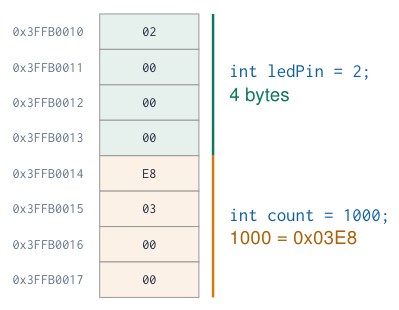
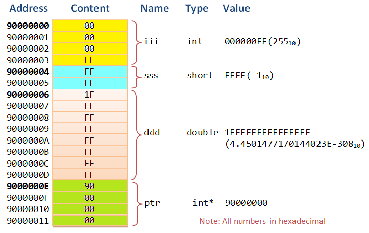
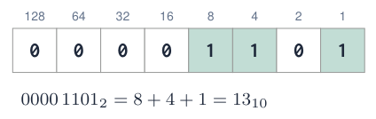
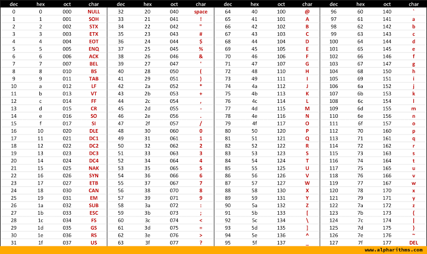

# Variables, Types and Numbers

## What is a variable?

[Try simulation: Variables](../dashboard.md?lab=simulations/course_topics_lab.html&topic=variables){ .md-button .lecture-simulation }

- A **named place in memory** that holds a value your program can read and change.

- Every variable has four properties:

  - **Name**: how you refer to it (`ledPin`)

  - **Type**: what kind of value and how many bytes (`int`)

  - **Value**: what is stored now (`2`)

  - **Address**: where in memory it lives

- The compiler chooses the address; you choose name, type and value.

{ .lecture-figure loading=lazy }

*Sources: [Embedded Programming, lectures 1–6](references.md#ep-lectures)*

## Variables in memory

[Try simulation: Memory layout](../dashboard.md?lab=simulations/memory_layout_lab.html){ .md-button .lecture-simulation }

{ .lecture-figure loading=lazy }

- Memory is a long row of **bytes**, each with an address.

- A variable occupies as many bytes as its **type** needs.

- The ESP32 stores multi-byte numbers **little endian**: the lowest byte first.

- A **pointer** (`int*`) is a variable that holds an **address**: you will meet them in libraries.

*Sources: Figure: c-jump.com, via lecture 1 [Embedded Programming, lectures 1–6](references.md#ep-lectures)*

## Declaring and using variables

[Try simulation: Variables](../dashboard.md?lab=simulations/course_topics_lab.html&topic=variables){ .md-button .lecture-simulation }

```cpp title="declare.ino"
const int ledPin = 2;   // constant: never changes
int counter = 0;        // declared + initialised
int lastValue;          // declared only

void setup() {
  Serial.begin(115200);
  counter = 10;         // assignment
  counter = counter + 1;
  Serial.println(counter);   // 11
}

void loop() {}
```

[Download this example](examples/variables-types/declare.ino){ download }

- **Declaration**: `type name;` reserves memory.

- **Initialisation**: give a first value at the same time.

- **Assignment** `=` copies the value on the right into the variable on the left.

- `const`: the compiler refuses any later change. Use it for pin numbers and settings.

!!! warning "Uninitialised local variables"
    
    A local variable without a first value contains **garbage**. Global variables start at 0, but always initialise anyway.


## Naming rules and conventions

**Rules (the compiler checks)**

- Letters, digits and `_`; no spaces.

- Must not start with a digit.

- **Case sensitive**: `ledPin` $\neq$ `LedPin`.

- No reserved words: `int`, `if`, `for`, `class` …

**Conventions (humans check)**

- `camelCase` for variables and functions.

- `UPPER_CASE` for constants.

- Names describe the **meaning**, not the type.

| **Bad**             | **Good**            |
|:--------------------|:--------------------|
| `int x = 23;` | `const int LED_BLUE = 23;` |
| `int t;` | `float temperatureC;` |
| `int a1, a2;` | `int potRaw, lightRaw;` |
| `bool f;` | `bool pumpOn;` |
| `int 2ndValue;` | `int secondValue;` |
| `int delay;` | `int blinkDelayMs;` |

  
does not compile; `delay` hides the Arduino function.

## Data types on the ESP32

[Try simulation: Variable types](../dashboard.md?lab=simulations/variable_types_lab.html){ .md-button .lecture-simulation }

| **Type** | **Bytes** | **Range** | **Typical use** |
|:---|:--:|:---|:---|
| `bool` | 1 | `true` / `false` | flags: `pumpOn`, `buttonPressed` |
| `char` | 1 | $-128 \dots 127$ | one ASCII character `'A'` |
| `uint8_t` / `byte` | 1 | $0 \dots 255$ | raw bytes, I<sup>2</sup>C data, LED brightness |
| `int16_t` | 2 | $-32\,768 \dots 32\,767$ | sensor registers |
| `int` / `int32_t` | 4 | $\approx \pm 2.1 \cdot 10^{9}$ | counters, ADC values, pin numbers |
| `unsigned long` / `uint32_t` | 4 | $0 \dots 4\,294\,967\,295$ | `millis()`, `micros()` |
| `long long` / `int64_t` | 8 | $\approx \pm 9.2 \cdot 10^{18}$ | very large counts |
| `float` | 4 | $\approx$ 7 significant digits | temperature, voltage |
| `double` | 8 | $\approx$ 15 significant digits | precise calculations |
| `String` | varies | text | messages (uses heap memory) |

!!! warning "Same name, different size"
    
    On an **Arduino Uno** an `int` is only **2 bytes** ($-32\,768 \dots 32\,767$) and `double` = `float`. Code that counts to 100 000 works on the ESP32 but overflows on the Uno. Use `int32_t`, `uint8_t` … when the size matters.


## Binary: how a computer stores numbers

[Try simulation: Number representation](../dashboard.md?lab=simulations/number_representation_lab.html){ .md-button .lecture-simulation }

- A **bit** is 0 or 1: off/on, false/true, no current/current.

- 8 bits = 1 **byte** $\rightarrow$ $2^8 = 256$ combinations.

- Each position has a **weight**: a power of 2.

- Everything (numbers, text, images, sound) is eventually stored as bits.

- The ESP32 is a **32-bit** processor: it handles data in 32-bit chunks.

{ .lecture-figure loading=lazy }

!!! info "Counting in binary"
    
    0, 1, 10, 11, 100, 101, 110, 111, 1000 …  
    Just like decimal, but you carry at 2 instead of 10.


*Sources: [Embedded Programming, lectures 1–6](references.md#ep-lectures)*

## Decimal, binary and hexadecimal

[Try simulation: Number representation](../dashboard.md?lab=simulations/number_representation_lab.html){ .md-button .lecture-simulation }

| **Dec** | **Bin** | **Hex** |
|--------:|:-------:|:-------:|
|       0 |  0000   |    0    |
|       1 |  0001   |    1    |
|       2 |  0010   |    2    |
|       7 |  0111   |    7    |
|       9 |  1001   |    9    |
|      10 |  1010   |    A    |
|      11 |  1011   |    B    |
|      12 |  1100   |    C    |
|      13 |  1101   |    D    |
|      14 |  1110   |    E    |
|      15 |  1111   |    F    |

- **Hexadecimal** (base 16) uses 0–9 and A–F.

- One hex digit = exactly **4 bits** (a “nibble”): a byte is always 2 hex digits.

- That is why datasheets and I<sup>2</sup>C addresses use hex: `0x76`, `0x3C`.

**The same number, three ways in C++**  
`int a = 60;``int b = 0b00111100;``int c = 0x3C;`  
**Converting by grouping**  
`0x3C` $\rightarrow$ `3` = 0011, `C` = 1100 $\rightarrow$ $0011\,1100_2$ $\rightarrow$ $32+16+8+4 = 60$

!!! warning "Leading zero"
    
    `int x = 012;` is **octal** (= 10), not twelve!


## Converting decimal to binary: step by step

[Try simulation: Number representation](../dashboard.md?lab=simulations/number_representation_lab.html){ .md-button .lecture-simulation }

**Method: divide by 2, keep the remainders**  

|     |     |            |
|----:|----:|:-----------|
| 200 | 100 | rest **0** |
| 100 |  50 | rest **0** |
|  50 |  25 | rest **0** |
|  25 |  12 | rest **1** |
|  12 |   6 | rest **0** |
|   6 |   3 | rest **0** |
|   3 |   1 | rest **1** |
|   1 |   0 | rest **1** |

  
Read the remainders **bottom to top**: $200 = 1100\,1000_2 =$ `0xC8`

**Check it in the Arduino IDE**

```cpp title="bases.ino"
void setup() {
  Serial.begin(115200);
  int x = 200;
  Serial.println(x, BIN);   // 11001000
  Serial.println(x, HEX);   // C8
  Serial.println(x, DEC);   // 200
  Serial.printf("0x%02X\n", x);  // 0xC8
}
void loop() {}
```

[Download this example](examples/variables-types/bases.ino){ download }

!!! tip "Powers of two to remember"
    
    1, 2, 4, 8, 16, 32, 64, 128, 256, 512, 1024, 2048, **4096** (12-bit ADC), 65 536


## Arithmetic and assignment operators

```cpp title="operators.ino"
int a = 1000;
int b = 2000;
int c;

c = a + b;     // 3000
c = b - a;     // 1000
c = a * 3;     // 3000
c = b / 3;     // 666  (integer!)
c = b % 3;     // 2    (remainder)

int count = 1000;
count = count + 10;   // 1010
count += 10;          // 1020
count++;              // 1021
count--;              // 1020
count *= 2;           // 2040
```

[Download this example](examples/variables-types/operators.ino){ download }

| **Operator**                            | **Meaning**                     |
|:----------------------------------------|:--------------------------------|
| `+ - * /`                     | add, subtract, multiply, divide |
| `%`                     | modulo: remainder of a division |
| `+= -= *= /=`                     | short for `x = x + \dots`   |
| `++` `--` | add / subtract 1                |

!!! info "Modulo is surprisingly useful"
    
    `n % 2 == 0` $\rightarrow$ even number  
    `i % 4` $\rightarrow$ counts 0, 1, 2, 3, 0, 1, … (cycle 4 LEDs)  
    `seconds % 60` $\rightarrow$ seconds within the minute


*Sources: [Embedded Programming, lectures 1–6](references.md#ep-lectures)*

## Integer pitfalls: division and overflow

[Try simulation: Variable types](../dashboard.md?lab=simulations/variable_types_lab.html){ .md-button .lecture-simulation }

```cpp title="pitfalls.ino"
int sum = 10 + 20 + 30;
int avg1 = sum / 4;             // 15: wrong count
int avg2 = sum / 3;             // 20: correct

float r1 = 7 / 2;               // 3.0 (!)
float r2 = 7 / 2.0;             // 3.5
float r3 = (float) 7 / 2;       // 3.5 (cast)

uint8_t level = 255;
level = level + 1;              // 0 (overflow)

int big = 2147483647;
big = big + 1;                  // -2147483648
```

[Download this example](examples/variables-types/pitfalls.ino){ download }

- **int / int = int**: the fraction is thrown away, **before** storing it in a `float`.

- Make one operand a `float` (`2.0`) or **cast** with `(float)`.

- **Overflow**: a type has a fixed size; past the maximum it wraps around, like a car odometer.

- `unsigned long` wraps too: `millis()` returns to 0 after $\approx$ 49.7 days.

!!! warning "Typical student bug"
    
    `float v = raw * 3.3 / 4095;` is fine, but `float v = raw / 4095 * 3.3;` is **always 0** for raw $<$ 4095. Why?


## Floating point, characters and text

[Try simulation: ASCII characters](../dashboard.md?lab=simulations/ascii_char_lab.html){ .md-button .lecture-simulation }

```cpp title="text.ino"
double pi = 3.14159;
float volts = 3.3 * (1564 / 4095.0);   // 1.26 V

char letter = 'A';      // stored as 65
char next = letter + 1; // 'B'
char digit = '0' + 7;   // '7'

String name = "ESP32";
String msg = "Hello, World!";
Serial.println(msg + " from " + name);
Serial.println(name.length());     // 5
Serial.println(volts, 3);          // 1.260
```

[Download this example](examples/variables-types/text.ino){ download }

- `float`/`double` store fractions; they are **approximations**: never test them with `==`.

- A `char` is a 1-byte **number** that the ASCII table maps to a character.

- `'A'` (single quotes) is one char; `"A"` (double quotes) is text.

- `String` glues text with `+`: handy, but uses heap memory; avoid in fast loops.

*Sources: Examples from lecture 1 [Embedded Programming, lectures 1–6](references.md#ep-lectures)*

## The ASCII table

[Try simulation: ASCII characters](../dashboard.md?lab=simulations/ascii_char_lab.html){ .md-button .lecture-simulation }

{ .lecture-figure loading=lazy }

- 128 codes: control characters (0–31), symbols, digits, letters.

- `'0'` = 48 … `'9'` = 57

- `'A'` = 65, `'a'` = 97: difference 32.

- `'\ n'` = 10 (new line), `'\ r'` = 13 (carriage return).

!!! tip "Trick"
    
    Digit character to number: `int d = c - '0';`


## Quiz: numbers and types

1.  Convert $1010\,1010_2$ to decimal and hexadecimal.

    <details class="lecture-answer"><summary>Check your answer</summary><p><span class="arithmatex">\(128+32+8+2 = 170\)</span> = <code>0xAA</code>.</p></details>

2.  The BME280 sensor has I<sup>2</sup>C address `0x76`. What is that in decimal and binary?

    <details class="lecture-answer"><summary>Check your answer</summary><p><span class="arithmatex">\(7 \cdot 16 + 6 = 118\)</span> = <span class="arithmatex">\(0111\,0110_2\)</span>.</p></details>

3.  How many different values can a 12-bit ADC produce?

    <details class="lecture-answer"><summary>Check your answer</summary><p><span class="arithmatex">\(2^{12} = 4096\)</span> values: 0 … 4095.</p></details>

4.  What does `float x = 9 / 2;` store?

    <details class="lecture-answer"><summary>Check your answer</summary><p>4.0: integer division happens first. Write <code>9 / 2.0</code>.</p></details>

5.  Which type for: a temperature, the number of button presses, a pin number, a yes/no flag?

    <details class="lecture-answer"><summary>Check your answer</summary><p><code>float</code>, <code>unsigned int</code> (or <code>uint32_t</code>), <code>const int</code> (or <code>uint8_t</code>), <code>bool</code>.</p></details>

## Exercises: variables and numbers

[Try simulation: Number representation](../dashboard.md?lab=simulations/number_representation_lab.html){ .md-button .lecture-simulation }

[Try simulation: Variable types](../dashboard.md?lab=simulations/variable_types_lab.html){ .md-button .lecture-simulation }

!!! example "Exercise 1 – Number printer"
    
    Print every number from 0 to 32 in decimal, binary and hexadecimal in one table on the Serial Monitor. Use `Serial.print(x, BIN)` and `Serial.print(x, HEX)`.


!!! example "Exercise 2 – Choose the types"
    
    Declare the variables of a weather station: temperature, humidity, pressure in hPa, number of measurements, station name, alarm on/off, last measurement time. Justify each type.


!!! example "Exercise 3 – Overflow hunt"
    
    Make a `uint8_t` counter that increases every 50 ms and print it. Predict and observe when it overflows. Repeat with `int8_t`.


## Further material: variables and numbers

### Read

- [Variables in memory (c-jump)](https://www.c-jump.com/bcc/c155c/MemAccess/W12_0290_variables_in_memory.htm)

- [Binary (SparkFun)](https://learn.sparkfun.com/tutorials/binary)

- [Hexadecimal (SparkFun)](https://learn.sparkfun.com/tutorials/hexadecimal)

- [Learn C++: variables and types](https://www.learncpp.com/)

### Watch

- [YouTube: binary numbers explained](https://www.youtube.com/results?search_query=binary+numbers+explained)

- [YouTube: Arduino variables and data types](https://www.youtube.com/results?search_query=arduino+variables+data+types)

### Try it

- [Variables](../dashboard.md?lab=simulations/course_topics_lab.html&topic=variables)

- [Variable types](../dashboard.md?lab=simulations/variable_types_lab.html)

- [Number representation](../dashboard.md?lab=simulations/number_representation_lab.html)

- [ASCII characters](../dashboard.md?lab=simulations/ascii_char_lab.html)
