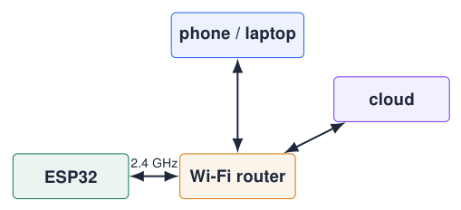
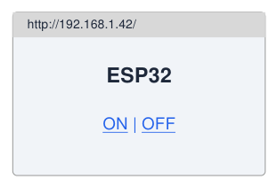

# Going Further: Wi-Fi and the Web

## From a single board to a connected device

{ .lecture-figure loading=lazy }

- The ESP32 has **Wi-Fi** and **Bluetooth** on chip: no extra module.

- **Station** (STA): joins an existing network, like your phone.

- **Access point** (AP): creates its own network.

- Typical uses: web interface, sending measurements, remote control, firmware updates.

!!! info "Extension material"
    
    These chapters go beyond the course assessment: use them in projects.


*Sources: [Arduino ESP32 Core Documentation](references.md#arduino-esp32-docs)*

## Connecting to Wi-Fi

```cpp title="wifi_sta.ino"
#include <WiFi.h>

const char* SSID = "your-ssid";
const char* PASS = "your-password";

void setup() {
  Serial.begin(115200);
  WiFi.mode(WIFI_STA);              // station (client)
  WiFi.begin(SSID, PASS);
  Serial.print("Connecting");
  while (WiFi.status() != WL_CONNECTED) {
    delay(500);
    Serial.print('.');
  }
  Serial.printf("\nIP: %s  RSSI: %d dBm\n",
                WiFi.localIP().toString().c_str(), WiFi.RSSI());
}

void loop() {}
```

[Download this example](examples/wifi-web/wifi_sta.ino){ download }

- Modes: `WIFI_STA`, `WIFI_AP`, `WIFI_AP_STA`.

- 2.4 GHz only; WPA2-Enterprise (eduroam) needs extra setup.

- RSSI $>$ -67 dBm: good link.

!!! warning "Remember"
    
    Wi-Fi on $\Rightarrow$ **no ADC2**. Peak current $\approx$ 240 mA: use a good USB cable / supply.


**Keep credentials in a `secrets.h` that is not committed to Git.**

## HTTP in one slide

- The web works with **requests** and **responses**.

- A **client** (browser) asks: `GET /on HTTP/1.1`

- A **server** answers with a status code and content: `200 OK` + HTML or JSON.

- The ESP32 can be **server** (a web page on the board) or **client** (it asks a web API).

| **Code**  | **Meaning**                   |
|:----------|:------------------------------|
| 200       | OK                            |
| 301 / 302 | moved: follow the new address |
| 404       | not found (wrong URL)         |
| 500       | server error                  |
| $<$ 0     | no connection (HTTPClient)    |

## A web server that controls an LED

```cpp title="web_led.ino"
#include <WiFi.h>
#include <WebServer.h>
WebServer server(80);
const int LED_PIN = 2;
void handleRoot() {
  server.send(200, "text/html",
    "<h1>ESP32</h1><a href='/on'>ON</a> | <a href='/off'>OFF</a>");
}
void setup() {
  pinMode(LED_PIN, OUTPUT);
  /* ... connect to Wi-Fi as on the previous section ... */
  server.on("/", handleRoot);
  server.on("/on",  [] { digitalWrite(LED_PIN, HIGH); handleRoot(); });
  server.on("/off", [] { digitalWrite(LED_PIN, LOW);  handleRoot(); });
  server.begin();
}
void loop() {
  server.handleClient();       // must be called often
}
```

[Download this example](examples/wifi-web/web_led.ino){ download }

{ .lecture-figure loading=lazy }

- Open the printed IP in a browser on the same network.

- Each URL $\rightarrow$ a handler function (lambda here).

- Next step: return JSON and build a dashboard.

## HTTPS client: reading a web API

```cpp title="weather.ino"
#include <WiFi.h>
#include <WiFiClientSecure.h>
#include <HTTPClient.h>
#include <ArduinoJson.h>       // library by Benoit Blanchon (v7)

const char* URL = "https://api.open-meteo.com/v1/forecast"
                  "?latitude=53.22&longitude=6.57&current=temperature_2m";

void printTemperature() {
  WiFiClientSecure client;
  client.setInsecure();        // lab only: skips certificate check
  HTTPClient http;
  http.begin(client, URL);
  int code = http.GET();
  if (code == HTTP_CODE_OK) {
    JsonDocument doc;
    deserializeJson(doc, http.getString());
    float t = doc["current"]["temperature_2m"];
    Serial.printf("Groningen: %.1f C\n", t);
  } else {
    Serial.printf("HTTP error %d\n", code);
  }
  http.end();
}
```

[Download this example](examples/wifi-web/weather.ino){ download }

- `HTTPClient`: GET / POST to REST APIs.

- **ArduinoJson** parses the response.

- Call `printTemperature()` after the Wi-Fi connection, e.g. every 10 minutes using `millis()`.

!!! warning "Security"
    
    `setInsecure()` accepts any server. In products use `client.setCACert(rootCA)`.


*Sources: [Arduino ESP32 Core Documentation](references.md#arduino-esp32-docs); [ArduinoJson: Efficient JSON serialization for embedded C++](references.md#arduinojson)*

## Exercises: Wi-Fi and web

!!! example "Exercise 1 – Web dashboard"
    
    Serve a page that shows the potentiometer value and the button states, and has buttons for the 4 LEDs.


!!! example "Exercise 2 – JSON API"
    
    Add the URL `/api` that returns `{"pot": 1234, "key1": false}`. Open it in the browser.


!!! example "Exercise 3 – Weather indicator"
    
    Get the outdoor temperature from a web API every 10 minutes and show it with the LEDs (cold / mild / warm / hot).


## Further material: Wi-Fi and web

### Read

- [Arduino-ESP32 Wi-Fi API](https://docs.espressif.com/projects/arduino-esp32/en/latest/api/wifi.html)

- [ArduinoJson documentation](https://arduinojson.org/)

- [Open-Meteo weather API](https://open-meteo.com/)

### Watch

- [YouTube: ESP32 web server](https://www.youtube.com/results?search_query=esp32+web+server+arduino+ide)

### Try it

- [Wokwi: ESP32 with Wi-Fi simulation](https://wokwi.com/projects/new/esp32)

- [Course dashboard example](../dashboard.md?lab=index.html)
