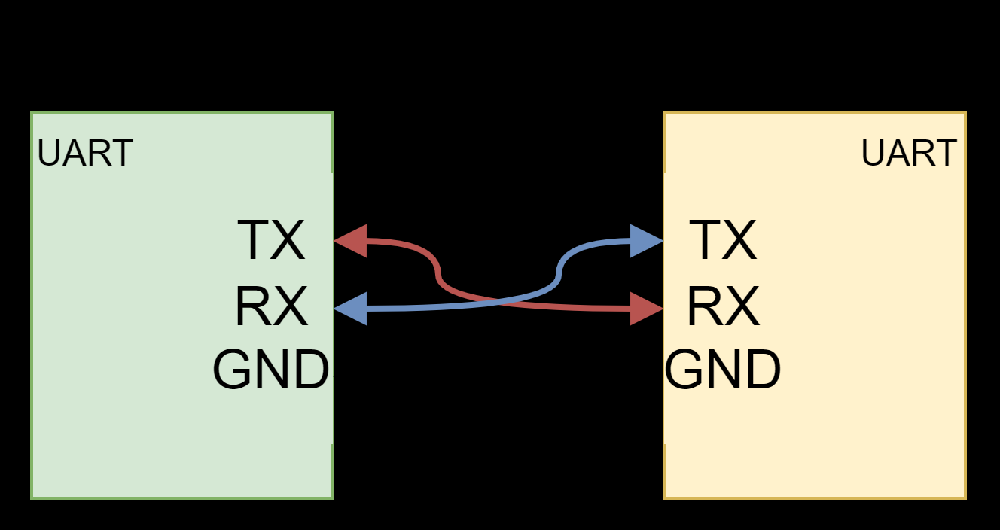

# Reading user input over UART

Use the Serial Monitor to send a number to the ESP32 and receive a response. Start the monitor at **115200 baud** and send a complete line.



## Read and compare a number

```cpp
void setup() {
  Serial.begin(115200);
  Serial.println("Enter a number and press Enter:");
}

void loop() {
  if (Serial.available() > 0) { // read only when data is waiting
    int value = Serial.parseInt();   // read an integer number from serial
    Serial.print("You entered: ");
    Serial.println(value);

    if (value > 5) {
      Serial.println("The entered value is greater than 5");
    } else if (value < 5) {
      Serial.println("The entered value is less than 5");
    } else {
      Serial.println("The entered value is equal to 5");
    }
    Serial.println("\nEnter another number:");
  }
}
```

## Continue learning

[Read the related lecture](../../lectures/serial-uart.md).

Next: [ESP32 hardware timer interrupts](../hardware-timers/index.md).
